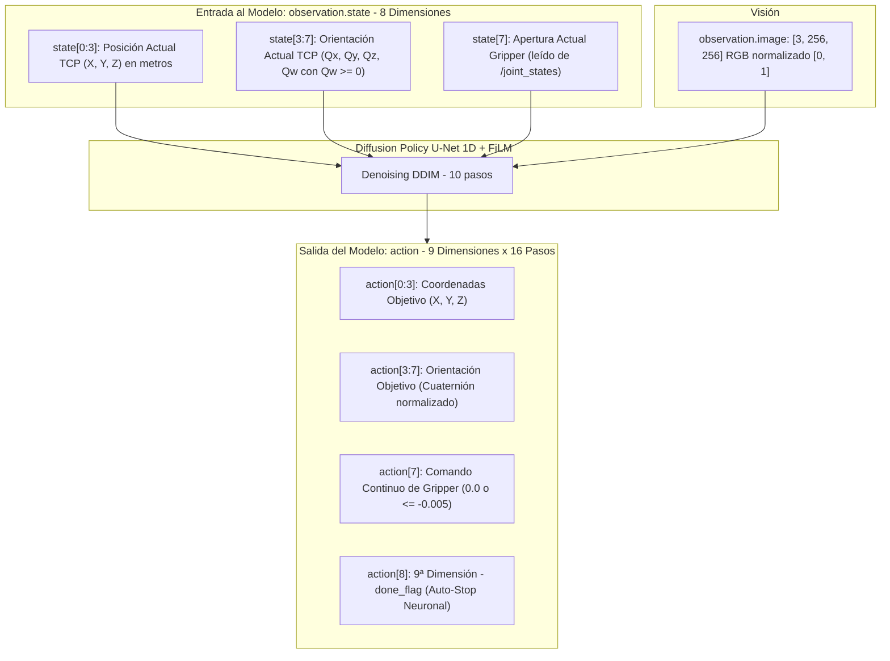

# Módulo 02: Espacio de Tensores, Auto-Stop y la 9ª Dimensión

Este documento compila las especificaciones métricas, formatos de tensores, protocolos de publicación y la arquitectura desacoplada de auto-stop extraídas de la auditoría línea por línea de `visuomotor_ros2` (`policy_node.py`, `action_executors.py`, `config/policy_params.yaml`).

---

## 1. Topología y Desglose de Tensores

En aprendizaje por imitación para robótica existe una separación estricta entre la **percepción física** (lo que los sensores del robot miden) y la **decisión cognitiva** (lo que la red neuronal predice):



---

## 2. Especificación Detallada de Tensores

### A. Observación Propioceptiva (`observation.state`) — 8 Dimensiones
Representa exclusivamente magnitudes cinemáticas y sensoriales del hardware en el instante $t$, referenciadas al marco del robot (`base_frame = 'link_base'`):

| Índice | Magnitud | Unidades | Rango Típico | Descripción y Reglas |
| :--- | :--- | :--- | :--- | :--- |
| `state[0]` | Posición $X$ TCP | Metros ($m$) | $[+0.15, +0.45]$ | Coordenada longitudinal respecto a `link_base`. |
| `state[1]` | Posición $Y$ TCP | Metros ($m$) | $[-0.25, +0.25]$ | Coordenada lateral respecto a `link_base`. |
| `state[2]` | Posición $Z$ TCP | Metros ($m$) | $[+0.10, +0.50]$ | Altura vertical sobre la base del brazo. |
| `state[3]` | Cuaternión $q_x$ | Adimensional | $[-1.0, +1.0]$ | Componente vectorial $i$ de orientación del efector. |
| `state[4]` | Cuaternión $q_y$ | Adimensional | $[-1.0, +1.0]$ | Componente vectorial $j$ de orientación del efector. |
| `state[5]` | Cuaternión $q_z$ | Adimensional | $[-1.0, +1.0]$ | Componente vectorial $k$ de orientación del efector. |
| `state[6]` | Cuaternión $q_w$ | Adimensional | $[0.0, +1.0]$ | Componente escalar real. **Garantía estricta $q_w \ge 0$**. |
| `state[7]` | Estado Gripper | Metros ($m$) | $[0.0, -0.01]$ | Posición medida del actuador leída de `/joint_states`. |

> [!IMPORTANT]
> **Normalización de Orientación en Entrada:**  
> Si la lectura de TF reporta $q_w < 0$, el nodo aplica de inmediato la inversión de signo completa:
> $$[q_x, q_y, q_z, q_w] \leftarrow [-q_x, -q_y, -q_z, -q_w]$$
> Esto colapsa la doble representación esférica $S^3$ a una semiesfera continua, evitando saltos de signo que desorientarían a la red.

---

### B. Espacio de Acciones Predichas (`action`) — 9 Dimensiones
Modela la trayectoria futura para los siguientes $H = 16$ timesteps predicha por la U-Net:

| Índice | Magnitud | Unidades | Comportamiento en Inferencia |
| :--- | :--- | :--- | :--- |
| `action[0:3]` | Trayectoria Cartesiana $[X, Y, Z]$ | Metros ($m$) | Coordenadas publicadas a `/target_frame_raw` (filtradas por `pose_smoother`). |
| `action[3:7]` | Trayectoria de Cuaternión $[q_x, q_y, q_z, q_w]$ | Adimensional | **Normalizado forzoso:** $\|q\| = 1.0$ antes de publicar en ROS 2. |
| `action[7]` | Comando de Gripper | Adimensional / $m$ | Binarizado por umbral `gripper_binary_threshold: -0.001`: emite `0.0` (abierto) o `-0.01` (cerrado). |
| `action[8]` | **`done_flag` / Fin de Tarea** | Probabilidad $[0, 1]$ | Supervisado por la capa de Auto-Stop Neuronal. |

---

## 3. Regla Fundamental: Prohibición de Fuga Causal (*Causal Leakage*)

> [!CRITICAL]
> **La señal de parada (`done`) JAMÁS debe formar parte de `observation.state`.**

### Análisis Causal y Teórico:
1. **La Parada es una Salida, no una Medida Física:**  
   Un sensor físico puede medir corriente, posición o aceleración. Ningún sensor en el efector final mide intrínsecamente si la tarea humana fue completada con éxito. La finalización es una inferencia de alto nivel basada en la correlación entre la imagen observada (ej. el objeto está depositado dentro del contenedor) y la cinemática del brazo.
2. **Dependencia Circular en Tiempo de Inferencia:**  
   Si `done` entra como la 9ª dimensión de `observation.state`:
   - El nodo de inferencia en tiempo real necesitaría saber si la tarea terminó *antes* de preguntarle al modelo.
   - Si se alimenta fijamente con `0.0`, la red (que aprendió que cuando `done=1.0` de entrada debe emitir `done=1.0` de salida) nunca activará el corte porque nunca recibe el estímulo de entrada.
   - Si se alimenta con `1.0`, el brazo se detendrá en el fotograma 1.
3. **Colapso del Aprendizaje (*Shortcut Learning*):**  
   Durante el entrenamiento, el gradiente elegiría el camino de mínima resistencia: conectar directamente la entrada `done` con la salida `done` con peso 1.0, ignorando completamente los 64 keypoints visuales de la ResNet.

---

## 4. Arquitectura de Auto-Stop Desacoplado en `policy_node.py`

El nodo de política implementa dos capas ortogonales e independientes para detectar la culminación del episodio sin intervención humana:

```mermaid
flowchart TD
    Infer[Inferencia DDIM: action 16x9] --> CheckNeural{enable_neural_auto_stop?}
    
    CheckNeural -- Sí --> EvalDone{action[8] >= neural_auto_stop_threshold?}
    EvalDone -- Sí --> TriggerNeural[Disparar Parada Neuronal]
    EvalDone -- No --> CheckHeuristic
    CheckNeural -- No --> CheckHeuristic{enable_heuristic_auto_stop?}
    
    CheckHeuristic -- Sí --> EvalVar{Varianza XYZ < umbral durante paciencia?}
    EvalVar -- Sí --> TriggerHeuristic[Disparar Parada Heurística]
    EvalVar -- No --> ExecuteAction[Publicar Acción a ROS 2]
    CheckHeuristic -- No --> ExecuteAction
    
    TriggerNeural --> Freeze[Transición a State.DONE: Congelar Brazo y Gripper]
    TriggerHeuristic --> Freeze
```

### A. Capa 1: Auto-Stop Neuronal (Primario)
* **Parámetros en `policy_params.yaml`:**
  - `enable_neural_auto_stop: true`
  - `neural_auto_stop_threshold: 0.05` (o `0.50` según el nivel de señal del checkpoint)
* **Condición de Disparo:**
  $$\text{done\_pred} = \text{action}[0, 8] \ge \text{neural\_auto\_stop\_threshold}$$
* **Efecto Inmediato:**
  - El estado del nodo cambia a `State.DONE`.
  - Se memoriza la última pose cartesiana y el estado actual del gripper.
  - El bucle de control a 20 Hz deja de invocar a la GPU y se limita a mantener fija la pose final en `/target_frame_raw`.

### B. Capa 2: Auto-Stop Heurístico (Respaldo por Inactividad)
* **Parámetros en `policy_params.yaml`:**
  - `enable_heuristic_auto_stop: false` (o `true` para modelos legacy de 8 dimensiones)
  - `auto_stop_variance_threshold: 1.0e-7`
  - `auto_stop_patience_steps: 20` (a 20 Hz = 1.0 segundo continuo)
* **Mecanismo:**
  - Mantiene un buffer FIFO de las últimas $N$ posiciones predichas $[X, Y, Z]$.
  - Si la varianza espacial tridimensional cae por debajo de `1.0e-7` durante $N = 20$ pasos continuos, asume que el brazo completó la trayectoria y se encuentra en reposo asintótico, disparando la transición a `State.DONE`.

---

## 5. Trazabilidad Estricta en Logs

El código de `policy_node.py` cuenta con un sistema de telemetría por consola diseñado para depuración visual en tiempo real:

1. **Log Periódico en Operación Regular (a 1 Hz):**
   ```text
   [IA] Accion: X=0.251 Y=-0.002 Z=0.399 | Gripper: -0.0100000 (CERRADO) | Dim 9 (Done): 0.0042 [Umbral: 0.05 -> No alcanzado]
   ```
2. **Log de Detonación Inmediata de Parada:**
   ```text
   [INFO] [policy_node]: ¡Auto-Stop Neuronal Activado! La red predijo FIN DE TAREA (Valor de 9na dimensión: 0.1245 >= umbral: 0.05).
   ```
3. **Log de Retención en Estado Congelado `State.DONE` (cada 2 segundos):**
   ```text
   [INFO] [policy_node]: Tarea completada (Auto-Stop (Neuronal: 9na dim = 0.1245 >= umbral 0.05)). Manteniendo posición fija.
   ```

---

## 6. Pipeline de Publicación y Control de Hardware (`action_executors.py`)

* **Pose Cartesiana:**  
  Se extrae la primera pose del horizonte temporal predicho (`action_chunk.poses[0]`) y se publica como `geometry_msgs/PoseStamped` al tópico `/target_frame_raw`.
  - Este tópico es recibido por el nodo `pose_smoother` (filtro 1-Euro), el cual lo procesa y publica la versión estabilizada en `/target_frame` para el `cartesian_motion_controller`.
* **Comando del Gripper:**  
  Se publica un mensaje `std_msgs/Float64MultiArray` con **exactamente 1 valor numérico** al tópico `/position_controller/commands`:
  ```python
  gripper_msg = Float64MultiArray()
  gripper_msg.data = [float(gripper_val)]
  self.gripper_pub.publish(gripper_msg)
  ```
  *Nota Crítica:* El controlador en Isaac Sim rechaza mensajes con arrays de 2 o más elementos.
