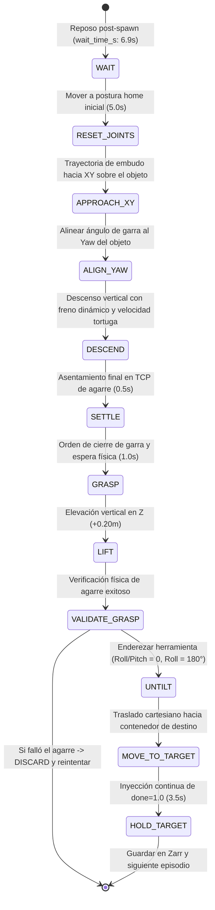

# Módulo 03: Recolección Autónoma de Datos y Máquina de Estados (FSM)

Este documento detalla la lógica completa del generador sintético experto, el control PID cinemático y el protocolo estocástico de recolección de demostraciones, auditado línea por línea en `visuomotor_data_collection` (`pickup_approximate.py`, `utils/pid_controller.py`, `sim_collector_node.py`, `config/data_collection_params.yaml`).

---

## 1. El Generador Autónomo Sintético Experto

El paquete `visuomotor_data_collection` implementa un generador autónomo que supera la lentitud, inconsistencia y fatiga de la teleoperación manual. Opera combinando una **Máquina de Estados Finita (FSM)** de 12 etapas con un **Controlador PID Cartesiano a 100 Hz** y muestreo estocástico **Halton Quasi-Monte Carlo**.

---

## 2. Máquina de Estados Finita (FSM de 12 Estados)



### Descripción Detallada de Cada Estado:

1. **`WAIT` (`wait_time_s = 6.9 s`):**
   - El robot permanece en la pose de reposo (`init_x = 0.25`, `init_y = 0.0`, `init_z = 0.40`).
   - Permite que el motor de físicas de Isaac Sim asiente el objeto tras la teletransportación estocástica y evita que la cámara capture rebotes físicos no deseados.
2. **`RESET_JOINTS` (`reset_joints_duration_s = 5.0 s`):**
   - Lleva suavemente las articulaciones del Lite6 a su configuración inicial cartesiana.
3. **`APPROACH_XY` (Aproximación Parabólica tipo Embudo):**
   - El robot se desplaza en el plano XY hacia las coordenadas del objeto, manteniendo una altura de seguridad en $Z$:
     $$Z_{hover} = Z_{obj} + \text{tcp\_offset\_z} + \text{hover\_z\_offset}$$
     Donde `tcp_offset_z = 0.079 m` (distancia de la muñeca a la punta de los dedos) y `hover_z_offset = 0.15 m`.
   - Se aplica un factor de curvatura parabólica (`funnel_curvature_multiplier = 1.5`) para suavizar la trayectoria.
4. **`ALIGN_YAW` (Alineación Angular de Pinza):**
   - El efector rota rápidamente sobre el eje $Z$ (`max_speed_rad_s = 3.8 rad/s`) para orientar la apertura del gripper paralela al eje longitudinal del objeto.
5. **`DESCEND` (Descenso Suave con Freno Dinámico):**
   - Baja verticalmente desde $Z_{hover}$ hasta la cota de agarre final.
   - Aplica **velocidad tortuga** (`turtle_descent_multiplier = 0.15`) y modula la velocidad de descenso en función del error angular residual para eliminar el *Motion Blur*.
6. **`SETTLE` (`settle_time_s = 0.5 s`):**
   - Pausa estática en la cota de agarre para amortiguar cualquier oscilación inercial antes del cierre de los dedos.
7. **`GRASP` (`grasp_wait_time_s = 1.0 s`):**
   - Se publica el comando de cierre `gripper_closed_pos = -0.01` al tópico `/position_controller/commands`.
   - Espera 1.0 s para garantizar el cierre físico completo de las mordazas en la simulación.
8. **`LIFT` (`lift_z_offset = 0.20 m`):**
   - El brazo asciende verticalmente 20 cm manteniendo el gripper energizado en posición cerrada.
9. **`VALIDATE_GRASP` (Validación Sensorial de Agarre):**
   - Si `validate_grasp_success = true`, el nodo consulta la posición real del objeto en TF (`pick_target`).
   - Comprueba si el objeto ascendió al menos `grasp_success_fraction * lift_z_offset = 0.4 * 0.20 = 0.08 m`.
   - Si el objeto se resbaló o cayó, invoca `EpisodeTrigger("DISCARD")`, borra el buffer temporal y aborta el guardado para evitar entrenar con demostraciones fallidas.
10. **`UNTILT` (`untilt_settle_time_s = 1.5 s`):**
    - Si el efector tuvo que inclinarse para agarrar el objeto, restaura la orientación canónica vertical (`target_roll = 3.14159`, `target_pitch = 0.0`, `target_yaw = 0.0`).
11. **`MOVE_TO_TARGET` (Transporte a Destino):**
    - Traslada suavemente el objeto hacia la zona de descarga (`target_x = 0.25`, `target_y = 0.0`, `target_z = 0.40`).
12. **`HOLD_TARGET` (`hold_target_time_s = 3.5 s`):**
    - El efector se mantiene inmóvil en el destino exacto durante 3.5 segundos (70 muestras a 20 Hz).
    - En este estado, la FSM conmuta forzosamente la señal de fin de tarea a `done_flag = 1.0`.

---

## 3. Dinámica del Controlador PID Cartesiano (`CartesianPID`)

Implementado en `visuomotor_data_collection/utils/pid_controller.py`:

### A. Setpoint Virtual con Salvaguarda Anti-Escape (*Anti-Runaway*)
A 100 Hz, un controlador PID estándar acumularía un término integral enorme si el robot físico se retrasa, generando aceleraciones violentas.
* **Solución de Setpoint Virtual:**  
  El controlador no calcula el error directo contra el objetivo lejano, sino contra un setpoint virtual que se desplaza a velocidad constante acotada (`max_speed_m_s = 0.067 m/s`):
  $$d_{\text{lead}} = \|\text{virtual\_setpoint} - \text{current\_pos}\|$$
* **Abrazadera de Seguridad (Max 5 cm Lead):**
  ```python
  if dist_to_robot > 0.05:
      self.virtual_setpoint = current_pos + ((self.virtual_setpoint - current_pos) / dist_to_robot) * 0.05
  ```
  Si el robot físico colisiona o se retrasa, el setpoint virtual jamás se adelanta más de 5 cm, previniendo oscilaciones destructivas.

### B. Interpolación SLERP de Orientación con Doble Cubierta (*Double Cover*)
1. **Problema Matemático de Cuaterniones:**
   En $SO(3)$, los cuaterniones $q$ y $-q$ representan la misma actitud física. Si el producto interno $q_1 \cdot q_2 < 0$, un SLERP estándar recorrería el camino largo de la esfera ($> 180^\circ$).
2. **Corrección de Signo y Semiesfera Superior:**
   ```python
   dot = np.sum(q1 * q2)
   if dot < 0.0:
       q1 = -q1
       dot = -dot
   ```
3. **Fallback a Interpolación Lineal para Ángulos Pequeños:**
   Si $\text{dot} > 0.9995$ ($\theta < 1.8^\circ$), el cálculo trigonométrico $\frac{\sin(\theta)}{\sin(\theta_0)}$ se vuelve numéricamente inestable; el controlador conmuta automáticamente a interpolación lineal normalizada.
4. **Abrazadera Angular Anti-Escape:**
   La rotación del setpoint virtual se acota a un adelanto angular máximo de $\approx 8.5^\circ$ (`ang_dist_to_robot <= 0.15 rad`).

---

## 4. Respawn Estocástico (Halton Quasi-Monte Carlo)

Para garantizar que la política visuomotora generalice ante cualquier posición del objeto sin acumular muestras en clústeres:
* **Secuencia de Halton 3D:**  
  Genera una cobertura cuasi-aleatoria de baja discrepancia en los rangos:
  - $X \in [0.25, 0.365] \text{ m}$
  - $Y \in [-0.64, -1.14] \text{ m}$
  - $\text{Yaw} \in [-\pi, +\pi] \text{ rad}$
* **Margen de Seguridad de Mesa (`spawn_safe_margin_y = 0.0225 m`):**  
  Si el objeto se ubica cerca del borde de la mesa de Isaac Sim, la rotación inicial se fija forzosamente en $0.0^\circ$ para evitar que las aristas del objeto sobresalgan de la mesa y caigan antes de que comience el episodio.

---

## 5. Garantía de Inyección del `done_flag`

1. **Grabación durante el Episodio:**  
   Durante todos los pasos normales (`APPROACH` a `MOVE_TO_TARGET`), el flag de acción en la dimensión 9 es estrictamente `0.0`.
2. **Piso Mínimo Garantizado en Guardado (`_save_episode`):**  
   Al procesar el buffer en memoria antes de escribir a disco Zarr, el código audita la longitud de la cola terminal. Si por alguna fluctuación de tiempo hubo menos de 40 frames en `HOLD_TARGET`, el método fuerza a que **como mínimo los últimos 40 fotogramas (2.0 segundos completos a 20 Hz)** tengan `done = 1.0`.
   Esto proporciona un volumen suficiente de gradiente de finalización en el entrenamiento.
