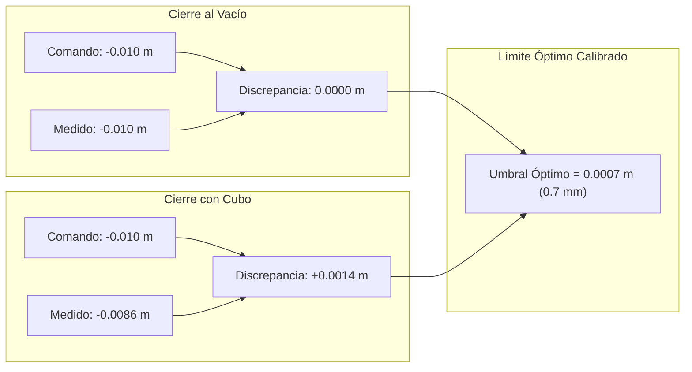

# Módulo 06: Reinforcement Learning (DPPO), Calibración de Pseudo-Fuerza y Dinámica de Contacto

Este documento compila el conocimiento técnico, matemático y empírico extraído de la implementación y calibración del stack de aprendizaje por refuerzo sobre políticas de difusión (**Diffusion Policy Policy Optimization - DPPO**), auditado en `visuomotor_ros2` (`rl_train_node.py`, `dppo_trainer.py`, `gym_ros2_env.py`, `calibrate_gripper.py`, `config/rl_training_params.yaml`).

---

## 1. El Paradigma de Fine-Tuning con DPPO

En sistemas visuomotores generativos, **Diffusion Policy (Behavior Cloning)** aprende eficazmente la distribución multimodal global de las trayectorias demostradas por el experto. Sin embargo, el clonado de comportamiento puro sufre de acumulación de error (*covariate shift*) durante interacciones físicas complejas (contactos, deslices del gripper y momentos terminales).

**DPPO (Diffusion Policy Policy Optimization)** extiende la política supervisada optimizando la cadena de difusión inversa mediante gradientes de política:

$$J(\theta) = \mathbb{E}_{\tau \sim \pi_\theta} \left[ \sum_{t=0}^T \gamma^t R(s_t, a_t) \right]$$

### Dinámica Real de Exploración vs. Fine-Tuning (Hallazgo Clave)
* **RL no es un explorador de espacio abierto desde cero:** En presencia de observaciones visuales de alta dimensión ($256 \times 256 \times 3$), DPPO no explora ni generaliza hacia zonas del espacio de trabajo donde el objeto nunca fue visto durante las demostraciones.
* **El Rol Científico de DPPO:** Opera como un **optimizador local fino (*micro-tuning*)** sobre los últimos $K_{ft}$ pasos del solver DDIM para:
  1. Corregir desalineaciones milimétricas al aproximarse al objeto.
  2. Ajustar la fuerza y el instante de cierre del gripper ante perturbaciones de contacto.
  3. Optimizar la precisión de la señal de término (`done_flag`).

---

## 2. Modelado de Recompensa Compuesta (*Reward Shaping*)

El entorno `gym_ros2_env.py` implementa una función de recompensa continua normalizada y densificada para guiar al manipulador a lo largo de las 4 fases de manipulación:

$$R_{\text{total}} = R_{\text{approach}} + R_{\text{orient}} + R_{\text{grasp}} + R_{\text{transport}} + R_{\text{terminal}} - R_{\text{penalty}}$$

### Desglose de Componentes:
1. **Aproximación Traslacional ($R_{\text{approach}}$):**
   $$R_{\text{approach}} = \exp\left( -k_{\text{dist}} \cdot \|\mathbf{x}_{\text{tcp}} - \mathbf{x}_{\text{obj}}\| \right)$$
   Guía el efector final de forma hiperbólica hacia el punto de agarre.
2. **Alineación Angular de Garra ($R_{\text{orient}}$):**
   $$R_{\text{orient}} = \frac{1 + \cos(2 \cdot \Delta \psi)}{2}$$
   Incentiva la alineación del Yaw del gripper con la orientación del objeto, aprovechando la simetría de $180^\circ$ de las pinzas paralelas.
3. **Certificación de Agarre ($R_{\text{grasp}}$):**
   $$R_{\text{grasp}} = w_g \cdot \mathbb{I}(\text{is\_clamped})$$
   Se activa únicamente cuando el sensor confirma que el objeto está efectivamente aprisionado entre los dedos.
4. **Transporte a Destino ($R_{\text{transport}}$):**
   $$R_{\text{transport}} = w_t \cdot \exp\left( -k_t \cdot \|\mathbf{x}_{\text{obj}} - \mathbf{x}_{\text{dest}}\| \right) \cdot \mathbb{I}(\text{is\_clamped})$$
   Solo premia el desplazamiento hacia Home si el agarre se mantiene activo.
5. **Término Exitoso ($R_{\text{terminal}}$):**
   Bono discreto masivo ($+100.0$) cuando el objeto reposa en destino y la política activa el auto-stop.

---

## 3. Calibración Empírica del Pseudo-Sensor de Fuerza Propioceptivo

En entornos simulados (Isaac Sim) o robots industriales sin sensores de par en la punta de los dedos (*F/T sensor*), la fuerza de contacto se modela a través de la **discrepancia elástica propioceptiva**:

$$\delta_{\text{elastic}} = p_{\text{medida}} - p_{\text{comando}}$$

Donde $p_{\text{comando}}$ es la posición objetivo enviada al motor (ej. $-0.010\text{ m}$, cerrado) y $p_{\text{medida}}$ es la posición reportada por `/joint_states`.

### Protocolo de Calibración (`visuomotor_ros2/calibrate_gripper.py`):
1. **Medición en Vacío (sin cubo):**
   - Comando cerrado: $-0.010\text{ m}$. Posición observada: $-0.010\text{ m}$.
   - Pseudo-fuerza en vacío: $0.000000\text{ m}$.
2. **Medición con Cubo Físico de Isaac Sim:**
   - Comando cerrado: $-0.010\text{ m}$. Posición observada: $-0.008600\text{ m}$.
   - Discrepancia real de contacto: $+0.001400\text{ m}$ ($1.4\text{ mm}$).
3. **Umbral Óptimo Matemático:**
   $$\theta_{\text{clamped}} = \frac{0.000000 + 0.001400}{2} = 0.000700\text{ m} \quad (0.7\text{ mm})$$
   Configurado en `config/rl_training_params.yaml`: `pseudo_force_clamped_threshold: 0.0007`.

### Certificación de Agarre en Vuelo (*In-Flight Certification*):
* **Problema:** En el aire ($\Delta z > 8\text{ cm}$), oscilaciones dinámicas inducen pequeñas velocidades articulares en los dedos que falseaban el flag `is_stationary`.
* **Solución Implementada:** Si el cubo está elevado ($\Delta z \ge 0.08\text{ m}$) y el gripper tiene orden de cierre activa, `is_clamped = True` de forma incondicional, blindando el episodio contra falsos descartes durante el vuelo.

---

## 4. Sincronización Determinista del Entorno (Isaac Sim)

### A. Pulso Bifásico con Micro-Jitter (Anti-Caché OmniGraph)
* **Causa Raíz:** El nodo Script de OmniGraph implementa `if linear == last_lin_processed: return;` para evitar sobrecarga en PhysX. Reintentar un episodio fallido con exactamente las mismas coordenadas provocaba la supresión del teletransporte en USD.
* **Solución:**
  1. **Pre-pulso:** Publicar orden en cota elevada ($Z + 4\text{ cm}$) con jitter estocástico ($\pm 0.5\text{ mm}$ en $X, Y$).
  2. **Espera:** 80 ms para registrar cambio en PhysX.
  3. **Pulso Final:** Ráfaga de 5 mensajes en cota de mesa ($Z = 0.44\text{ m}$) en las coordenadas meta.

### B. Estabilización Gravitacional y Purgado de Observaciones (`_wait_and_stabilize_at_home`)
1. El robot se mantiene inmóvil en Home con pinza abierta durante `reset_stabilize_s = 2.0s`.
2. El objeto cae por gravedad y se asienta completamente sobre la mesa.
3. Se purga el semáforo de cámara (`self._obs_event.clear()`) y se aguarda un fotograma RGB fresco capturado **después** del reposo del cubo antes de arrancar el bucle de RL.
