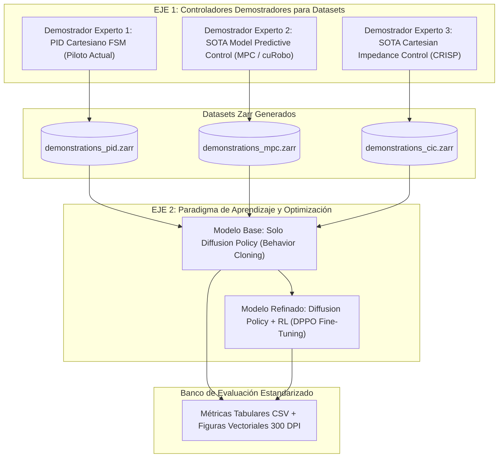

# Módulo 07: Metodología Científica, Benchmarking y Métricas para Publicaciones

Este documento define el protocolo de experimentación rigurosa, el diseño factorial de evaluación, el esquema de datos tabulares y los estándares de reproducibilidad necesarios para contrastar empíricamente **Diffusion Policy (DP)** frente a **Diffusion Policy + Reinforcement Learning (DP + RL)** y evaluar demostradores expertos hacia publicaciones científicas (IEEE / Robotics).

---

## 1. Los Dos Ejes Fundamentales de Investigación Experimental

Para producir resultados cuantitativos científicamente sólidos, el repositorio estructura sus hipótesis en dos dimensiones ortogonales:



### A. Eje 1 — Generación de Demostraciones Expertas (Datasets):
* **Estado Actual (Piloto):** El generador autónomo (`pickup_approximate.py`) opera con un PID cartesiano como prueba de concepto piloto.
* **Pregunta de Investigación:** *¿Cómo influye la naturaleza del controlador experto (la suavidad y optimalidad de un MPC frente a la acomodación pasiva de un controlador de impedancia) en el espacio de trayectorias aprendido por la red de difusión?*

### B. Eje 2 — Paradigma de Aprendizaje (Solo DP vs. DP + RL):
* **Hipótesis Científica:** DP aprende eficazmente la cobertura global del espacio, mientras que DPPO optimiza la precisión milimétrica final, la estabilidad del contacto y la calibración temporal del auto-stop.
* **Pregunta de Investigación:** *¿Qué mejora cuantitativa medible aporta el fine-tuning con RL sobre una política generativa base entrenada sobre demostraciones idénticas?*

---

## 2. Matriz de Diseño Factorial Completo para Papers

Para aislar el efecto de cada variable, se define una matriz de evaluación cruzada $(D_{\text{experto}}) \times (\text{Algoritmo})$:

| Condición | Dataset de Entrenamiento | Demostrador de Origen | Modelo Evaluado | Objetivo Científico |
| :---: | :---: | :---: | :---: | :---: |
| **A1** | `demonstrations_v8_pid.zarr` | PID Cartesiano (Piloto) | Solo DP (BC) | Línea base canónica de imitación. |
| **A2** | `demonstrations_v8_pid.zarr` | PID Cartesiano (Piloto) | DP + RL (DPPO) | Impacto de RL sobre datos con ruido de seguimiento PID. |
| **B1** | `demonstrations_v8_mpc.zarr` | SOTA MPC / cuRobo | Solo DP (BC) | Impacto de demostraciones cinemáticamente óptimas. |
| **B2** | `demonstrations_v8_mpc.zarr` | SOTA MPC / cuRobo | DP + RL (DPPO) | Desempeño cumbre de RL sobre datos de alta optimalidad. |
| **C1** | `demonstrations_v8_cic.zarr` | SOTA Impedancia (CRISP) | Solo DP (BC) | Capacidad de DP para imitar compliancia pasiva. |
| **C2** | `demonstrations_v8_cic.zarr` | SOTA Impedancia (CRISP) | DP + RL (DPPO) | Sinergia entre compliancia experta y optimización de agarre. |

---

## 3. Definición Formal de Métricas Científicas

Cada experimento de evaluación debe ejecutarse a lo largo de $N \ge 100$ episodios estandarizados bajo semillas fijas de respawn Quasi-Monte Carlo (Halton), registrando:

### 1. Tasa de Éxito de Tarea (*Task Success Rate - SR %*):
$$\text{SR} = \frac{1}{N} \sum_{i=1}^N \mathbb{I}(\text{task\_completed}_i) \times 100\%$$
Un episodio se califica como exitoso si y solo si:
1. El objeto se encuentra a menos de $8\text{ cm}$ de la pose meta en Home.
2. El agarre se mantuvo firme durante todo el transporte.
3. El auto-stop neuronal (`done_flag`) se activó deteniendo el manipulador.

### 2. Error Cuadrático Medio de Seguimiento (*Tracking RMSE*):
$$\text{RMSE}_{\text{track}} = \sqrt{\frac{1}{T} \sum_{t=1}^T \|\mathbf{x}_{\text{cmd}}(t) - \mathbf{x}_{\text{actual}}(t)\|^2}$$
Mide la discrepancia entre la intención motora generada por la red y la respuesta cinemática del robot.

### 3. Error Terminal de Posicionamiento (*Terminal Positioning Error - mm*):
$$\text{Error}_{\text{terminal}} = \|\mathbf{x}_{\text{obj}}(T_{\text{final}}) - \mathbf{x}_{\text{dest}}\|_2$$
Mide la exactitud milimétrica de entrega en la zona objetivo.

### 4. Tasa de Deslizamiento de Agarre (*Grasp Slip Rate - %*):
$$\text{Slip Rate} = \frac{\text{Episodios con desprendimiento post-lift}}{\text{Episodios con intento de agarre}} \times 100\%$$

### 5. Métricas de Detección de Parada (*Auto-Stop F1-Score*):
Evaluando la 9ª dimensión (`done_flag`) como un clasificador continuo de estado terminal:
$$\text{Precision} = \frac{\text{TP}}{\text{TP} + \text{FP}}, \quad \text{Recall} = \frac{\text{TP}}{\text{TP} + \text{FN}}, \quad \text{F1} = 2 \cdot \frac{\text{Precision} \cdot \text{Recall}}{\text{Precision} + \text{Recall}}$$
Donde un FP representa un auto-stop prematuro (robot congelado antes de llegar a destino) y un FN representa falta de detención asintótica.

---

## 4. Esquema de Datos Tabular Estandarizado (`metrics.csv`)

Todas las ejecuciones de evaluación e inferencia registrarán series temporales en formato CSV plano:

```text
timestamp,experiment_id,dataset_demonstrator,learning_paradigm,episode_idx,step_idx,tcp_x,tcp_y,tcp_z,cmd_x,cmd_y,cmd_z,tracking_error_m,obj_x,obj_y,obj_z,is_clamped,done_flag_pred,contact_force_est,reward_instant
```

### Organización de Archivos en Disco:
```text
experiments/
├── 20261027_exp_dset_pid_solo_dp/
│   ├── metadata.json          # Hiperparámetros, checkpoint, semilla Halton
│   ├── step_metrics.csv       # Telemetría a 20 Hz de los 100 episodios
│   ├── episode_summary.csv    # Retorno, duración, éxito y errores por episodio
│   ├── figures/
│   │   ├── tracking_error_distribution.pdf  # Boxplots y violin plots
│   │   ├── trajectory_3d_comparison.pdf    # Trazado ortográfico 3D
│   │   └── success_rate_bar.pdf            # Comparativas de éxito con error bars
│   └── run.log                # Log enriquecido con timing nanosegundo
└── 20261027_exp_dset_pid_dp_rl/
    └── ...
```

---

## 5. Estándares Visuales para Figuras de Publicación (IEEE / Nature)

* **Backend Headless:** Uso estricto de `matplotlib.use('Agg')` sin dependencias de X11.
* **Formato Dual:** Exportación simultánea en `.png` (alta resolución a 300 DPI) y `.pdf` (vectorial sin pérdida para LaTeX).
* **Intervalos de Confianza:** Todas las curvas de recompensa y error deben incluir sombra de dispersión que represente el error estándar de la media:
  $$\text{CI}_{95\%} = \bar{x} \pm 1.96 \cdot \frac{s}{\sqrt{N}}$$
* **Paleta Accesible:** Utilizar paletas de color aptas para personas daltónicas (`seaborn-colorblind` o paletas Tab10/viridis).
