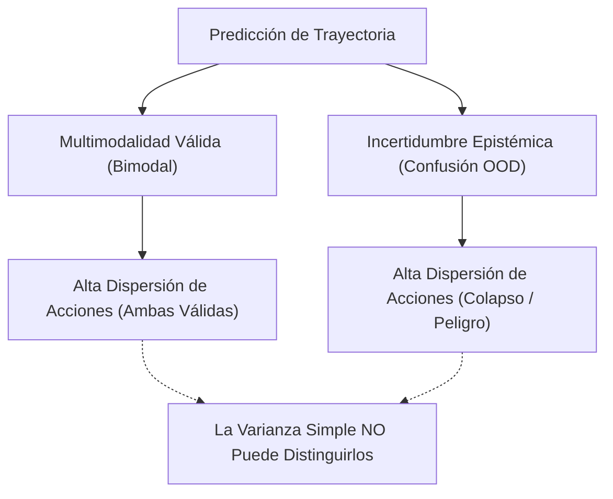

# Módulo 07: Evaluación SOTA, Cuantificación de Incertidumbre y Validación Avanzada en Políticas Visuomotoras

Este documento compila el Estado del Arte (SOTA 2024–2026) en metodologías avanzadas para evaluar, calibrar y verificar modelos generativos de manipulación robótica (Diffusion Policy, DDIM, DPPO y Flow Matching), auditado e integrado para el ecosistema `visuomotor_ros2`.

---

## 1. El Dilema Fundamental: Multimodalidad vs. Incertidumbre Epistémica

En aprendizaje por imitación y políticas visuomotoras generativas, la evaluación estándar basada únicamente en la varianza de acciones predichas (*action variance*) presenta un fallo conceptual grave:

* **Multimodalidad Válida:** Si el efector puede rodear un obstáculo por la izquierda o por la derecha, ambas trayectorias son óptimas. Una métrica de varianza cartesiana reportará un valor alto, clasificando erróneamente el comportamiento como "inseguro" o "incierto".
* **Incertidumbre Epistémica (OOD):** Si el objeto se ubica fuera del espacio muestreado en el dataset, la red predice acciones erráticas debido a falta de conocimiento.

---

## 2. Método SOTA 1: Cuantificación de Incertidumbre por Consistencia de Score (Diff-DAgger & VFD)

Para aislar la verdadera incertidumbre sin ser engañado por la multimodalidad (frameworks como *Diff-DAgger*, 2024–2025):
1. **Discrepancia del Campo de Ruido (*Score-Matching Inconsistency*):**
   - En lugar de medir la dispersión espacial de las acciones finales $A^0$, se evalúa la consistencia de la función de score $\epsilon_\theta(A^k, k, O_t)$ a lo largo de las etapas intermedias de desruidizado.
   - En regiones familiares del espacio de estados, la red predice gradientes de eliminación de ruido coherentes con la variedad demostrada. En regiones fuera de distribución (OOD), el error de consistencia del score se dispara antes de que la trayectoria física diverja.
2. **Desacuerdo en el Campo de Velocidades (*Velocity-Field Disagreement - VFD*):**
   - En modelos de *Flow Matching*, se utiliza un ensamble ligero de dos cabezas o checkpoints temporales. La discrepancia angular entre los campos vectoriales predichos mide directamente la incertidumbre epistémica, permitiendo disparar el auto-stop preventivo antes de colisiones.

---

## 3. Método SOTA 2: Predicción Conforme (*Conformal Prediction*) y Cobertura Garantizada (*PlanCP*)

La evaluación tradicional asume normalidad gaussiana de los errores o se limita a calcular medias y desviaciones estándar. La **Predicción Conforme (CP)** ofrece una alternativa matemáticamente rigurosa y libre de distribución (*distribution-free*):

### Formulación para Trayectorias Robóticas:
1. **Conjunto de Calibración:** Se reserva un conjunto de episodios pareados de calibración $\mathcal{D}_{\text{cal}} = \{(O_i, A_i^*)\}_{i=1}^M$.
2. **Función de No Conformidad ($s$):** Mide la discrepancia entre la trayectoria predicha por la Diffusion Policy $\hat{A}_i$ y la trayectoria experta/física real $A_i^*$:
   $$s_i = \max_{t \in [1, H]} \|\hat{a}_{i, t} - a_{i, t}^*\|_2$$
3. **Cálculo del Cuantil Conforme:** Para un nivel de significancia $\alpha \in (0, 1)$ (ej. $\alpha = 0.05$ para $95\%$ de confianza), se calcula el cuantil empírico:
   $$\hat{q} = \text{Quantile}\left( \{s_1, \dots, s_M\}, \, \frac{\lceil (M + 1)(1 - \alpha) \rceil}{M} \right)$$
4. **Región de Cobertura Válida:** Para cualquier nueva observación en inferencia, el tubo de trayectoria conformalizado se define como:
   $$\mathcal{C}(O) = \left\{ A \in \mathbb{R}^{H \times 9} : \max_{t} \|a_t - \hat{a}_t\|_2 \le \hat{q} \right\}$$
   **Garantía Matemática:** $\mathbb{P}(A^* \in \mathcal{C}(O)) \ge 1 - \alpha$, sin requerir supuestos sobre la distribución del ruido ni linealidad del robot.
5. **Métrica de Evaluación:** Se reporta la **Cobertura Empírica** (*Empirical Coverage*) vs. la Cobertura Objetivo ($95\%$) y el **Volumen de Incertidumbre** (radio medio $\hat{q}$). Si el volumen se infla excesivamente, el modelo exhibe baja precisión aunque mantenga cobertura.

---

## 4. Método SOTA 3: Verificadores de Valor y Escalado en Tiempo de Test (*Test-Time Scaling / Best-of-N*)

Inspirado en el escalado en tiempo de inferencia de modelos de lenguaje y robótica avanzada:
1. **Generación Candidata Paralela:** Para una observación sensorial $O_t$, la U-Net genera en un solo batch $B$ trayectorias alternativas usando diferentes semillas de ruido estocástico $\epsilon_1, \dots, \epsilon_B \sim \mathcal{N}(0, \mathbf{I})$ en GPU:
   $$\mathcal{A}_{\text{candidatos}} = \{A^{(1)}, A^{(2)}, \dots, A^{(B)}\}$$
2. **Evaluación mediante el Crítico de RL ($V_\phi$ o $Q_\phi$):**
   - El modelo de Crítico entrenado durante la fase de DPPO actúa como un **Verificador (*Verifier*)**.
   - Evalúa el valor esperado de cada trayectoria candidata:
     $$v_b = V_\phi(O_t, A^{(b)})$$
3. **Selección Óptima (*Best-of-N*):**
   $$A^* = \arg\max_{A^{(b)}} v_b$$
4. **Impacto en Evaluación:** Este mecanismo permite evaluar la "capacidad latente" del modelo de difusión: medir cuánto mejora la tasa de éxito al pasar de $B=1$ (inferencia estándar) a $B=4$ u $8$ candidatos filtrados por el Crítico.

---

## 5. Método SOTA 4: Diagnóstico Físico Explicable con AdaBoost y Tocones de Decisión

Para entender **por qué** falla una política y qué umbrales físicos separan el éxito del fracaso en una campaña de benchmarking (ej. sobre `benchmark_episodes.csv`):

### Algoritmo de Diagnóstico Forense:
1. Se extrae una matriz de características cinemáticas por episodio:
   $$\mathbf{x}_i = [\delta_{\text{elastic}}, \, d_{\text{contacto\_min}}, \, \text{error\_terminal}, \, \Delta z_{\text{elevación}}, \, \text{duración}]$$
   con etiquetas $y_i \in \{+1 \text{ (Éxito)}, -1 \text{ (Fallo)}\}$.
2. Se entrena un clasificador **AdaBoost con tocones de decisión**:
   * En cada ronda $t$, el tocón genera una regla de umbral univariada: $\mathbb{I}(x_j \ge \theta)$.
   * Se calculan los pesos $\alpha_t = \frac{1}{2} \ln \frac{1 - \epsilon_t}{\epsilon_t}$ y se reponderan las muestras difíciles.
3. **Interpretabilidad Física Inmediata:** Los primeros 3 tocones con mayor peso $\alpha_t$ revelan el cuello de botella del modelo (ej. *"Si $\delta_{\text{elastic}} < 0.7\text{ mm}$, el 100% de los episodios falla por falso agarre"* o *"Si $d_{\text{contacto}} > 10\text{ mm}$, el efector no alcanza la superficie"*).

---

## 6. Protocolo de Pruebas de Estrés Sistemáticas (Benchmark Suite)

Siguiendo las mejores prácticas de **RoboMimic**, **SIMPLER** y **LIBERO**:
1. **Perturbaciones Espaciales Cuasi-Aleatorias (Halton QMC):**
   - Evaluar $N \ge 100$ episodios divididos en cuadrícula nominal ($X \in [-0.35, -0.52]$, $Y \in [-0.56, -1.08]$) vs. cuadrícula extrema extendida ($+15\%$ en bordes) para medir el decaimiento fuera de distribución.
2. **Perturbaciones Físicas de Carga:** Variar la masa del cubo en el simulador ($\pm 20\%$) y la fricción de contacto ($\mu \in [0.4, 1.2]$) para certificar la robustez del agarre propioceptivo.
3. **Métricas Consolidadas de Publicación:**
   - **Tasa de Éxito Global (SR %):** Con intervalos de confianza de Wilson al $95\%$.
   - **Error Terminal RMSE (mm):** Precisión de depósito en reposo.
   - **Tiempo de Ciclo Medio (s):** Eficiencia temporal.
   - **Tasa de Deslizamiento de Garra (*Grasp Slip Rate %*):** Pérdida de sujeción en vuelo.
   - **Significancia Estadística:** Valor $p$ del test de rangos con signo de Wilcoxon ($p < 0.05$) frente al modelo basal.
