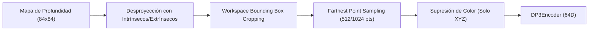

# Módulo 08: 3D Diffusion Policy (DP3) y Rigor en Machine Learning para Robótica Manipuladora

Este documento consolida la base de conocimientos derivada del estudio de **3D Diffusion Policy (DP3)** (Ze et al., 2024) y de los fundamentos avanzados de **Ciencia de Datos y Aprendizaje Automático** (Stanford CS221, Harvard CS109, CMU 11-785/15-388), aplicados a la arquitectura de políticas generativas y control visuomotor en `visuomotor_ros2`.

---

## 1. La Revolución de la Representación 3D: Por Qué el 2D Colapsa en Pocas Demostraciones

En políticas visuomotoras basadas en visión 2D (cámaras RGB con ResNet / ViT):
* **Extrapolación Plana:** La proyección de la escena 3D a un plano $2\text{D}$ destruye la métrica euclidiana de profundidad $Z$. Con un número reducido de demostraciones (ej. 5 a 10), las políticas 2D aprenden a navegar exclusivamente dentro de una variedad plana o degenerada, fallando al generalizar en el volumen completo de trabajo.
* **Sobredependencia de Datos:** Los métodos 2D requieren habitualmente entre 100 y 200 demostraciones por tarea para compensar variaciones de iluminación, textura y perspectiva.
* **Ventaja Cuantitativa de DP3:** Al alimentar la política con nubes de puntos 3D dispersas ($N_p \in [512, 1024]$), DP3 supera a la política 2D en un $+24.2\%$ relativo a través de 72 tareas de simulación, resolviendo tareas complejas con apenas 10 demostraciones y alcanzando un $85\%$ de éxito en robots reales con 40 demostraciones.

---

## 2. Anatomía del `DP3Encoder`: El Descubrimiento Forense sobre PointNet

Uno de los aportes arquitectónicos más significativos de DP3 es la elucidación de por qué los codificadores de nubes de puntos clásicos (PointNet, PointNet++, PointNeXt, Point Transformer) colapsaban al aplicarse a control visuomotor en lazo cerrado:

### A. Diagnóstico de Inhibidores en PointNet Clásico
Al evaluar PointNet estándar en control continuo, la tasa de éxito media fue de apenas **$15.7\%$**. El estudio de ablación reveló dos causantes letales:
1. **La T-Net (Spatial Transformer Network):**
   - *Problema:* Las cámaras en estaciones de trabajo robótico están rígidamente fijadas al mundo o a la muñeca. La T-Net intenta aprender una transformación afín ortogonal libre para alinear objetos. En control visuomotor, esto destruye la coherencia espacial fija entre el efector final y la mesa, desorientando a la política.
   - *Solución:* Eliminar completamente la T-Net.
2. **Batch Normalization (`BatchNorm`):**
   - *Problema:* `BatchNorm` calcula medias y varianzas sobre el mini-batch. En secuencias temporales correlacionadas y con tamaños de lote pequeños típicos de robótica, las estadísticas fluctúan erráticamente, descalibrando el decaimiento móvil exponencial (EMA) y produciendo derivas en tiempo de inferencia.
   - *Solución:* Sustituir `BatchNorm` por `LayerNorm` (o `GroupNorm`), operando estrictamente sobre las dimensiones de canal de cada muestra individual de forma independiente al batch.

### B. Implementación PyTorch del `DP3Encoder` (Éxito del $78.3\%$)
Al prescindir de T-Net y `BatchNorm`, e intercalar `LayerNorm` en un MLP de 3 niveles con proyección compacta de salida:

```python
import torch
import torch.nn as nn

class DP3Encoder(nn.Module):
    def __init__(self, in_channels: int = 3, out_dim: int = 64):
        super().__init__()
        # Entrada: coordenadas geométricas puras [X, Y, Z] (in_channels=3)
        self.mlp = nn.Sequential(
            nn.Linear(in_channels, 64),
            nn.LayerNorm(64),
            nn.ReLU(),
            nn.Linear(64, 128),
            nn.LayerNorm(128),
            nn.ReLU(),
            nn.Linear(128, 256),
            nn.LayerNorm(256),
            nn.ReLU(),
        )
        # Cabezal de proyección compacto a espacio latente
        self.projection = nn.Sequential(
            nn.Linear(256, out_dim),
            nn.LayerNorm(out_dim),
        )

    def forward(self, x: torch.Tensor) -> torch.Tensor:
        """
        Args:
            x: Tensor de nube de puntos [Batch, NumPoints, in_channels]
        Returns:
            Vector latente compacto [Batch, out_dim]
        """
        # 1. Extracción de características por punto
        feat = self.mlp(x)                     # [B, N, 256]
        # 2. Agregación equivariante al orden por max-pooling global
        feat_global = torch.max(feat, dim=1)[0] # [B, 256]
        # 3. Proyección a representación compacta
        out = self.projection(feat_global)     # [B, out_dim]
        return out
```

---

## 3. Pipeline de Preprocesamiento 3D y Buenas Prácticas



1. **Desproyección Geométrica de Profundidad:**
   - A partir de la imagen de profundidad $D(u, v)$ de la cámara y su matriz intrínseca $K$, cada píxel se proyecta al espacio cartesiano tridimensional:
     $$X = \frac{(u - c_x) \cdot D}{f_x}, \quad Y = \frac{(v - c_y) \cdot D}{f_y}, \quad Z = D$$
     transformado al marco base (`link_base`) mediante la cinemática directa de la cámara.
2. **Recorte Espacial del Espacio de Trabajo (*Workspace Bounding Box Cropping*):**
   - *Impacto en Rendimiento:* En la ablación del paper, omitir el recorte espacial provocó un colapso en la tasa de éxito de **$78.3\%$ a $45.3\%$**.
   - *Fundamento:* La nube de puntos cruda contiene millones de puntos irrelevantes (suelo, techo, soportes del robot). Definir una caja delimitadora estricta para la mesa ($X \in [x_{\min}, x_{\max}]$, $Y \in [y_{\min}, y_{\max}]$, $Z \in [z_{\min}, z_{\max}]$) elimina el ruido ambiental y concentra la capacidad representacional en el objeto manipulable.
3. **Muestreo por Puntos Más Lejanos (*Farthest Point Sampling - FPS*):**
   - Frente al muestreo aleatorio uniforme (que sobrerrepresenta zonas densas y omite bordes sutiles), FPS garantiza una dispersión cuasi-uniforme sobre toda la geometría del objeto, reteniendo únicamente $512$ o $1024$ puntos.
4. **Invarianza de Apariencia por Supresión de Color:**
   - Al procesar estrictamente las coordenadas espaciales $(X, Y, Z)$ y descartar los canales de color RGB, la política adquiere **invarianza automática a variaciones de color, textura e iluminación**, generalizando con éxito a objetos de prueba con aspectos visuales radicalmente distintos.

---

## 4. Estrategia de Predicción en el Solucionador DDIM: Muestra ($x_0$) vs. Ruido ($\epsilon$)

* **Predicción de Ruido ($\epsilon$-prediction):** Habitual en generación de imágenes 2D, donde la U-Net predice el ruido Gaussiano residual $\epsilon_k$.
* **Predicción de Muestra ($x_0$-prediction):** En control continuo de alta dimensión ($16 \times 9$), DP3 demuestra que entrenar la red para predecir directamente la trayectoria limpia desruidizada ($A^0$) estabiliza y acelera drásticamente la convergencia (alcanzando meseta en $\sim 500$ épocas frente a $> 2000$ épocas de $\epsilon$-pred).

---

## 5. Arquitectura Acelerada: *Simple DP3* (25.3 FPS)

Para cerrar la brecha de latencia en despliegues físicos en tiempo real:
* La U-Net estándar de Diffusion Policy introduce sobrecostos en canales temporales profundos.
* **Simple DP3** poda las dimensiones internas de los bloques residuales Mish, duplicando la frecuencia de inferencia de $12.7$ FPS a **$25.3$ FPS** (una ganancia del $+99\%$ en velocidad) con una pérdida marginal de precisión (de $74.4\%$ a $70.2\%$). Esto la hace ideal para control reactivo en lazos de 20 Hz sobre ROS 2.

---

## 6. Principios de Rigor Metodológico en Machine Learning (Desde las Diapositivas UCN/Stanford/CMU)

El análisis de las diapositivas de Ciencia de Datos aporta pautas metodológicas críticas para blindar el desarrollo de este repositorio:

### A. Prevención de Fuga de Información (*Data Leakage*) en Datos Secuenciales
* **Regla Inviolable:** En robótica y trayectorias continuas, **jamás se debe realizar partición aleatoria de datos a nivel de fotogramas individuales**.
* **Causa Física:** Dos fotogramas consecutivos a 20 Hz ($t$ y $t + 50\text{ ms}$) comparten el $99.9\%$ de información visual y propioceptiva. Si el fotograma $t$ queda en entrenamiento y $t+1$ en validación, la red sobreajusta memorizando la secuencia, arrojando pérdidas de validación engañosamente perfectas que colapsan en inferencia real.
* **Solución Estandarizada:** El particionamiento (ej. split 80/20) debe realizarse **estrictamente a nivel de episodio completo**, garantizando que ninguna trayectoria vista en entrenamiento participe en la validación.

### B. La Ley de Kolter y la Matriz de Diagnóstico en Debugging de ML
Al depurar fallas en modelos de aprendizaje robótico:
1. **Fase de Sanidad Cero (*Overfitting Test*):** Antes de entrenar con el corpus completo (667 episodios), verificar que el modelo sea capaz de sobreajustar al $100\%$ sobre **un único episodio o mini-batch** (pérdida cercana a cero). Si el modelo no puede memorizar un solo lote, existe un bug matemático en la arquitectura, en las dimensiones o en el flujo de gradientes.
2. **Matriz Factible / Imposible:**
   * *Pérdida de entrenamiento no desciende:* Falla de optimización (tasa de aprendizaje inadecuada, colapso de gradientes, normalización errónea).
   * *Pérdida de entrenamiento desciende pero validación se degrada:* Falla de generalización (capacidad excesiva, falta de regularización L2/Dropout, necesidad de aumento de datos o más demostraciones).

### C. Dinámica de Curvatura y Acondicionamiento del Hessiano
* En superficies de pérdida no convexas con valles estrechos (número de condición del Hessiano $\kappa = \lambda_{\max} / \lambda_{\min} \gg 1$), el gradiente descendente estándar oscila violentamente en las direcciones de alta curvatura mientras avanza lentamente en las planas.
* El optimizador **AdamW** mitiga este fenómeno al normalizar el paso por la raíz del segundo momento no centrado con decaimiento de pesos desacoplado (*decoupled weight decay*), amortiguando las oscilaciones cinemáticas.

### D. Regularización por Restricción y Mínimos Planos (*Flat Minima*)
* **Exponential Moving Average (EMA):** El mantenimiento de una copia paralela de pesos promediada temporalmente ($\theta_{\text{EMA}} \leftarrow \beta \theta_{\text{EMA}} + (1-\beta)\theta$) actúa como un suavizador geométrico que ubica a la política en mínimos planos (*flat minima*), protegiendo la inferencia contra ruidos sensoriales de alta frecuencia.
