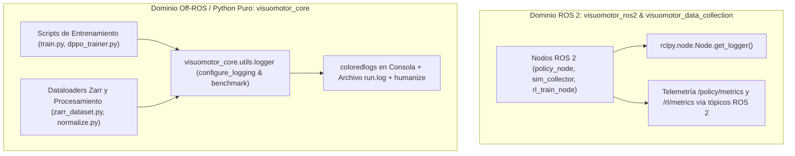

# Módulo 08: Estándar de Logging Científico y Benchmarking de Rendimiento Off-ROS

Este documento especifica el estándar técnico y operativo de **registro de eventos (logging)** y **medición de desempeño temporal (benchmarking)** para todos los componentes de software en el repositorio que **no utilicen ROS 2** (`visuomotor_core`), preservando la pureza del stack de Deep Learning.

---

## 1. Principio de Aislamiento de Dominios de Logging

En arquitecturas visuomotoras mixtas (Robótica + Deep Learning), el logging debe respetar las fronteras del software:



* **Regla Inviolable:** Queda terminantemente prohibido importar librerías de ROS (`rclpy`) en `visuomotor_core` para tareas de logging. Asimismo, en código Off-ROS se prohíbe el uso de declaraciones informales `print()` en bucles de producción, reemplazándolas por llamadas estructuradas a `logging.Logger`.

---

## 2. Especificación de `configure_logging()`

Ubicado en `visuomotor_core/visuomotor_core/utils/logger.py`:

```python
def configure_logging(level: int = logging.DEBUG, log_file: str | None = None) -> None:
```

### Características Técnicas:
1. **Formato Enriquecido de Registro:**
   `%(asctime)s [%(levelname)8s] %(name)s:%(lineno)d (%(process)d/%(threadName)s) - %(message)s`
   - `asctime` con resolución en milisegundos (`milliseconds=True`).
   - Identificación de proceso e hilo para trazabilidad de `num_workers > 0` en PyTorch DataLoaders.
   - Ruta relativa y número de línea exacto para depuración inmediata.
2. **Estilos de Coloración en Terminal (`coloredlogs`):**
   - `DEBUG`: Negro brillante (`bright=True`).
   - `INFO`: Verde.
   - `WARNING`: Magenta.
   - `ERROR`: Rojo.
   - `CRITICAL`: Rojo en negrita (`bold=True`).
3. **Manejador Dual a Archivo (`FileHandler`):**
   Si se provee `log_file` (ej. `outputs/train/training.log`), todos los eventos se persisten en disco sin secuencias de escape ANSI, permitiendo inspección remota vía `tail -f` o integración en clústeres.
4. **Filtro Anti-Ruido de Librerías Externas:**
   Atenúa automáticamente a nivel `WARNING` los logs espurios de:
   `PIL`, `asyncio`, `matplotlib`, `numba`, `zarr`, `numcodecs`, `httpx`, `git`.

---

## 3. Gestor de Contexto de Benchmarking (`benchmark`)

```python
@contextmanager
def benchmark(
    operation_name: str | None = None,
    log: logging.Logger | None = None,
    track_gpu: bool = False,
) -> Generator[None, None, None]:
```

### Características Técnicas:
1. **Precisión Temporal en Nanosegundos:**
   Utiliza `time.perf_counter_ns()` para evitar la deriva o imprecisión de los relojes de sistema operativo (`time.time()`).
2. **Formateo Legible con `humanize`:**
   Convierte el delta en texto intuitivo de alta granularidad (`humanize.precisedelta(delta, minimum_unit="microseconds", format="%.2f")`):
   - `⏱️ Zarr Dataset Loading executed in 3.42 seconds`
   - `⏱️ Forward + Backward Pass executed in 45.12 milliseconds`
3. **Extensión Científica para Deep Learning (GPU VRAM Tracking):**
   Si `track_gpu=True` y `torch.cuda.is_available()`, reinicia las estadísticas de pico antes del bloque (`torch.cuda.reset_peak_memory_stats()`) y reporta la memoria VRAM consumida al salir:
   `⏱️ Forward Step executed in 28.15 milliseconds | Peak VRAM: 3412.5 MB`

---

## 4. Patrón Canónico de Integración en Scripts de Entrenamiento

```python
import logging
from pathlib import Path
from visuomotor_core.utils.logger import configure_logging, benchmark

def run_experiment(out_dir: str, ...):
    output_directory = Path(out_dir)
    output_directory.mkdir(parents=True, exist_ok=True)
    
    # 1. Configurar logging al iniciar
    configure_logging(level=logging.DEBUG, log_file=str(output_directory / "training.log"))
    log = logging.getLogger("train")
    
    # 2. Benchmarking en carga de datos
    with benchmark("Inicialización ZarrDataset", log):
        dataset = ZarrDataset(...)
        
    # 3. Bucle de épocas con profiling
    for epoch in range(epochs):
        with benchmark(f"Época {epoch}", log, track_gpu=True):
            for batch in dataloader:
                # Paso de difusión...
                pass
                
        # 4. Guardado de checkpoints
        with benchmark("Guardado de Checkpoint", log):
            policy.save_pretrained(output_directory)
```
