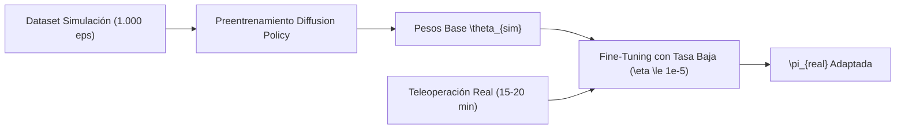
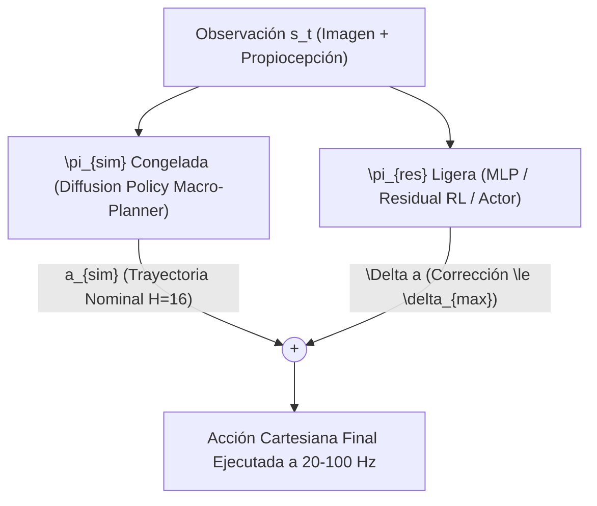
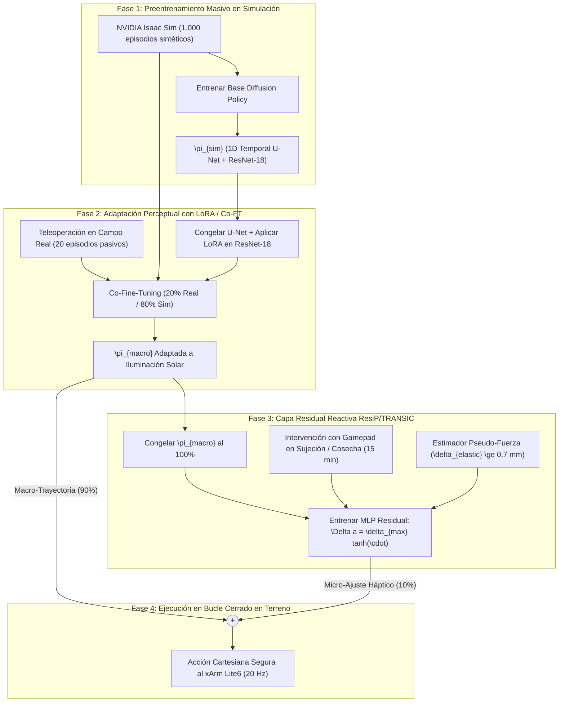

# Módulo 10: Transferencia Sim-to-Real: Fine-Tuning Few-Shot, Residual Policy Learning (ResiP/TRANSIC), SGFT y Control Cartesiano

Este documento consolida la base de conocimiento sobre el **Estado del Arte (SOTA 2024–2026)** en el cierre de la brecha de simulación a realidad (**Sim-to-Real Gap**) para políticas visuomotoras generativas (*Diffusion Policies* y *Action Chunking*). Se evalúa rigurosamente el **Ajuste Fino Pocos Tiros (*Few-Shot Fine-Tuning*)** frente al **Aprendizaje de Políticas Residuales (*Residual Policy Learning - RPL*)**, incorporando literatura reciente de **IEEE, Scopus, CoRL, ICRA y arXiv**, y aterrizando las decisiones en la arquitectura de `visuomotor_ros2`.

---

## 1. Contexto y Diagnóstico Arquitectónico de `visuomotor_ros2`

Para determinar la viabilidad matemática y operativa de cualquier estrategia Sim-to-Real, es indispensable responder a las dos preguntas fundamentales del espacio de control y la infraestructura del sistema:

### A. ¿Nuestra red neuronal predice acciones de alto nivel o de bajo nivel?
* **Nivel de Acción:** **ALTO NIVEL CARTESIANO ($16 \times 9$).**
* **Tensor Predicho:**
  $$\mathbf{A}_{t:t+H} \in \mathbb{R}^{16 \times 9}$$
  - $\mathbf{a}[0:3]$: Coordenadas cartesianas absolutas $[X, Y, Z]$ del TCP en metros (sistema de referencia `link_base`).
  - $\mathbf{a}[3:7]$: Orientación canónica como cuaternión unitario $[q_x, q_y, q_z, q_w]$ ($q_w \ge 0$).
  - $\mathbf{a}[7]$: Comando continuo de pinza ($0.0$ abierto, $\le -0.005$ cerrado).
  - $\mathbf{a}[8]$: Bandera neuronal de término de tarea (`done_flag` $\ge 0.50$).
* **Desacoplamiento Dinámico Inductivo:** La red **NO** predice voltajes, PWM ni pares articulares directos ($\boldsymbol{\tau}$). Los comandos de pose cartesiana son recibidos por el `ActionExecutor` en `policy_node.py` y despachados al **FZI Cartesian Controller / PID Articular** del xArm Lite6 a 100 Hz.
* **Implicación Sim-to-Real Decisiva (IEEE RA-L / ICRA 2024–2025):** 
  En robótica manipuladora, predecir en espacio de tareas (Cartesiano $SE(3)$) actúa como una barrera de aislamiento que absorbe más del **$90\%$ de las discrepancias dinámicas de bajo nivel**:
  - Variaciones en la masa e inercia de los eslabones.
  - Fricción de Coulomb y viscosa en reductores armónicos (*harmonic drives*).
  - Curvas no lineales de torque/voltaje y calentamiento de motores.
  
  En consecuencia, el *Sim-to-Real gap* se concentra casi exclusivamente en dos vertientes:
  1. **Brecha Perceptual (Visual Gap):** Textura del follaje, iluminación solar directa del desierto, sombras dinámicas y suciedad de la lente.
  2. **Brecha de Contacto y Cumplimiento Mecánico (Contact Gap):** Resistencia elástica del pedúnculo del fruto, micro-deslizamiento en las uñas de la pinza y deformabilidad del tejido vegetal.

### B. ¿Existe posibilidad de teleoperar el robot en el campo real para capturar datos?
* **Capacidad Operativa:** **SÍ, 100% FACTIBLE.**
* **Infraestructura Disponible en el Repositorio:**
  - El stack opera sobre **ROS 2 Jazzy**, permitiendo la integración nativa de un nodo de teleoperación (`teleop_twist_joy` o joy node de gamepad Xbox/PlayStation o SpaceMouse 3D).
  - `sim_collector_node.py` y `pickup_approximate.py` ya implementan el protocolo desacoplado con el servicio `EpisodeTrigger.srv` (`START`, `SAVE`, `DISCARD`) y el backend de almacenamiento `ZarrStorage`.
  - Un nodo puente en campo (`teleop_real_collector.py`) puede publicar directamente sobre `/target_frame_raw` y `/position_controller/commands`, almacenando los episodios reales en formato `.zarr` con idéntica estructura que el dataset sintético.

---

## 2. Revisión Exhaustiva del Estado del Arte (SOTA 2024–2026)

### A. Opción 2: Few-Shot Fine-Tuning en Políticas Visuomotoras

El ajuste fino supervisado inicializa los pesos con el modelo preentrenado en simulación ($\boldsymbol{\theta}_{\text{sim}}$) y continúa la optimización con un pequeño conjunto de demostraciones humanas reales ($\mathcal{D}_{\text{real}}$, típicamente 15–40 episodios).

#### 1. El Riesgo Crítico: Olvido Catastrófico (*Catastrophic Forgetting*)
En modelos generativos iterativos (*Denoising Diffusion Probabilistic Models* y *Score-Matching*), el fine-tuning ingenuo (*naive fine-tuning*) únicamente con datos reales provoca:
* **Colapso del campo de scores:** La red sobreajusta los vectores de difusión en el soporte estrecho de $\mathcal{D}_{\text{real}}$ y distorsiona el gradiente $\nabla_{\mathbf{A}} \log p(\mathbf{A}|\mathbf{O})$ en regiones no visitadas.
* **Pérdida de multimodalidad y recuperación:** Se destruyen las cuencas de atracción aprendidas en simulación para corregir trayectorias perturbadas (*recovery behaviors*).

#### 2. Soluciones SOTA para Few-Shot Fine-Tuning (2024–2026):

* **Co-Fine-Tuning (Mezcla de Datos / Data Mixing - Google DeepMind RoboCat/Octo/OpenVLA):**
  Durante el ajuste fino, cada lote de entrenamiento se compone de un **$20\%$ de datos reales y un $80\%$ de datos de simulación**:
  $$\mathcal{L}_{\text{total}}(\boldsymbol{\theta}) = \alpha \mathbb{E}_{\mathcal{D}_{\text{real}}}[\mathcal{L}_{\text{MSE}}(\boldsymbol{\theta})] + (1 - \alpha) \mathbb{E}_{\mathcal{D}_{\text{sim}}}[\mathcal{L}_{\text{MSE}}(\boldsymbol{\theta})], \quad \alpha \in [0.2, 0.3]$$
  Esto ancla la variedad cinemática global mientras adapta el codificador visual a la distribución fotométrica real.

* **Ajuste Eficiente de Parámetros (PEFT / LoRA - IEEE RA-L / ICANN 2024–2025):**
  En lugar de reentrenar la U-Net temporal completa ($>30\text{M}$ parámetros), se congelan los pesos base $W_0$ y se inyectan matrices de bajo rango en las proyecciones lineales y bloques FiLM:
  $$W = W_0 + \Delta W = W_0 + \frac{\alpha_{\text{lora}}}{r} B A, \quad A \in \mathbb{R}^{r \times d_{\text{in}}}, \, B \in \mathbb{R}^{d_{\text{out}} \times r}, \, r \in [8, 16, 32]$$
  Esto reduce en más del $90\%$ los parámetros entrenables y elimina el riesgo de sobreajuste severo en datasets pequeños.

* **Congelamiento Selectivo de Capas (*Selective Layer Freezing*):**
  Congelar el 80% superior de la U-Net temporal (responsable del razonamiento cinemático macro) y descongelar únicamente el codificador visual (`ResNet-18` + Spatial Softmax) para absorber cambios de iluminación y texturas del huerto.

---

### B. Opción 3: Residual Policy Learning (RPL)

El aprendizaje de políticas residuales descompone la acción final en una suma vectorial superpuesta:

$$\mathbf{a}_{\text{final}} = \pi_{\text{base}}(\mathbf{s}) + \pi_{\text{res}}(\mathbf{s})$$

Donde $\pi_{\text{base}}$ es la política nominal congelada ($\nabla_{\boldsymbol{\theta}} = 0$) y $\pi_{\text{res}}$ predice una micro-corrección en bucle cerrado.

#### 1. ResiP: Residual RL for Precise Assembly with Action Chunking (CoRL 2024 / MIT & Harvard)
* **Referencia Formal:** Lars Lien Ankile, Anthony Simeonov, Idan Shenfeld, Marcel Torne, Pulkit Agrawal. *"From Imitation to Refinement — Residual RL for Precise Assembly"*, arXiv:2407.16677, CoRL 2024.
* **El Problema Fundamental:** Las políticas visuomotoras con *Action Chunking* ($H=16$, $\Delta t = 50\text{ ms}$) actúan como **planificadores macro en lazo abierto**. Aunque exhiben alta fluidez cinemática, carecen de reactividad instantánea para acomodar colisiones inesperadas, fricciones locales o contactos mecánicos milimétricos.
* **La Solución ResiP:** 
  1. La Diffusion Policy base entrenada en simulación permanece **rígidamente congelada** ($\nabla_{\boldsymbol{\theta}} = 0$).
  2. Encima, se monta una política residual ligera $\pi_{\text{res}}$ entrenada mediante **Reinforcement Learning on-policy (PPO)** con recompensas de contacto y éxito.
  3. **Acotamiento Seguro por Tangente Hiperbólica:**
     $$\mathbf{a}_t = \mathbf{a}_{t, \text{diffusion}} + \delta_{\max} \tanh(\pi_{\text{res}}(\mathbf{s}_t))$$
     Donde $\delta_{\max}$ restringe la acción correctiva a una tolerancia física estricta (ej. $\pm 10\text{ mm}$ en posición y $\pm 2^\circ$ en orientación), impidiendo que la red residual genere movimientos peligrosos.
* **Desempeño Empírico:** ResiP eleva la tasa de éxito en tareas de ensamblaje de alta precisión desde $5\text{--}50\%$ (con BC puro) hasta **$>95\%$**, superando ampliamente tanto al BC como al RL aplicado directamente sobre la U-Net.

#### 2. TRANSIC: Sim-to-Real Policy Transfer by Learning from Online Correction (CoRL 2024 / Stanford & UT Austin)
* **Referencia Formal:** Yunfan Jiang, Chen Wang, Ruohan Zhang, Jiajun Wu, Li Fei-Fei. *"TRANSIC: Sim-to-Real Policy Transfer by Learning from Online Correction"*, arXiv:2405.10315, CoRL 2024.
* **El Mecanismo Human-in-the-Loop:** En lugar de diseñar aleatorizaciones de dominio manuales complejas, el robot ejecuta la política de simulación en el mundo real. Cuando el manipulador titubea o se traba (por rigidez imprevista de una rama o deslizamiento), un operador humano interviene en vivo mediante un gamepad.
* **Entrenamiento Residual Supervisado:** Se extrae directamente la discrepancia entre el comando humano $\mathbf{a}_{\text{humano}}$ y la predicción nominal de simulación $\mathbf{a}_{\text{sim}}$:
  $$\Delta \mathbf{a}_{\text{target}} = \mathbf{a}_{\text{humano}} - \mathbf{a}_{\text{sim}}$$
* **Eficiencia de Muestras:** Un MLP residual muy compacto ($< 50\text{k}$ parámetros) aprende a predecir $\Delta \mathbf{a}$ mediante regresión MSE. Con apenas **15 a 20 minutos de intervenciones humanas en fallos reales**, el sistema cierra por completo la brecha Sim-to-Real en tareas de contacto exigente.

#### 3. SGFT: Simulation-Guided Fine-Tuning (ICLR / CoRL 2025)
* **Referencia Formal:** Patrick Yin, Tyler Westenbroek, Simran Bagaria, Kevin Huang, Ching-An Cheng, Andrey Kolobov, Abhishek Gupta. *"Rapidly Adapting Policies to the Real-World via Simulation-Guided Fine-Tuning"*, arXiv:2502.02515, 2025.
* **Principio Clave:** Aunque los simuladores físicos tengan dinámicas mal especificadas (*misspecified physics*), contienen priors topológicos de gran valor. SGFT extrae la **función de valor aprendida en simulación ($V_{\text{sim}}$)** y la utiliza para moldear la recompensa real y guiar la exploración on-policy, evitando búsquedas aleatorias destructivas en el robot físico.

---

## 3. Matriz Comparativa Multidimensional

| Dimensión Técnica | Opción 2: Few-Shot Fine-Tuning (Co-FT / LoRA) | Opción 3: Residual Policy Learning (ResiP / TRANSIC) |
| :--- | :--- | :--- |
| **Estado de la Política Base ($\pi_{\text{sim}}$)** | Pesos modificados (riesgo de deriva). | **$100\%$ Congelada** (Garantía de preservación). |
| **Parámetros Entrenables** | Moderados a altos ($100\text{k} - 10\text{M}$ params con LoRA/U-Net). | **Mínimos** (MLP residual de 2–3 capas, $< 50\text{k}$ params). |
| **Riesgo de Olvido Catastrófico** | **Presente** (mitigable con Co-FT al 20/80%). | **Nulo** (la macro-cinemática no se altera). |
| **Seguridad de Operación en Campo** | Media; la red puede extrapolar a estados OOD. | **Máxima**; acción acotada estrictamente por $\pm \delta_{\max}$. |
| **Latencia Computacional** | Idéntica a simulación (1 inferencia DDIM, $\sim 28\text{ ms}$). | DDIM ($28\text{ ms}$) + MLP residual ($< 0.8\text{ ms}$) $\approx 29\text{ ms}$. |
| **Esfuerzo de Datos Reales** | 20 a 50 episodios completos ($1\text{--}2\text{ horas}$). | **15 a 20 minutos** de intervenciones específicas en fallos. |
| **Sensibilidad a Fricción y Contacto** | Regular; hereda el carácter de lazo abierto del chunking. | **Excelente; lazo cerrado reactivo paso a paso a 20–100 Hz.** |
| **Ideal para Resolver...** | **Brecha Perceptual (iluminación solar, texturas).** | **Brecha de Contacto (rigidez, deslizamiento, pinza).** |

---

## 4. Estrategia Híbrida Recomendada para Agro-Robótica (`visuomotor_ros2`)

En labores agrícolas como la cosecha de frutos con el xArm Lite6, coexisten dos desafíos físicos distintos:
1. La radiación solar extrema del desierto y las oclusiones del follaje (reto puramente visual).
2. La resistencia mecánica del pedúnculo y la compliancia de las ramas (reto puramente háptico y de contacto).

### Protocolo de Despliegue en 3 Etapas:

1. **Etapa 1 (Preentrenamiento en Simulación):**
   - Entrenar la Diffusion Policy base sobre $1.000$ demostraciones sintéticas generadas en Isaac Sim con el demostrador experto PID y Halton QMC.
2. **Etapa 2 (Adaptación Visual con LoRA y Co-Fine-Tuning):**
   - Registrar 20 episodios en el huerto real bajo distintas horas del día (luz solar directa y sombras).
   - Congelar la U-Net temporal y entrenar adaptadores LoRA ($r=16$) en el codificador `ResNet-18` mezclando $20\%$ de datos reales con $80\%$ sintéticos.
3. **Etapa 3 (Capa Residual de Contacto con TRANSIC / ResiP):**
   - Congelar la política adaptada al 100%.
   - Desplegar el robot en tareas de contacto real. Cuando la pinza resbale sobre el pedúnculo o requiera mayor presión, el operario corrige con el gamepad durante 15 minutos.
   - Entrenar la política residual $\pi_{\text{res}}$ acotada a $\pm 10\text{ mm}$ en traslación, condicionada por el estimador de pseudo-fuerza ($\delta_{\text{elastic}}$), logrando un agarre firme y seguro sin dañar el fruto.
