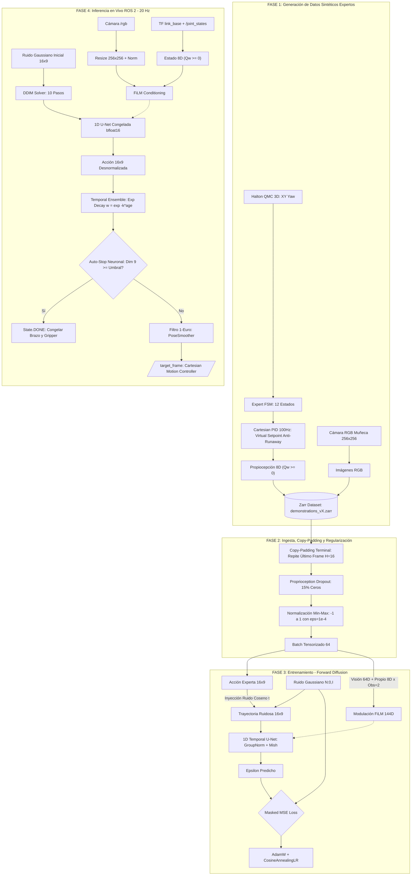

# Diffusion Policy Expert Knowledge Base

## 1. La Jerarquía Visuomotora (The Robotics AI Stack)
El ecosistema visuomotor opera en 6 capas rigurosamente desacopladas:

1. **El Dominio $\rightarrow$ Visuomotor Control:** Píxeles crudos directos a comandos de motores (End-to-End).
2. **La Metodología $\rightarrow$ Behavior Cloning (Imitation Learning):** Enseñar al robot copiando demostraciones de un maestro experto, sin funciones de recompensa manuales.
3. **El Paradigma Generativo $\rightarrow$ Diffusion Policy:** Usar modelos de difusión para mapear imágenes a distribuciones multimodales de trayectorias completas, evitando el promedio catastrófico de acciones.
4. **La Arquitectura (El Cerebro) $\rightarrow$ 1D Temporal U-Net + ResNet-18:**
   - **ResNet-18 + Spatial Softmax:** Extrae keypoints visuales métricos ($K=32 \rightarrow 64$ dimensiones latentes). Sustituye **siempre** `BatchNorm2d` por `GroupNorm(num_groups=C // 16)` para estabilizar el cálculo de medias/varianzas con batch sizes pequeños y evitar derivas en el decaimiento móvil exponencial (EMA).
   - **FiLM (Feature-wise Linear Modulation):** El vector de condicionamiento global ($\mathbf{cond} \in \mathbb{R}^{144}$ para $T_{obs}=2$) modula las activaciones intermedias temporales de la U-Net aplicando $\gamma(e) \cdot \text{GroupNorm}(h) + \beta(e)$ en cada bloque residual.
   - **1D Temporal U-Net vs DiT:** Para tareas continuas de *Pick&Place* con datasets de escala moderada (< 2,000 episodios), la CNN 1D es inmensamente superior: entrena en minutos/horas, converge a *Flat Minima* estables y no sufre el sobreajuste severo típico de los *Diffusion Transformers* (DiT).
5. **El Algoritmo (Motor Matemático) $\rightarrow$ DDIM (Denoising Diffusion Implicit Models):**
   - **Squared-Cosine Beta Schedule:** Curva no lineal que preserva la estructura de la trayectoria en los primeros niveles de ruido.
   - **Predicción $\epsilon$ (Epsilon):** La U-Net predice el ruido Gaussiano introducido, estabilizando la topología del gradiente frente a la predicción directa de $x_0$.
   - **Inferencia DDIM:** Comprime 100 pasos de difusión en **10 saltos deterministas** (~30 ms en GPU), logrando ciclos de control a 20 Hz.
6. **Estrategia de Ejecución $\rightarrow$ Receding Horizon Control (RHC) & ROS 2 Filtering:**
   - Predice un horizonte futuro de $H=16$ pasos.
   - **Temporal Ensemble:** Promedia bloques continuos superpuestos con decaimiento exponencial $w_j = \exp(-k \cdot j)$ para suavizado de alta fidelidad.
   - **Filtro 1-Euro Adaptativo:** Elimina micro-vibraciones de alta frecuencia en reposo sin añadir desfase temporal (*lag*) en tránsitos rápidos.

---

## 2. Pipeline Completo del Sistema



---

## 3. Diagnóstico de Entrenamiento y Convergencia (*Flat Minima*)

### El Fenómeno del "Flat Minima" y la Oscilación de Pérdida
En políticas visuomotoras continuas basadas en difusión:
* **El MSE Loss NUNCA desciende a 0.0:** Debido a la naturaleza estocástica del ruido forward inyectado, el loss MSE converge típicamente a una meseta oscilante entre `0.003` y `0.008`.
* **Criterio de Parada Temprana:** Al estabilizarse en esta meseta durante varias decenas de épocas, el entrenamiento **debe detenerse**. Extender el entrenamiento con el objetivo de reducir el loss a mínimos extremos provoca sobreajuste a *Sharp Minima*, destruyendo la capacidad del modelo para generalizar ante variaciones visuales y de postura.
* **Tasa de Aprendizaje y Escala de Lote:**
  $$\text{lr} = 1.0 \times 10^{-4} \cdot \sqrt{\frac{\text{batch\_size}}{64}}$$
  El uso de `AdamW` (`weight_decay = 1e-6`) con `CosineAnnealingLR` garantiza una navegación suave en la meseta de mínimos planos.

---

## 4. Técnicas Clave de Robustez y Anti-Overfitting

### A. Proprioception Dropout (15%)
* **Problema:** Un modelo que recibe la propiocepción $[X, Y, Z, q_x, q_y, q_z, q_w]$ en todo momento tiende a aprender trayectorias en lazo abierto (*blind dead-reckoning*), ignorando las imágenes de la cámara.
* **Técnica:** En `zarr_dataset.py`, aplicar aleatoriamente con un 15% de probabilidad:
  ```python
  if torch.rand(1).item() < 0.15:
      state = torch.zeros_like(state)
  ```
  Esto fuerza al encoder visual (ResNet-18 + SpatialSoftmax) a guiar activamente el efector final basándose en la retroalimentación visual en vivo.

### B. Corrección de Semiesfera y Doble Cubierta de Cuaterniones (*Double Cover*)
* **Propiedad de $SO(3)$:** Los cuaterniones $q$ y $-q$ representan exactamente la misma orientación física tridimensional. Sin embargo, para una red neuronal convolucional o una función de pérdida L2, predecir $-q$ cuando la meta está en $q$ produce un gradiente enorme y destructivo que atraviesa el origen $\|q\| \rightarrow 0$.
* **Regla Inviolable:** Forzar siempre que la componente escalar de los cuaterniones en la observación y acciones pertenezca a la semiesfera superior:
  ```python
  if q[3] < 0.0:
      q = -q
  ```
  En interpolaciones SLERP del generador sintético:
  ```python
  dot = np.sum(q1 * q2)
  if dot < 0.0:
      q1 = -q1
      dot = -dot
  ```

### C. Freno Dinámico en Z (Prevención de Desenfoque Óptico)
* Movimientos rápidos de rotación del gripper combinados con descensos bruscos provocan *Motion Blur* severo en la cámara de muñeca, degradando las activaciones del ResNet.
* **Solución:** Incluir un multiplicador de "velocidad tortuga" (`turtle_descent_multiplier: 0.15`) y modular la velocidad de descenso en $Z$ de forma inversamente proporcional al error angular pendiente.

---

## 5. Modelado de Fin de Tarea (Auto-Stop) y Reglas de Tensores

### A. Especificación Formal de Tensores
* **Observación (`observation.state`) — 8 Dimensiones:**
  Modela magnitudes físicas medidas por hardware en el instante $t$:
  `[X, Y, Z, Qx, Qy, Qz, Qw, Gripper_Actual]` (con $Q_w \ge 0$).
* **Acción (`action`) — 9 Dimensiones:**
  Modela la trayectoria futura predicha para los siguientes 16 timesteps:
  `[Target_X, Target_Y, Target_Z, Target_Qx, Target_Qy, Target_Qz, Target_Qw, Target_Gripper, Done_Flag]`
  - Dimensión 8 (`Done_Flag`): Probabilidad continua $[0, 1]$ de finalización de tarea.

### B. Regla Fundamental: Prohibición de Fuga Causal (*Causal Leakage*)
> [!CRITICAL]
> **La señal de parada (`done`) JAMÁS debe formar parte de la observación `observation.state`.**
* La señal de parada es una **decisión cognitiva de salida**, no un sensor físico de entrada. Si entra a la observación, se crea una dependencia circular en inferencia donde el nodo requeriría un oráculo externo para saber qué alimentar a la red, y la red colapsaría aprendiendo simplemente a copiar la entrada a la salida.

### C. El Bug del Recorte del Horizonte (*Horizon Truncation Bug*) y Solución Copy-Padding
* **El Problema:** Al predecir $H=16$ pasos futuros, un dataloader ingenuo descarta los últimos 16 frames de cada demostración para evitar indexar fuera del array. Si el fin de la tarea se grabó en los últimos frames, el modelo entrena con un $100\%$ de muestras con `done = 0.0`.
* **Solución Mandatoria (*Copy-Padding*):** Replicar el último vector de acción terminal (que contiene la pose final y `done = 1.0`) hasta completar los 16 pasos:
  ```python
  pad_len = self.h_act - actual_len
  pad_actions = np.repeat(actual_actions[-1:], pad_len, axis=0)
  actions = np.concatenate([actual_actions, pad_actions], axis=0)
  ```
  Esto enseña a la red a detenerse y permanecer estática en destino cuando la imagen confirma el éxito.

### D. Doble Capa de Auto-Stop Desacoplado en Inferencia
1. **Auto-Stop Neuronal (Primario):**
   - Parámetros: `enable_neural_auto_stop: true`, `neural_auto_stop_threshold: 0.05` a `0.50`.
   - Se activa cuando $\text{action}[0, 8] \ge \text{umbral}$.
   - Pasa inmediatamente a `State.DONE`, congela el brazo y retiene el gripper.
2. **Auto-Stop Heurístico (Respaldo):**
   - Parámetros: `enable_heuristic_auto_stop: false`, `auto_stop_variance_threshold: 1.0e-7`, `auto_stop_patience_steps: 20`.
   - Monitorea la varianza cartesiana 3D en ventana deslizante; si el robot permanece quieto durante la ventana de paciencia, asume finalización asintótica.

---

## 6. Pipeline de Suavizado y Ejecución Cinemática en Tiempo Real

Para mitigar el jitter sin retrasar la respuesta:
1. **Capa 1: Temporal Ensemble (Receding Horizon):**
   Combina predicciones solapadas mediante decaimiento exponencial:
   $$w_j = \exp(-k \cdot j)$$
   $$\bar{A}_t = \frac{\sum_j w_j A_t^{(j)}}{\sum_j w_j}$$
   Con $k = 0.0$ (promedio plano, máxima suavidad) o $k = 0.01$ (SOTA).
2. **Capa 2: Filtro 1-Euro Adaptativo (`pose_smoother.py`):**
   Modula la frecuencia de corte según la velocidad del efector:
   $$f_c = f_{c,\min} + \beta \|\hat{\dot{x}}\|$$
   - Aplica desenvolvimiento angular de Euler (`np.unwrap`) en cuaterniones para evitar discontinuidades en $\pm\pi$.
   - Timeout de 0.5 s para resetear memorias si la inferencia se suspende.
3. **Capa 3: Publicación Unidimensional del Gripper:**
   El controlador en simulación espera un `Float64MultiArray` con **estrictamente 1 elemento** `[pos]`. Publicar arreglos bidimensionales produce el rechazo silencioso de la orden.

---

## 7. El Paradigma Dual: Diffusion Policy vs. RL Fine-Tuning (DPPO)

En robótica visuomotora generativa, no se debe confundir el aprendizaje por refuerzo con un explorador de espacio abierto desde cero:

1. **Diffusion Policy (Behavior Cloning):**
   - Modela la distribución multimodal global $p(A_{t:t+H} \mid O_t)$ a partir de las demostraciones expertas.
   - Es el responsable de la navegación global, el acercamiento macro y la cobertura espacial aprendida por el generador Halton Quasi-Monte Carlo.
2. **DPPO (RL Fine-Tuning):**
   - Opera como un **optimizador local fino (*micro-tuning*)** sobre la cadena de difusión inversa.
   - Su objetivo científico es mitigar el *covariate shift*, absorber micro-deslizamientos durante el contacto físico y calibrar el instante exacto de detención del auto-stop neuronal (`done_flag`).
3. **Calibración Empírica del Pseudo-Sensor de Contacto:**
   - Para evitar falsos positivos o negativos al validar el agarre, la discrepancia elástica $\delta = p_{\text{medida}} - p_{\text{cmd}}$ se calibra empíricamente:
     - En vacío: $\delta = 0.0000\text{ m}$.
     - Con objeto rígido: $\delta = +0.0014\text{ m}$ ($1.4\text{ mm}$).
     - Umbral óptimo de decisión: $\theta = 0.0007\text{ m}$ ($0.7\text{ mm}$).
   - En vuelo libre ($\Delta z \ge 8\text{ cm}$ con orden de cierre activa), el agarre se certifica incondicionalmente para evitar falsos descartes provocados por oscilaciones inerciales.
4. **Sincronización Determinista de Respawn en Simulador:**
   - Para invalidar el filtro de caché en nodos Script de OmniGraph (`last_lin_processed`), el reset debe inyectar un **pulso bifásico con micro-jitter** ($Z+4\text{ cm}$, $\pm 0.5\text{ mm}$) seguido del pulso en cota de mesa.
   - Requiere $2.0\text{ s}$ de retención gravitacional en Home con pinza abierta y purgado de semáforo de cámara antes de computar acciones de RL.

---

## 8. Eje de Demostradores Expertos y Controladores SOTA (MPC, cuRobo, CRISP)

El rendimiento final de la política visuomotora depende fuertemente de la calidad de las demostraciones y del controlador de bajo nivel:

1. **Demostrador Experto Piloto (PID Cartesiano):**
   - Sirve como prueba de concepto para recolectar datos rápidamente (`pickup_approximate.py`), pero adolece de rigidez ante colisiones y posibles sobreimpulsos.
2. **Demostradores Expertos SOTA para Generación de Datasets:**
   - **Model Predictive Control (cuRobo GPU MPC):** Optimización cinemática acelerada en GPU sujeta a restricciones de barrera, suavidad y evasión de singularidades.
   - **Cartesian Impedance Control (CRISP):** Framework en `ros2_control` para acoplar la inferencia de políticas de aprendizaje con control de rigidez ($K$) y amortiguamiento ($D$) compliante a $1\text{ kHz}$.
3. **Diseño Factorial para Publicaciones Científicas:**
   - Se debe cruzar sistemáticamente:
     $$\text{Dataset}(D_{\text{PID}}, D_{\text{MPC}}, D_{\text{CIC}}) \times \text{Modelo}(\text{Solo DP}, \text{DP + RL})$$
     Permitiendo aislar qué porcentaje de la precisión y robustez proviene de la red generativa frente al controlador de ejecución.

---

## 9. Estándar de Logging y Benchmarking Científico Off-ROS

Todo código dentro de `visuomotor_core` debe implementar:
1. `configure_logging(level=logging.DEBUG, log_file=...)`: Integración con `coloredlogs`, resolución en milisegundos, identificación de hilos de DataLoaders y supresión de librerías externas.
2. `@contextmanager def benchmark(operation_name, log, track_gpu=True)`: Monitoreo con `time.perf_counter_ns()`, formateo con `humanize` y reporte de pico de memoria VRAM GPU (`torch.cuda.max_memory_allocated()`).
3. Cero llamadas a `print()` en bucles de entrenamiento y estricta ausencia de dependencias de ROS (`rclpy`) en el núcleo de Deep Learning.

---

## 10. Evolución hacia Visión 3D: Principios y Patrones de 3D Diffusion Policy (DP3)

Para superar la limitación de extrapolación plana de los modelos 2D (que requieren cientos de demostraciones), la arquitectura **DP3** (Ze et al., 2024) establece los siguientes patrones de diseño:

1. **Representación por Nubes de Puntos Dispersas:**
   - Desproyección de mapas de profundidad a coordenadas cartesianas mediante la matriz intrínseca $K$ de la cámara.
   - **Workspace Bounding Box Cropping:** Recorte estricto del volumen de la mesa ($X, Y, Z$). Omitir este recorte reduce la tasa de éxito de $78.3\%$ a $45.3\%$.
   - **Farthest Point Sampling (FPS):** Reducción determinista a $512$ o $1024$ puntos geométricos.
   - **Supresión de Canales RGB:** Procesar únicamente $(X, Y, Z)$ desvincula la política de texturas y colores, otorgando invarianza de apariencia inmediata.

2. **Arquitectura del `DP3Encoder` (Por Qué PointNet Clásico Falla):**
   - El PointNet estándar (con T-Net y `BatchNorm`) colapsa en control continuo ($15.7\%$ de éxito).
   - La eliminación de T-Net y `BatchNorm`, sustituidos por `LayerNorm` en un MLP de 3 etapas con proyección latente a 64D, eleva el éxito al **$78.3\%$**:
     ```python
     Linear(3, 64) -> LayerNorm -> ReLU ->
     Linear(64, 128) -> LayerNorm -> ReLU ->
     Linear(128, 256) -> LayerNorm -> ReLU ->
     max_pool(dim=1) -> Linear(256, 64) -> LayerNorm(64)
     ```
3. **Predicción de Muestra ($x_0$-prediction) vs. Ruido ($\epsilon$-prediction):**
   - En espacios de acción continuos ($16 \times 9$), predecir directamente la trayectoria limpia desruidizada $A^0$ en el solver DDIM converge significativamente más rápido que predecir el ruido residual $\epsilon$.
4. **Simple DP3 para Inferencia de Alta Velocidad (25.3 FPS):**
   - Poda de canales internos en la U-Net temporal 1D que duplica la frecuencia de ejecución ($12.7 \to 25.3\text{ FPS}$) preservando más del $95\%$ del desempeño.
