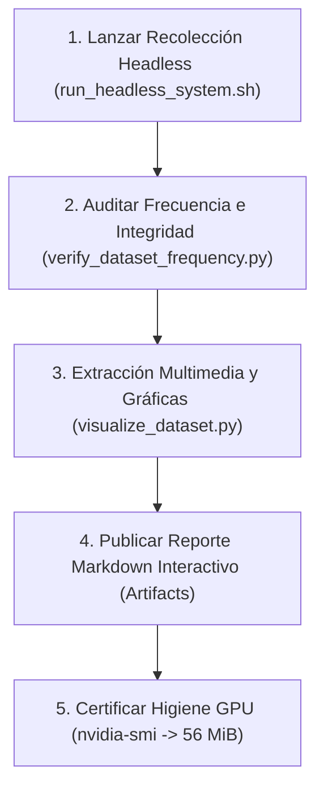

# Skill: Headless Experimentation and Dataset Collection Workflow (v1.0)

Esta habilidad proporciona el procedimiento estandarizado, reproducible y libre de fallos para ejecutar el ciclo de vida completo de recolección de demostraciones expertas, auditoría cinemática y visualización multimedia sobre **NVIDIA Isaac Sim Headless y ROS 2 Jazzy**.

---

## 1. Cuándo Activar esta Habilidad

- Cuando el usuario solicite recolectar un nuevo dataset de demostraciones (ej. `demonstrations_vX.zarr`) o probar calibraciones del generador experto.
- Cuando se requiera validar empíricamente la frecuencia de muestreo ($dt = 50\text{ ms}$, $20\text{ Hz}$) y las velocidades cartesianas máximas.
- Para inspeccionar visualmente demostraciones recién grabadas sin necesidad de abrir la GUI pesada de Isaac Sim.
- Cuando se invoque el comando `/workflow-skill-creator` o se necesite estandarizar una campaña de recolección para papers científicos o entregables.

---

## 2. Parámetros Calibrados Óptimos (Garantías de Producción)

Para garantizar un ciclo de recolección veloz (~56 s de pared por episodio) con física estable y sin falsos positivos de auto-stop:

| Parámetro | Valor Calibrado | Archivo de Configuración | Función |
| :--- | :---: | :--- | :--- |
| `max_speed_m_s` | **`0.20`** | `data_collection_params.yaml` | Frontera Pareto óptima: previene oscilaciones en `ALIGN_ROTATION` y amortigua el contacto en `SETTLE`. |
| `wait_time_s` | **`0.8`** | `data_collection_params.yaml` | $0.3\text{ s}$ de estabilización Halton + $0.5\text{ s}$ de reposo estático en Home. |
| `reset_joints_duration_s` | **`1.5`** | `data_collection_params.yaml` | Retorno continuo y suave a Home sin tirones articulares. |
| `settle_time_s` | **`0.1`** | `data_collection_params.yaml` | Transición cuasi-instantánea a cierre de mordazas tras descender. |
| `hold_target_time_s` | **`2.0`** | `data_collection_params.yaml` | **Piso garantizado exacto de 40 frames continuos con `done_flag = 1.0` a 20 Hz.** |

> [!WARNING]
> **Realidad de `frameSkipCount` en Isaac Sim 6.0:**
> El atributo `inputs:frameSkipCount` de `OgnROS2CameraHelper` está **deprecado** y no evita pasadas de GPU en Hydra (solo descarta la publicación en CycloneDDS). La aceleración del simulador ($0.33\times$ RTF) proviene estrictamente del modo headless, Real-Time 2.0 (RTPT), DLSS Performance, Eco Mode y el reajuste dinámico de `RenderProduct` a $256 \times 256$ en memoria RAM.

---

## 3. Flujo Operativo Estandarizado (5 Pasos)



### Paso 1: Lanzamiento de Recolección Headless
Ejecutar desde el host el orquestador maestro con el número de episodios deseado y la ruta del dataset Zarr:

```bash
./tools/sim/run_headless_system.sh collect --episodes 10 --dataset datasets/demonstrations_v8.zarr
```
- El script inicializa automáticamente Isaac Sim Headless en `isaac-sim-6.0-wayland` si no está corriendo.
- Inyecta en RAM el grafo `/ClockGraph` y reajusta la cámara `/rgb` a $256 \times 256$.
- Lanza `lite6_cartesian` y `pickup_approximate_node`.
- Al terminar la cuota de episodios, detiene los nodos ROS 2 y la simulación, liberando la VRAM automáticamente.

### Paso 2: Auditoría de Frecuencia Temporal e Integridad
Verificar que la frecuencia de muestreo se mantuvo estrictamente en $20\text{ Hz}$ ($dt = 0.050\text{ s} \pm 0.005$) y que las velocidades respetan la cota física:

```bash
docker exec -u 1000:1000 -w /ros visuomotor_ros2 python3 tools/verify_dataset_frequency.py \
    --dataset datasets/demonstrations_v8.zarr \
    --out-plot datasets/visualizations_v8/frequency_verification.png
```

### Paso 3: Extracción Multimedia y Gráficas de 4 Canales
Extraer videos y curvas de telemetría de todos los episodios:

```bash
docker exec -u 1000:1000 -w /ros visuomotor_ros2 python3 tools/visualize_dataset.py \
    --dataset datasets/demonstrations_v8.zarr \
    --out-dir datasets/visualizations_v8 \
    --save-video \
    --save-plots \
    --save-gif \
    --h264
```
- Genera `episode_X.mp4` (original) y `episode_X_h264.mp4` (compatible con navegadores web).
- Genera `episode_X.gif` (submuestreado a 10 fps) para visualización inmediata en carruseles markdown.
- Genera `episode_X_trajectory.png` con 4 canales: XYZ medido vs acción, cuaternión de orientación, comando vs estado de pinza, y la 9ª dimensión `done_flag`.

### Paso 4: Generación de Reporte Interactivo en Markdown
Copiar los recursos a la carpeta de artefactos de Antigravity (`<appDataDir>/brain/<conversation-id>/`) y generar un documento `.md` que contenga:
- Tabla resumen cuantitativa (pasos, duración simulación, duración reloj de pared, Z inicial/final, piso `done=1.0`).
- Carrusel de animaciones GIF y gráficas de trayectoria.
- Enlaces a los archivos fuente MP4 H.264.

### Paso 5: Certificación de Higiene de Recursos GPU
Confirmar que no quedaron procesos colgados (`kit`, `python3`, `ros2_control_node`):

```bash
nvidia-smi --query-compute-apps=pid,process_name,used_memory --format=csv
```
La salida esperada debe mostrar 0 procesos de cómputo y la VRAM en estado base (~56 MiB).

---

## 4. Comandos de Referencia Rápida

```bash
# Recolección rápida de prueba (ej. 4 episodios a 0.20 m/s)
./tools/sim/run_headless_system.sh collect --episodes 4 --dataset datasets/demonstrations_test.zarr

# Recolección masiva de producción (100 episodios)
./tools/sim/run_headless_system.sh collect --episodes 100 --dataset datasets/demonstrations_v8.zarr

# Detener de inmediato cualquier proceso colgado y liberar VRAM
./tools/sim/run_headless_system.sh stop

# Visualizar e inspeccionar cualquier dataset Zarr existente
docker exec -u 1000:1000 -w /ros visuomotor_ros2 python3 tools/visualize_dataset.py \
    --dataset datasets/demonstrations_v8.zarr \
    --out-dir datasets/visualizations_v8 \
    --save-gif --h264
```
