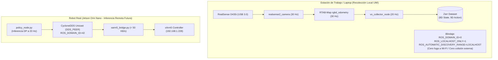

# Skill: RealSense VIO & UMI Handheld Data Collection (v1.5)

Esta habilidad proporciona el procedimiento estandarizado para capturar demostraciones expertas a mano alzada en hardware real mediante Odometría Visual-Inercial (VIO) con cámaras Intel RealSense (D435i / D415) y RTAB-Map sobre ROS 2 Jazzy, bajo el estándar **UMI** (*Universal Manipulation Interface*, Stanford / TRI).

---

## 1. Cuándo Activar esta Habilidad

* Al capturar demostraciones expertas reales para entrenar o evaluar políticas visuomotoras (Diffusion Policy).
* Al medir la precisión del sistema de odometría (contra una referencia: xArm5 o tablero ChArUco; el retorno a la marca solo es un chequeo rápido).
* Al aumentar o continuar grabando episodios sobre un dataset Zarr existente (ej. `demonstrations_real_v5.zarr`).
* Al configurar la topología de red para evitar interferencias con otros equipos ROS 2 o preparar el enlace remoto con la Jetson Orin.

---

## 2. Parámetros de Calidad y Criterios de Aceptación (Grado UMI)

> [!CAUTION]
> **Revisión del 2026-11-23:** la odometría de la D435i NO está certificada. Las cifras "certificadas" de versiones
> anteriores eran el mejor de 9 intentos. La grabación v7 tiene poses nulas guardadas como poses, 784
> discontinuidades > 2 cm y ningún sello de tiempo (`.agents/knowledge/15_visual_odometry_rtabmap_realsense.md` §0,
> `context.md` lección 43). Plan de mejora: `docs/plans/plan_d435i_herramienta_demostraciones.md`.

| Métrica | Criterio | Estado real (medido) | Estado |
| :--- | :--- | :--- | :--- |
| **Retorno a la marca** (`run_benchmark.sh`) | Solo chequeo rápido: no mide trayectoria ni escala | Conf 4, 9 corridas: mediana 21.6 mm, 1/9 ≤ 3 mm | **No sirve como certificación** |
| **Jitter en reposo** | $\le 2.50\text{ mm}$ | Mediana 3.0 mm (1.6–6.1) en las 9 corridas | **No cumple en la mayoría** |
| **Precisión en movimiento** (ATE/RPE/escala contra el xArm5 o un ChArUco) | Mediana ATE ≤ 5 mm, p90 ≤ 10 mm (propuesto) | Nunca medida | **Pendiente** |
| **Pérdida de rastreo** | 0 frames perdidos o nulos en episodios guardados | v7: 4 poses nulas guardadas como poses (ep. 23 y 24) | **No cumple** |
| **Frecuencia de muestreo** | Sello de tiempo por frame, 50 ± 2 ms | Sin sellos: no verificable | **No verificable** |
| **Etiqueta done** | Frames done estáticos | 72/83 episodios solo con el piso forzado; ~21 % de frames done en movimiento | **No cumple** |
| **Compatibilidad xArm5** (si el dataset se entrenará para el robot real) | 0 episodios marcados en `_conversion_report.json` (o excluidos con `--drop-flagged`) | `tools/xarm5/convert_vio_dataset_to_xarm5.py` | Obligatorio |
| **Auditoría física** (dataset para el xArm5) | Gravedad del VIO vs. HOME3 < 20° en la mayoría de episodios con la extrínseca configurada; 0 saltos de signo del cuaternión; ruido eliminado por el filtro < 10 mm RMS | `tools/xarm5/analyze_vio_dataset_quality.py` (v7: 13.4° mediana, 0 saltos, 8.8 mm) | Obligatorio |
| **Alcance del brazo** (dataset para el xArm5) | 0 frames fuera del alcance del puente (muñeca a ≤ `workspace_max_reach_m` del hombro) y 0 fuera de la caja configurada | `tools/xarm5/analyze_xarm5_workspace.py` (v7: 0.9 % y 1.4 %) | Obligatorio |

> [!WARNING]
> La integridad de tensores y la frecuencia de 20 Hz no certifican la física. `demonstrations_real_v7_xarm5.zarr` pasó
> esa "certificación" con la cámara invertida 180°, 1015 saltos de signo del cuaternión y velocidades infladas 4x por el
> ruido (ver `.agents/knowledge/17_real_vio_dataset_curation_and_relative_actions.md`).

---

## 3. Protocolo Operativo Paso a Paso

### Paso 1: Lanzar el Contenedor y Stream VIO Blindado (Terminal 1)
El lanzador confina el flujo de datos pesados de la cámara ($46\text{ MB/s}$) a la memoria compartida local mediante `ROS_LOCALHOST_ONLY=1` y `ROS_AUTOMATIC_DISCOVERY_RANGE=LOCALHOST` bajo `ROS_DOMAIN_ID=0`, garantizando que ninguna otra máquina con ROS 2 en la red Wi-Fi o LAN pueda colisionar con los tópicos:

```bash
# Lanzar stream VIO en background/foreground (sin GUI para máxima eficiencia):
./tools/hardware/run_vo_container.sh ros2 launch visuomotor_bringup realsense_d435i_vio.launch.py gui:=false

# Opcional (con visor 3D RViz2 para inspección visual):
./tools/hardware/run_vo_container.sh ros2 launch visuomotor_bringup realsense_d435i_vio.launch.py gui:=true
```

### Paso 2: Chequeo rápido de la odometría (Terminal 2)
Es un chequeo rápido, no una certificación: el retorno a la marca no mide la trayectoria ni la escala (ver la tabla
de §2). Sirve para detectar una configuración rota antes de grabar:
```bash
./tools/hardware/run_benchmark.sh "conf 4"
```
* **Protocolo:**
  1. Apoyar la cámara en la marca física de inicio y pulsar `[ENTER]`.
  2. Desplazar la cámara a mano alzada ($> 30\text{ cm}$) simulando la trayectoria.
  3. Regresar la cámara exactamente a la marca inicial y pulsar `[ENTER]`.
  4. Comparar el error de retorno con la distribución de §2 (mediana ~22 mm). Un valor muy superior indica una
     configuración rota; un valor bajo NO certifica la precisión.

### Paso 3: Recolección Interactiva de Demostraciones (Terminal 2)
El script [`tools/hardware/run_data_collection.sh`](file:///home/hackbrian/Documents/gits/visuomotor_ros2/tools/hardware/run_data_collection.sh) gestiona automáticamente la ruta y la indexación:

#### Modalidad A: Crear automáticamente una nueva versión incremental
```bash
./tools/hardware/run_data_collection.sh
# Crea automáticamente datasets/demonstrations_real_vX.zarr (ej. v6)
```

#### Modalidad B: Continuar aumentando un dataset específico existente
```bash
./tools/hardware/run_data_collection.sh demonstrations_real_v5
# Detecta episodios previos (ej. 8) y anexa consecutivamente desde episode_8
```

---

## 3b. Restricciones para Demostraciones Destinadas al xArm5 (5 GDL)

La política se ejecuta en un UFACTORY xArm5: lo demostrado debe ser ejecutable por él (ver
`.agents/knowledge/16_xarm5_real_hardware_bringup.md`, §5m–5p).

1. **Inicio = HOME3 (pose de trabajo, redefinida el 2026-11-20).** Cada episodio empieza con la cámara en la pose que
   tendría montada en la muñeca del brazo en HOME3, con la misma disposición de la escena.
   - TCP (brida) en `link_base`, según el controlador: (0.150, 0.005, 0.750) m, rpy (3.102, −0.430, −0.011). Es decir,
     muy alto sobre la base (75 cm) y con la garra inclinada ~−24.6° en el plano del brazo (punta hacia fuera).
   - Juntas: [0.05, −41.99, −92.46, 109.92, 1.53]°; menú RViz2 *Go to HOME3*.
   - El primer frame se mapea a `home_x/y/z/roll/pitch/yaw` de `deploy/jetson/config/jetson_policy_params.yaml`. Si se
     redefine HOME3, actualizar allí y reconvertir.
2. **Orientación:** la garra debe estar vertical o inclinada solo en el plano vertical que contiene a la base del brazo
   (hacia la base o alejándose), hasta ±85°. Nunca debe inclinarse lateralmente (roll): el xArm5 no puede ejecutarlo;
   se proyecta y el episodio se marca si la desviación supera `max_orientation_deviation_rad` de
   `xarm5_dataset_alignment.yaml` (0.70 rad desde la Fase 22).
3. **Volumen alcanzable** (distinguir el brazo de la caja de seguridad; `tools/xarm5/analyze_xarm5_workspace.py`):
   - **Brazo** (Hardware Manual v2.7.1, XF1305, en `bio/xarm5_ufactory_XF1305/`): 700 mm de radio alrededor del eje de
     la base, a la altura del hombro (0.267 m). A la altura de aproximación de v7 (brida ~0.28 m, garra vertical) el
     alcance lateral es ±0.47 m a la profundidad de los objetos (aproximadamente √(R² − x²)).
   - **Caja de seguridad del puente** (`xarm5_real_params.yaml`): radio 0.15–0.65 m y |y| ≤ 0.30 m. Es una decisión de la
     celda: respetarla al grabar o ampliarla ANTES, tras medir la celda (con ±0.45 m ningún frame v7 queda fuera).
   - La altura máxima baja con la distancia: 0.75 m cerca de la base, 0.71 m a 0.35 m, 0.61 m a 0.50 m y 0.37 m a 0.65 m.
   - HOME3 ya está en el techo (z = 0.75) y en el radio mínimo (x = 0.15): desde ahí la demostración solo puede bajar o
     alejarse.
4. **Velocidad:** ≤ 5 cm/s y ≤ 0.5 rad/s (límites actuales de `xarm5_bridge`). Si se demuestra más rápido, el robot
   ejecuta más lento que lo aprendido; subir antes los límites del puente y reconvertir.
5. **Montaje:** el mismo soporte de cámara en la mano y en la muñeca del robot (extrínseca cámara→TCP en
   `visuomotor_bringup/config/xarm5/xarm5_dataset_alignment.yaml`, medir y poner `extrinsic_calibrated: true`).
6. **Gripper:** `0.0` si no se registra (`[G]` para alternar).

---

## 3c. Protocolo de Grabación para el xArm5 (lecciones de `demonstrations_real_v7`)

1. **Reiniciar la odometría al inicio de cada episodio** (o registrar la IMU cruda). Hoy `odom` persiste durante toda
   la sesión y su vertical deriva hasta 50-60° (medido con los ArUco de la mesa); solo el movimiento relativo dentro del
   episodio es fiable, y el conversor ya lo usa así.
2. **Sostener la cámara derecha:** arriba de la imagen = lejos de la base, igual que montada en la brida en HOME3
   (`tcp_to_camera_rpy_rad: [pi, -pi/2, 0]`). Empezar con la inclinación de HOME3 (~25° de la vertical); en v7 la media
   medida fue 32° ± 6°.
3. **No girar la muñeca más de ±140°:** el yaw del puente está acotado a ±2.6 rad y los giros de ~180° se convierten en
   saltos; en v7 se descartaron 5 episodios por eso.
4. **Velocidad real:** ~0.05 m/s es compatible con el puente. Los "0.20 m/s" que daba el dataset sin filtrar eran ruido
   del VIO (~8.8 mm RMS), no la velocidad de la mano.
5. **Tracking:** si la vista pierde textura (saltos > 0.15 m entre frames), descartar con `[D]` en vez de guardar.
6. **Desde HOME3, bajar antes de alejarse de la base.** Avanzar en alto saca la muñeca de alcance: 209 frames de
   5 episodios v7, hasta 51 mm. El puente recortaría esos tramos y el robot se separaría de la demostración al arrancar.
7. **Repartir los objetos con una grilla planificada:** a ambos lados de la base y en varias profundidades. En v7 la
   media lateral quedó 10 cm a un lado, y desde el reposo ir siempre hacia la dirección media ya acertaba el 55 % (la
   política, el 64 %): con poca variedad de destinos la política apenas aprende a usar la imagen para elegir hacia dónde ir.

---

## 4. Controles Durante la Recolección Interactiva (recolector v3, 2026-11-24; v2 del 2026-11-23)

**v3: empezar en la vista de HOME3.** La política arranca en el robot siempre desde la misma vista. Las demos v7
empezaban dispersas (escala 0,88–1,26 y hasta ~80 px de corrimiento).
* **La guía:**
  - Compara los ArUco de la mesa con `visuomotor_bringup/config/realsense/home3_view_reference.yaml`, generado
    desde las imágenes del robot en HOME3.
  - Ver la guía en vivo: `ros2 run rqt_image_view rqt_image_view /vo_collector_node/start_guide`. En verde, dónde
    deben quedar los marcadores; en naranja, dónde están.
  - La terminal imprime el error y las pistas.
* **`[ESPACIO]`** solo empieza con la vista alineada (`start_guide_tolerance_px`, 8 px a 640×480). **`[I]`** empieza
  igual y queda registrado en `start_view.override`.
* **Opcionales:**
  - `auto_start` empieza solo cuando la vista lleva 1 s alineada y quieta, porque tocar el teclado mueve la cámara.
  - `auto_save` guarda cuando la cámara ya se alejó del inicio y lleva quieta al final 2 s + margen. Con `auto_save`
    no hacer pausas largas a mitad de camino.
* **Llegada:** la herramienta centrada y llenando el recuadro central de la imagen de guía, siempre a la misma vista.
  En v7 la altura de parada variaba ±7 cm y la red no reconoció el final en el intento 12.
* **Velocidad:** aviso por encima de `max_demo_speed_m_s` (0,15 m/s); la máxima y la media quedan en los atributos.
* **Programa (`schedule_file`):**
  - Generarlo con `tools/hardware/make_collection_schedule.py`: celdas 1–9 × orientaciones, en orden aleatorio.
  - Las celdas siguen el teclado numérico visto en la imagen de HOME3: 7-8-9 lejos, 1-2-3 junto a la base.
  - El recolector muestra la siguiente entrada y la guarda en `schedule`. **`[N]`** salta una entrada.
* **Recompilar** `visuomotor_data_collection` tras cambiar el código o el YAML: la instalación es una copia.
* **Logs en rclpy:** nunca `(warn if x else info)(msg)` en una misma línea. Si la severidad cambia entre llamadas,
  rclpy lanza `ValueError` y se cae el ejecutor; al recolector v2 le pasaba con el primer frame perdido.

Lógica en `visuomotor_data_collection/vo_episode_logic.py`, con pruebas en `tests/test_vo_episode_logic.py` y
`tests/test_vo_collector_node_sim.py`. Parámetros en `vo_data_collection_params.yaml`.

* **`[ESPACIO]` (START):**
  - Con la cámara QUIETA en la pose de inicio, reinicia la odometría (`reset_odom`) y espera
    `reset_settle_frames` poses válidas.
  - Después empieza a grabar en una rejilla regular de 20 Hz con sellos de tiempo, y guarda la gravedad que mide el
    IMU al inicio.
* **`[H]` (HOLD):** al llegar al objetivo. done = 1 desde aquí; mantener la cámara quieta al menos
  `min_hold_duration_s`. Ya no se fuerza done en frames en movimiento.
* **`[S]` (SAVE):** guarda solo si el control de calidad pasa. Lo que bloquea el guardado:
  - frames perdidos (odometría nula de RTAB-Map o sin imagen a ≤ 20 ms);
  - imágenes repetidas;
  - frames con menos de `min_inliers_tracking` inliers;
  - un HOLD corto o en movimiento.
* **`[F]` (FORZAR):** guarda pese a los problemas, que quedan en `qa_problems` y `qa_forced`. Solo para depurar.
* **`[D]` (DISCARD):** descarta el episodio (y su grabación cruda, si está activa).
* **`[1]`–`[9]`:** celda de la grilla donde está el objeto (atributo `object_cell`); **`[0]`** = ninguna.
* **`[G]`:** gripper (0.0 / -0.005). **`[Q]`:** salir.
* **Por episodio se guarda:**
  - arrays `timestamp`, `image_stamp`, `pose_stamp`, `inliers` y `lost`;
  - atributos `quality`, `qa_problems`, `odom_reset`, `start_gravity_mps2`, `git_commit`, `config_sha256` y
    `collector_version` (3). v3 agrega `start_view`, `schedule`, `max_speed_m_s`, `mean_speed_m_s`, `travel_m` y
    `save_trigger`.
* **Middleware:** usar CycloneDDS, como `run_vo_container.sh`. En la simulación, con FastDDS el suscriptor de
  imágenes en Python perdió ráfagas de ~300 ms; el control de calidad las marca, pero se pierden episodios.

## 4a. Poses del dataset: DROID-SLAM offline (2026-11-25)

La odometría en vivo (RTAB-Map) solo guía y alimenta el control de calidad. Las poses que van al dataset se calculan
offline desde los bags crudos (`raw_bag_enabled: true`) con DROID-SLAM RGB-D: skill
`.agents/skills/droid-slam-offline-vio/SKILL.md`. Medido contra el xArm5: 10,9 mm de mediana, 0 % de pérdidas y
error final ≤ 2,6 mm, frente a 21,7 mm y hasta 33 % de pérdidas con la configuración de v7. Decisión:
`.agents/knowledge/18_vio_estimator_selection_droid_slam.md`.
\nEl anclaje usa la pose REAL de inicio de cada demo (ArUco de la mesa + acelerómetro; `tools/xarm5/estimate_start_poses.py`), en vez de suponer que empezó en HOME3. **Tras el pitido de inicio, quedarse quieto ~0,5 s**: esa ventana da los frames y el acelerómetro. No mover los ArUco sobre el mantel.

## 4b. Medición de la odometría sin el robot (2026-11-24)

Referencia: tablero ChArUco **A3 9×7, cuadro de 36 mm**, medido con calibre (`measured: true`). En una aproximación
sintética, el A4 7×5 anterior tenía ~14 mm de error a la distancia de HOME3; el A3 9×7 tiene 1,7 mm.
* **Impresión:** el PDF de `make_charuco_board.py` se escribe sin matplotlib. El de matplotlib 3.6 salía corrupto,
  con rayas diagonales. Imprimirlo al 100 % (tamaño real), en papel mate, comprobar la regla de 100 mm y pegarlo en
  una placa rígida.
* **Dónde:** solo para las corridas de medición. Plano en el centro de la mesa, donde va la herramienta, sin tapar
  los dos ArUco. Las aproximaciones terminan sobre él.
* **Comprobar:** con `tools/hardware/check_board_view.py`, desde la vista de HOME3 deben verse las 48 esquinas.
* **Demos v8:** sin tablero, con la misma escena que v7 y los ensayos en el robot, incluida la base móvil del robot
  (tipo Husky A200) frente a la mesa: en HOME3 se ven abajo su frente amarillo, la Kinect 360 y los salientes de las
  ruedas.
* **Grabación:** `record_vio_bag.sh` reinicia la odometría antes de grabar.
  - Usa `timeout --foreground` y `--disable-keyboard-controls`: sin eso, `ros2 bag record` quedaba detenido
    (estado T) y nunca terminaba.

```bash
# Corridas (cámara + RTAB-Map corriendo; tablero a la vista): primero 15 s quieta, luego >= 10 aproximaciones
./tools/hardware/record_vio_bag.sh reposo_home3 15
./tools/hardware/record_vio_bag.sh aprox_01
# Odometría en vivo contra el tablero (mediana [p90, máx] entre corridas; nunca el mejor caso)
python3 tools/hardware/evaluate_pose_estimates.py --run datasets/vio_bags/<bag> --out-dir experiments/vio_measurement/<fecha>
# Mismos bags, todos los candidatos de RTAB-Map (vio_measurement.yaml) y evaluación conjunta
python3 tools/hardware/replay_odometry_candidates.py --run datasets/vio_bags/<b1> --run datasets/vio_bags/<b2> --out-dir experiments/vio_replay/<fecha>
# Probar la cadena sin cámara: bag sintético con verdad conocida
python3 tools/hardware/make_synthetic_vio_bag.py --out /tmp/syn
```
Regla de decisión (plan, Fase 3): gana la menor mediana de ATE anclado que cumpla el p90 y no tenga pérdidas. Si dos
están a menos del 10 %, se elige el más simple. Antes de las corridas, fijar la exposición y el balance:
`tools/hardware/read_camera_auto_settings.py`.

## 5. Auditoría y Visualización Post-Recolección

Una vez finalizada la sesión, verificar la integridad temporal y extraer la telemetría multimedia:

```bash
# 1. Diagnóstico de la grabación cruda: poses nulas, duplicados, discontinuidades de la odometría, done en movimiento.
#    (tools/verify_dataset_frequency.py NO verifica la frecuencia: asume dt = 0.05 porque no hay sellos de tiempo)
docker exec -u 1000 -w /ros visuomotor_ros2 python3 tools/xarm5/analyze_vio_dataset_quality.py \
    --raw datasets/demonstrations_real_v5.zarr --raw-diagnostics --out-dir datasets/evaluations_real_v5

# 2. Extracción de videos MP4, trayectorias PNG y GIFs animados
docker exec -u 1000 visuomotor_ros2 python3 tools/visualize_dataset.py \
    --dataset datasets/demonstrations_real_v5.zarr \
    --out-dir datasets/visualizations_real_v5
```

**Conversión obligatoria antes de entrenar para el xArm5.** `vo_collector` guarda la pose de la cámara en el marco
`odom` de RTAB-Map. En el robot, `policy_node` observa el TCP en `link_base` menos el home (HOME3). La conversión
escribe una copia nueva y nunca modifica el original:
```bash
python3 tools/xarm5/convert_vio_dataset_to_xarm5.py --src datasets/demonstrations_real_v5.zarr --report-only   # auditoría
python3 tools/xarm5/convert_vio_dataset_to_xarm5.py --src datasets/demonstrations_real_v5.zarr --drop-flagged
# -> entrenar con datasets/demonstrations_real_v5_xarm5.zarr; revisar demonstrations_real_v5_xarm5_conversion_report.json
# (si <src>_xarm5.zarr ya existe, pasar --dst con un sufijo nuevo, p. ej. _xarm5_v2.zarr: nunca se sobrescribe)

# Auditoría física obligatoria (gravedad vs. extrínseca, ArUco, PSD/ruido, velocidad real, saltos de signo), con figuras
python3 tools/xarm5/analyze_vio_dataset_quality.py --raw datasets/demonstrations_real_v5.zarr \
    --old <conversión anterior, o la misma si no hay> --new datasets/demonstrations_real_v5_xarm5.zarr --out-dir datasets/evaluations_real_v5_xarm5
```
La herramienta se niega a convertir con `extrinsic_calibrated: false`. Marca los episodios con orientación inalcanzable,
fuera del volumen o del alcance, con saltos de tracking (`max_raw_step_m`) o más rápidos que el puente. Desde el conversor
v2 aplica el filtro de trayectoria (Hampel + Butterworth 1.5 Hz de fase cero) y la convención de cuaternión `home` de
`xarm5_dataset_alignment.yaml`. Nunca relajar esos umbrales para que un dataset "pase".

---

## 6. Topología de Red Dual: Localhost vs. Jetson Orin Nano



---

## 7. Evaluación y Certificación SOTA del Dataset (`tools/evaluate_real_dataset.py`)

Tras la conversión o recolección, evaluar el dataset con la herramienta científica desacoplada:
```bash
docker exec -u 1000 -w /ros visuomotor_ros2 bash -c "\
    python3 tools/evaluate_real_dataset.py \
    --dataset datasets/demonstrations_real_vX_xarm5.zarr \
    --out-dir datasets/evaluations_real_vX_xarm5"
```
* **Métricas evaluadas:**
  - Desplazamiento neto $D$ vs. longitud de camino efectivo suavizado $L_{\text{eff}}$ (índice de tortuosidad $L_{\text{eff}}/D$).
  - Perfil de aproximación en espacio de fases $\mathbf{v}(d_{\text{target}})$ hacia la zona de contacto ($d \le 5\text{ cm}$).
  - Garantía de piso terminal de auto-stop ($\ge 2.0\text{ s}$ con `done=1.0`).
  - Generación de panel SOTA multicanal 2x3 (`.png` 300 DPI y `.pdf`), reporte Markdown y registro automático en SQLite `experiments/experiments.db`.
  - Todo reporte y gráfico generado en inglés formal de publicación científica.
