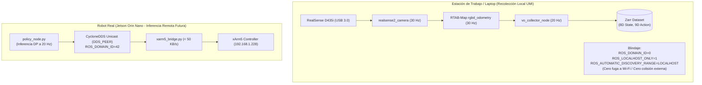

# Skill: RealSense VIO & UMI Handheld Data Collection (v1.3)

Esta habilidad proporciona el procedimiento estandarizado para capturar demostraciones expertas a mano alzada en hardware real mediante Odometría Visual-Inercial (VIO) con cámaras Intel RealSense (D435i / D415) y RTAB-Map sobre ROS 2 Jazzy, bajo el estándar **UMI** (*Universal Manipulation Interface*, Stanford / TRI).

---

## 1. Cuándo Activar esta Habilidad

* Al capturar demostraciones expertas reales para entrenar o evaluar políticas visuomotoras (Diffusion Policy).
* Al calibrar o verificar la precisión métrica del sistema de odometría (cierre de bucle $E_{\text{loop}} \le 3.00\text{ mm}$).
* Al aumentar o continuar grabando episodios sobre un dataset Zarr existente (ej. `demonstrations_real_v5.zarr`).
* Al configurar la topología de red para evitar interferencias con otros equipos ROS 2 o preparar el enlace remoto con la Jetson Orin.

---

## 2. Parámetros de Calidad y Criterios de Aceptación (Grado UMI)

| Métrica | Umbral de Certificación | Valor Certificado (`conf 4`) | Estado |
| :--- | :--- | :--- | :--- |
| **Error de Retorno (Loop Closure)** | $\le 3.00\text{ mm}$ tras $> 50\text{ cm}$ de excursión | **$2.307\text{ mm}$** ($\Delta X=-0.83, \Delta Y=-0.06, \Delta Z=+2.15\text{ mm}$) | **PASA** |
| **Jitter Estático en Reposo ($\sigma$)** | $\le 2.50\text{ mm}$ | **$1.6144\text{ mm}$** (reducción del 89.2% vs. baseline) | **PASA** |
| **Pérdida de Tracking** | $0.0\%$ (cero fotogramas perdidos) | **$0.0\%$** ($258.8$ inliers promedio sostenidos) | **PASA** |
| **Frecuencia de Muestreo** | $20.0\text{ Hz}$ canónicos sincrónicos | $20.0\text{ Hz}$ sincrónicos con timer de ROS 2 | **PASA** |
| **Piso de Auto-Stop** | $\ge 2.0\text{ s}$ con `done=1.0` en destino | Garantizado mediante inyección forzada de 40 frames | **PASA** |
| **Compatibilidad xArm5** (si el dataset se entrenará para el robot real) | 0 episodios marcados en `_conversion_report.json` (o excluidos con `--drop-flagged`) | `tools/xarm5/convert_vio_dataset_to_xarm5.py` | Obligatorio |
| **Auditoría física** (dataset para el xArm5) | Gravedad del VIO vs. HOME3 < 20° en la mayoría de episodios con la extrínseca configurada; 0 saltos de signo del cuaternión; ruido eliminado por el filtro < 10 mm RMS | `tools/xarm5/analyze_vio_dataset_quality.py` (v7: 13.4° mediana, 0 saltos, 8.8 mm) | Obligatorio |
| **Alcance del brazo** (dataset para el xArm5) | 0 frames fuera del alcance del puente (muñeca a ≤ `workspace_max_reach_m` del hombro) y 0 fuera de la caja configurada | `tools/xarm5/analyze_xarm5_workspace.py` (v7: 0.9 % y 1.4 %) | Obligatorio |

> [!WARNING]
> La integridad de tensores y la frecuencia de 20 Hz no certifican la física. `demonstrations_real_v7_xarm5.zarr` pasó
> esa "certificación" con la cámara invertida 180°, 1015 saltos de signo del cuaternión y velocidades infladas 4x por el
> ruido (ver `.agents/knowledge/17_real_vio_dataset_curation_and_relative_actions.md`).

---

## 3. Protocolo Operativo Paso a Paso

### Paso 1: Lanzar el Contenedor y Stream VIO Blindado (Terminal 1)
El lanzador confina el flujo de datos pesados de la cámara ($46\text{ MB/s}$) a la memoria compartida local mediante `ROS_LOCALHOST_ONLY=1` y `ROS_AUTOMATIC_DISCOVERY_RANGE=LOCALHOST` bajo `ROS_DOMAIN_ID=0`, garantizando que ninguna otra máquina con ROS 2 en la red Wi-Fi o LAN pueda colisionar con los tópicos:

```bash
# Lanzar stream VIO en background/foreground (sin GUI para máxima eficiencia):
./tools/hardware/run_vo_container.sh ros2 launch visuomotor_bringup realsense_d435i_vio.launch.py gui:=false

# Opcional (con visor 3D RViz2 para inspección visual):
./tools/hardware/run_vo_container.sh ros2 launch visuomotor_bringup realsense_d435i_vio.launch.py gui:=true
```

### Paso 2: Verificación de Calibración / Benchmark Métrico (Terminal 2)
Si se modificaron parámetros de cámara, iluminación o mesa de trabajo, verificar la precisión métrica antes de recolectar:
```bash
./tools/hardware/run_benchmark.sh "conf 4 (SOTA UMI Final Fusion)"
```
* **Protocolo:**
  1. Apoyar la cámara en la marca física de inicio y pulsar `[ENTER]`.
  2. Desplazar la cámara a mano alzada ($> 30\text{ cm}$) simulando la trayectoria.
  3. Regresar la cámara exactamente a la marca inicial y pulsar `[ENTER]`.
  4. Certificar que el error de retorno sea $\le 3.00\text{ mm}$.

### Paso 3: Recolección Interactiva de Demostraciones (Terminal 2)
El script [`tools/hardware/run_data_collection.sh`](file:///home/hackbrian/Documents/gits/visuomotor_ros2/tools/hardware/run_data_collection.sh) gestiona automáticamente la ruta y la indexación:

#### Modalidad A: Crear automáticamente una nueva versión incremental
```bash
./tools/hardware/run_data_collection.sh
# Crea automáticamente datasets/demonstrations_real_vX.zarr (ej. v6)
```

#### Modalidad B: Continuar aumentando un dataset específico existente
```bash
./tools/hardware/run_data_collection.sh demonstrations_real_v5
# Detecta episodios previos (ej. 8) y anexa consecutivamente desde episode_8
```

---

## 3b. Restricciones para Demostraciones Destinadas al xArm5 (5 GDL)

La política se ejecuta en un UFACTORY xArm5: lo demostrado debe ser ejecutable por él (ver
`.agents/knowledge/16_xarm5_real_hardware_bringup.md`, §5m–5p).

1. **Inicio = HOME3 (pose de trabajo, redefinida el 2026-11-20).** Cada episodio empieza con la cámara en la pose que
   tendría montada en la muñeca del brazo en HOME3, con la misma disposición de la escena.
   - TCP (brida) en `link_base`, según el controlador: (0.150, 0.005, 0.750) m, rpy (3.102, −0.430, −0.011). Es decir,
     muy alto sobre la base (75 cm) y con la garra inclinada ~−24.6° en el plano del brazo (punta hacia fuera).
   - Juntas: [0.05, −41.99, −92.46, 109.92, 1.53]°; menú RViz2 *Go to HOME3*.
   - El primer frame se mapea a `home_x/y/z/roll/pitch/yaw` de `deploy/jetson/config/jetson_policy_params.yaml`. Si se
     redefine HOME3, actualizar allí y reconvertir.
2. **Orientación:** la garra debe estar vertical o inclinada solo en el plano vertical que contiene a la base del brazo
   (hacia la base o alejándose), hasta ±85°. Nunca debe inclinarse lateralmente (roll): el xArm5 no puede ejecutarlo;
   se proyecta y el episodio se marca si la desviación supera `max_orientation_deviation_rad` de
   `xarm5_dataset_alignment.yaml` (0.70 rad desde la Fase 22).
3. **Volumen alcanzable** (distinguir el brazo de la caja de seguridad; `tools/xarm5/analyze_xarm5_workspace.py`):
   - **Brazo** (Hardware Manual v2.7.1, XF1305, en `bio/xarm5_ufactory_XF1305/`): 700 mm de radio alrededor del eje de
     la base, a la altura del hombro (0.267 m). A la altura de aproximación de v7 (brida ~0.28 m, garra vertical) el
     alcance lateral es ±0.47 m a la profundidad de los objetos (aproximadamente √(R² − x²)).
   - **Caja de seguridad del puente** (`xarm5_real_params.yaml`): radio 0.15–0.65 m y |y| ≤ 0.30 m. Es una decisión de la
     celda: respetarla al grabar o ampliarla ANTES, tras medir la celda (con ±0.45 m ningún frame v7 queda fuera).
   - La altura máxima baja con la distancia: 0.75 m cerca de la base, 0.71 m a 0.35 m, 0.61 m a 0.50 m y 0.37 m a 0.65 m.
   - HOME3 ya está en el techo (z = 0.75) y en el radio mínimo (x = 0.15): desde ahí la demostración solo puede bajar o
     alejarse.
4. **Velocidad:** ≤ 5 cm/s y ≤ 0.5 rad/s (límites actuales de `xarm5_bridge`). Si se demuestra más rápido, el robot
   ejecuta más lento que lo aprendido; subir antes los límites del puente y reconvertir.
5. **Montaje:** el mismo soporte de cámara en la mano y en la muñeca del robot (extrínseca cámara→TCP en
   `visuomotor_bringup/config/xarm5/xarm5_dataset_alignment.yaml`, medir y poner `extrinsic_calibrated: true`).
6. **Gripper:** `0.0` si no se registra (`[G]` para alternar).

---

## 3c. Protocolo de Grabación para el xArm5 (lecciones de `demonstrations_real_v7`)

1. **Reiniciar la odometría al inicio de cada episodio** (o registrar la IMU cruda). Hoy `odom` persiste durante toda
   la sesión y su vertical deriva hasta 50-60° (medido con los ArUco de la mesa); solo el movimiento relativo dentro del
   episodio es fiable, y el conversor ya lo usa así.
2. **Sostener la cámara derecha:** arriba de la imagen = lejos de la base, igual que montada en la brida en HOME3
   (`tcp_to_camera_rpy_rad: [pi, -pi/2, 0]`). Empezar con la inclinación de HOME3 (~25° de la vertical); en v7 la media
   medida fue 32° ± 6°.
3. **No girar la muñeca más de ±140°:** el yaw del puente está acotado a ±2.6 rad y los giros de ~180° se convierten en
   saltos; en v7 se descartaron 5 episodios por eso.
4. **Velocidad real:** ~0.05 m/s es compatible con el puente. Los "0.20 m/s" que daba el dataset sin filtrar eran ruido
   del VIO (~8.8 mm RMS), no la velocidad de la mano.
5. **Tracking:** si la vista pierde textura (saltos > 0.15 m entre frames), descartar con `[D]` en vez de guardar.
6. **Desde HOME3, bajar antes de alejarse de la base.** Avanzar en alto saca la muñeca de alcance: 209 frames de
   5 episodios v7, hasta 51 mm. El puente recortaría esos tramos y el robot se separaría de la demostración al arrancar.
7. **Repartir los objetos con una grilla planificada:** a ambos lados de la base y en varias profundidades. En v7 la
   media lateral quedó 10 cm a un lado, y desde el reposo ir siempre hacia la dirección media ya acertaba el 55 % (la
   política, el 64 %): con poca variedad de destinos la política apenas aprende a usar la imagen para elegir hacia dónde ir.

---

## 4. Controles Durante la Recolección Interactiva

* **`[ESPACIO]` (START):** Fija el origen relativo del episodio en $(0.0, 0.0, 0.0)$. Mover la cámara hacia el objeto/destino.
* **`[G]` (GRIPPER TOGGLE):** Alterna el estado de la pinza entre abierta (`0.0`) y cerrada (`-0.005`) para simular agarre manual a mano alzada. Si no se usa pinza física, dejar en `0.0` (por defecto).
* **`[H]` (HOLD TARGET):** Presionar al llegar con éxito al objetivo. Inyecta `done = 1.0` en la 9ª dimensión mientras se sostiene la cámara en reposo durante 2 segundos.
* **`[S]` (SAVE):** Guarda el episodio en el Zarr. El sistema garantiza un piso mínimo de 2.0 segundos de `done = 1.0` y confirma el índice del episodio guardado.
* **`[D]` (DISCARD):** Descarta el episodio en caso de movimiento errático o caída de inliers.
* **`[Q]` (QUIT):** Cierra la sesión de recolección limpiamente.

---

## 5. Auditoría y Visualización Post-Recolección

Una vez finalizada la sesión, verificar la integridad temporal y extraer la telemetría multimedia:

```bash
# 1. Auditoría de frecuencia a 20 Hz (garantía de intervalo dt ~ 0.05s)
docker exec -u 1000 visuomotor_ros2 python3 tools/verify_dataset_frequency.py --dataset datasets/demonstrations_real_v5.zarr

# 2. Extracción de videos MP4, trayectorias PNG y GIFs animados
docker exec -u 1000 visuomotor_ros2 python3 tools/visualize_dataset.py \
    --dataset datasets/demonstrations_real_v5.zarr \
    --out-dir datasets/visualizations_real_v5
```

**Conversión obligatoria antes de entrenar para el xArm5.** `vo_collector` guarda la pose de la cámara en el marco
`odom` de RTAB-Map. En el robot, `policy_node` observa el TCP en `link_base` menos el home (HOME3). La conversión
escribe una copia nueva y nunca modifica el original:
```bash
python3 tools/xarm5/convert_vio_dataset_to_xarm5.py --src datasets/demonstrations_real_v5.zarr --report-only   # auditoría
python3 tools/xarm5/convert_vio_dataset_to_xarm5.py --src datasets/demonstrations_real_v5.zarr --drop-flagged
# -> entrenar con datasets/demonstrations_real_v5_xarm5.zarr; revisar demonstrations_real_v5_xarm5_conversion_report.json
# (si <src>_xarm5.zarr ya existe, pasar --dst con un sufijo nuevo, p. ej. _xarm5_v2.zarr: nunca se sobrescribe)

# Auditoría física obligatoria (gravedad vs. extrínseca, ArUco, PSD/ruido, velocidad real, saltos de signo), con figuras
python3 tools/xarm5/analyze_vio_dataset_quality.py --raw datasets/demonstrations_real_v5.zarr \
    --old <conversión anterior, o la misma si no hay> --new datasets/demonstrations_real_v5_xarm5.zarr --out-dir datasets/evaluations_real_v5_xarm5
```
La herramienta se niega a convertir con `extrinsic_calibrated: false`. Marca los episodios con orientación inalcanzable,
fuera del volumen o del alcance, con saltos de tracking (`max_raw_step_m`) o más rápidos que el puente. Desde el conversor
v2 aplica el filtro de trayectoria (Hampel + Butterworth 1.5 Hz de fase cero) y la convención de cuaternión `home` de
`xarm5_dataset_alignment.yaml`. Nunca relajar esos umbrales para que un dataset "pase".

---

## 6. Topología de Red Dual: Localhost vs. Jetson Orin Nano



---

## 7. Evaluación y Certificación SOTA del Dataset (`tools/evaluate_real_dataset.py`)

Tras la conversión o recolección, evaluar el dataset con la herramienta científica desacoplada:
```bash
docker exec -u 1000 -w /ros visuomotor_ros2 bash -c "\
    python3 tools/evaluate_real_dataset.py \
    --dataset datasets/demonstrations_real_vX_xarm5.zarr \
    --out-dir datasets/evaluations_real_vX_xarm5"
```
* **Métricas evaluadas:**
  - Desplazamiento neto $D$ vs. longitud de camino efectivo suavizado $L_{\text{eff}}$ (índice de tortuosidad $L_{\text{eff}}/D$).
  - Perfil de aproximación en espacio de fases $\mathbf{v}(d_{\text{target}})$ hacia la zona de contacto ($d \le 5\text{ cm}$).
  - Garantía de piso terminal de auto-stop ($\ge 2.0\text{ s}$ con `done=1.0`).
  - Generación de panel SOTA multicanal 2x3 (`.png` 300 DPI y `.pdf`), reporte Markdown y registro automático en SQLite `experiments/experiments.db`.
  - Todo reporte y gráfico generado en inglés formal de publicación científica.
