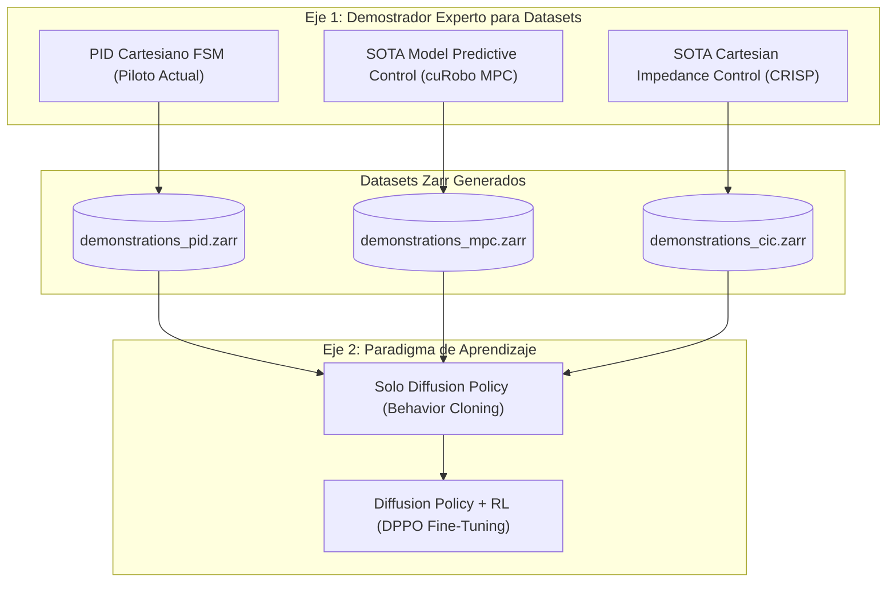

# Skill: Scientific Benchmarking & Robotics Paper Reporting (v1.0)

Esta habilidad proporciona las directrices y estándares metodológicos para planificar, ejecutar y reportar experimentos científicos cuantitativos de nivel publicación (IEEE Transactions on Robotics, ICRA, IROS, Nature Machine Intelligence).

---

## 1. Cuándo Activar esta Habilidad
- Al planificar nuevas campañas de recolección de datasets de demostración.
- Al entrenar y evaluar modelos comparativos (ej. Solo Diffusion Policy vs. Diffusion Policy + RL Fine-Tuning).
- Al comparar la calidad y transferibilidad de datasets generados por distintos controladores demostradores (PID Piloto vs. MPC / cuRobo vs. Impedancia Cartesiana / CRISP).
- Al generar figuras vectoriales (.pdf / .png 300 DPI) y tablas de significancia estadística para artículos de investigación.

---

## 2. Los Dos Ejes Experimentales Obligatorios

Toda campaña de investigación en este repositorio debe categorizarse y documentarse según dos ejes ortogonales:



1. **Eje 1 (Calidad de Demostración):** Determina las propiedades cinemáticas y dinámicas de los datos de entrenamiento (suavidad, optimalidad, acomodación de contacto).
2. **Eje 2 (Efecto del Aprendizaje por Refuerzo):** Determina si el fine-tuning con RL supera a la imitación pura en precisión milimétrica, robustez de agarre y temporización de auto-stop.

---

## 3. Protocolo de Evaluación de Modelos ($N \ge 100$ Episodios)

Para garantizar validez estadística:
1. **Condiciones Iniciales Deterministas:**
   - La distribución espacial del objeto debe seguir una secuencia estandarizada generada por Halton Quasi-Monte Carlo (QMC), almacenada en `eval_seeds.json` o fijando la semilla aleatoria del generador.
   - Tanto el modelo de Solo DP como el modelo DP+RL deben evaluarse exactamente contra las mismas coordenadas iniciales.
2. **Variables de Salida Cuantitativas Obligatorias:**
   - **Task Success Rate (SR %):** Porcentaje de episodios con entrega exitosa en destino y parada neuronal activada.
   - **Cycle Time / Duración Media (s):** Tiempo desde el inicio hasta la parada.
   - **Tracking RMSE ($X, Y, Z, \text{Yaw}$):** Desviación cuadrática media entre comando predicho y pose TCP física.
   - **Terminal Position Error (mm):** Distancia euclidiana final entre el objeto y el setpoint Home.
   - **Grasp Slip Rate (%):** Frecuencia de desprendimiento del cubo durante la fase de transporte.
   - **Auto-Stop F1-Score:** Precisión y exhaustividad de la 9ª dimensión (`done_flag`).

---

## 4. Estándar de Logging Tabular (`metrics.csv`)

Toda ejecución de evaluación debe exportar un archivo CSV con las siguientes columnas mínimas:

```text
timestamp,experiment_id,dataset_demonstrator,learning_paradigm,episode_idx,step_idx,tcp_x,tcp_y,tcp_z,cmd_x,cmd_y,cmd_z,tracking_error_m,obj_x,obj_y,obj_z,is_clamped,done_flag_pred,contact_force_est,reward_instant
```

---

## 5. Estándares para Figuras de Publicación Científica

1. **Operación Headless:** Siempre configurar `matplotlib.use('Agg')` antes de importar `pyplot`.
2. **Formatos:**
   - `.pdf`: Vectorial para incrustar en LaTeX.
   - `.png`: Rasterizado a alta resolución (`dpi=300, bbox_inches='tight'`).
3. **Incertidumbre y Dispersión:**
   - En curvas de aprendizaje y trayectorias, nunca mostrar solo la media. Graficar el intervalo de confianza del 95% ($\bar{x} \pm 1.96 \cdot \text{SE}$) como banda sombreada (`alpha=0.2`).
   - En comparativas de error milimétrico o tiempos de ciclo, preferir **Boxplots** con puntos dispersos (*jittered strip plots*) o **Violin Plots** para mostrar la distribución empírica completa.
