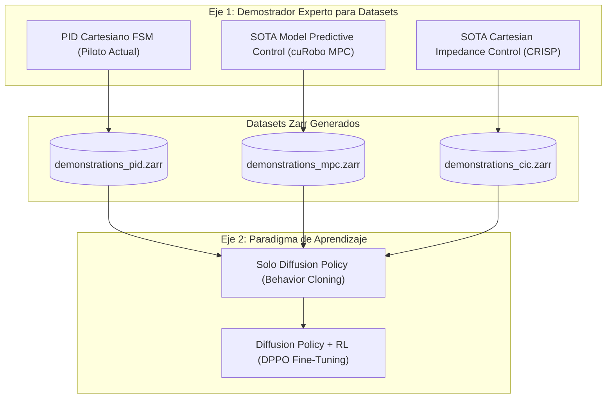

# Skill: Scientific Benchmarking & Robotics Paper Reporting (v2.0)

Esta habilidad proporciona las directrices y estándares metodológicos para planificar, ejecutar y reportar experimentos científicos cuantitativos de nivel publicación (IEEE Transactions on Robotics, ICRA, IROS, Nature Machine Intelligence).

---

## 1. Cuándo Activar esta Habilidad

- Al planificar nuevas campañas de recolección de datasets de demostración.
- Al entrenar y evaluar modelos comparativos (ej. Solo Diffusion Policy vs. Diffusion Policy + RL Fine-Tuning).
- Al comparar la calidad y transferibilidad de datasets generados por distintos controladores demostradores (PID Piloto vs. MPC / cuRobo vs. Impedancia Cartesiana / CRISP).
- Al generar figuras vectoriales (.pdf / .png 300 DPI) y tablas de significancia estadística para artículos de investigación.

---

## 2. Los Dos Ejes Experimentales Obligatorios

Toda campaña de investigación en este repositorio debe categorizarse y documentarse según dos ejes ortogonales:



1. **Eje 1 (Calidad de Demostración):** Determina las propiedades cinemáticas y dinámicas de los datos de entrenamiento (suavidad, optimalidad, acomodación de contacto).
2. **Eje 2 (Efecto del Aprendizaje por Refuerzo):** Determina si el fine-tuning con RL supera a la imitación pura en precisión milimétrica, robustez de agarre y temporización de auto-stop.

---

## 3. Protocolo de Evaluación de Modelos ($N \ge 100$ Episodios)

Para garantizar validez estadística:
1. **Condiciones Iniciales Deterministas:**
   - La distribución espacial del objeto debe seguir una secuencia estandarizada generada por Halton Quasi-Monte Carlo (QMC), almacenada en `eval_seeds.json` o fijando la semilla aleatoria del generador.
   - Tanto el modelo de Solo DP como el modelo DP+RL deben evaluarse exactamente contra las mismas coordenadas iniciales.
2. **Modelo Cinemático del Tool Center Point (TCP Offset 79.0 mm):**
   - La distancia de aproximación y contacto se proyecta analíticamente desde la muñeca usando el cuaternión de orientación $\mathbf{q}$:
     $$\mathbf{v}_z = [2(q_x q_z + q_w q_y), 2(q_y q_z - q_w q_x), 1 - 2(q_x^2 + q_y^2)]$$
     $$\mathbf{p}_{\text{tcp}} = \mathbf{p}_{\text{ee}} + \mathbf{v}_z \cdot 0.079$$
     $$d_{\text{contacto}} = \|\mathbf{p}_{\text{tcp}} - \mathbf{p}_{\text{objeto}}\|$$
   - Evita la distorsión artificial de $\sim 80\text{ mm}$ de la brida y reporta el contacto físico real ($0.88 - 7.14\text{ mm}$ en agarres exitosos).
3. **Variables de Salida Cuantitativas Obligatorias:**
   - **Task Success Rate (SR %):** Porcentaje de episodios con entrega exitosa en destino y parada neuronal activada.
   - **Cycle Time / Duración Media (s):** Tiempo desde el inicio hasta la parada.
   - **Tracking RMSE ($X, Y, Z, \text{Yaw}$):** Desviación cuadrática media entre comando predicho y pose TCP física.
   - **Terminal Position Error (mm):** Distancia euclidiana final entre el objeto y el setpoint Home ajustado por offset ($\mathbf{p}_{\text{target\_obj}} = \mathbf{p}_{\text{home}} - [0, 0, 0.079]$).
   - **Grasp Slip Rate (%):** Frecuencia de desprendimiento del cubo durante la fase de transporte.
   - **Auto-Stop F1-Score:** Precisión y exhaustividad de la 9ª dimensión (`done_flag`).
   - **Test Pareado de Wilcoxon ($p < 0.05$):** Evaluación obligatoria de significancia en diferencias pareadas, inmune a outliers cinemáticos y truncamientos temporales.

---

## 4. Estándar de Logging Tabular

### A. Telemetría por Paso (`metrics.csv` / `benchmark_steps.csv`)
```text
timestamp,experiment_id,dataset_demonstrator,learning_paradigm,episode_idx,step_idx,tcp_x,tcp_y,tcp_z,cmd_x,cmd_y,cmd_z,tracking_error_m,obj_x,obj_y,obj_z,is_clamped,done_flag_pred,contact_force_est,reward_instant
```
*Nota:* `tcp_x, tcp_y, tcp_z` deben registrar la coordenada del TCP proyectado ($\mathbf{p}_{\text{tcp}}$), no la brida cruda.

### B. Agregación Episódica Obligatoria (`benchmark_episodes.csv`)
Base tabular consumida directamente por `replot_benchmark.py` y las pruebas estadísticas:
```text
model,episode,spawn_x,spawn_y,spawn_z,spawn_yaw,task_success,is_clamped,min_dist_tcp_obj_mm,min_dist_ee_obj_mm,delta_z_cm,terminal_error_obj_mm,terminal_error_tcp_mm,tracking_rmse_mm,duration_s,auto_stop_triggered,final_done_flag
```

---

## 5. Estándares para Figuras de Publicación Científica

1. **Operación Headless:** Siempre configurar `matplotlib.use('Agg')` antes de importar `pyplot`.
2. **Formatos:**
   - `.pdf`: Vectorial para incrustar en LaTeX.
   - `.png`: Rasterizado a alta resolución (`dpi=300, bbox_inches='tight'`).
3. **Incertidumbre y Dispersión:**
   - En curvas de aprendizaje y trayectorias, nunca mostrar solo la media. Graficar el intervalo de confianza del 95% ($\bar{x} \pm 1.96 \cdot \text{SE}$) como banda sombreada (`alpha=0.2`).
   - En comparativas de error milimétrico o tiempos de ciclo, preferir **Boxplots** con puntos dispersos (*jittered strip plots*) o **Violin Plots** para mostrar la distribución empírica completa.
4. **Arquitectura Canónica del Panel $2 \times 3$ de Publicación (`replot_benchmark.py`):**
   - **Subplot A (0,0):** Tasa de Éxito Global y Agarre Firme (%) [Barras pareadas con text badges].
   - **Subplot B (0,1):** Mínima Distancia TCP a Cubo (mm) [Boxplot + Jitter en **Escala Logarítmica** 0.4 a 200 mm].
   - **Subplot C (0,2):** Error Terminal de Entrega en Home (mm) [**Smart Zoom** 105–172 mm + Badges explícitos para outliers].
   - **Subplot D (1,0):** Fidelidad Cinemática Cartesiana RMSE (mm) [Boxplot + Jitter].
   - **Subplot E (1,1):** Elevación Vertical del Objeto $\Delta Z$ (cm) [**Smart Zoom** 21–33 cm + Badges explícitos].
   - **Subplot F (1,2):** Duración del Ciclo / Pasos (s) [Boxplot + Jitter].
5. **Tratamiento Riguroso de Outliers:**
   - Escala logarítmica obligatoria en contacto fino para permitir coexistencia de resoluciones submilimétricas con fallos fuera de distribución.
   - Smart zoom en rango nominal para error terminal y duración, señalizando outliers con badges claros (ej. `▲ Outlier Ep 3: 390.7 mm`).
   - Prohibición de líneas de corte arbitrarias que mutilen los boxplots.
6. **Herramientas de Soporte Desacopladas:**
   - Re-ploteo instantáneo (< 2 s) sin simulación: `python3 tools/replot_benchmark.py`.
   - Base relacional SQLite fail-safe: `python3 tools/experiment_tracker.py summary`.
   - Verificación previa de datasets (20 Hz, max_speed $\le 0.20\text{ m/s}$): `python3 tools/verify_dataset_frequency.py`.
   - Orquestador maestro headless: `./tools/sim/run_headless_system.sh benchmark --episodes N --seed S`.

---

## 6. Metodologías SOTA de Evaluación y Calibración (2024–2026)

1. **Predicción Conforme (*Conformal Prediction / PlanCP*):**
   - Evaluar regiones de cobertura $1 - \alpha = 95\%$ sobre la variedad de trayectorias generadas, reportando la cobertura empírica y el volumen medio del tubo de incertidumbre $\hat{q}$.
2. **Cuantificación de Incertidumbre Epistémica (*Diff-DAgger*):**
   - Evitar la varianza cartesiana simple entre trayectorias en tareas con multimodalidad legítima (ej. esquivar por la izquierda o por la derecha). Evaluar la consistencia interna del score de difusión $\epsilon_\theta$ o el desacuerdo en el campo de velocidades (*Velocity-Field Disagreement - VFD*).
3. **Escalado en Tiempo de Inferencia con Verificador (*Test-Time Best-of-N*):**
   - Medir el incremento en la tasa de éxito al generar $B \in \{1, 4, 8\}$ hipótesis candidatas en paralelo en GPU y seleccionar la de mayor valor predicho por el Crítico $V_\phi(s, a)$.
4. **Diagnóstico Interpretable de Fallos mediante AdaBoost con Tocones:**
   - Entrenar tocones de decisión sobre las variables continuas de `metrics.csv` y `benchmark_episodes.csv` ($\delta_{\text{elastic}}$, $\Delta Z$, error terminal) para identificar los umbrales mecánicos exactos que separan el éxito del fallo.

---

## 7. Evaluación y Caracterización Cinemática de Datasets Reales (Panel SOTA 2x3)

Al procesar demostraciones capturadas en hardware real (`tools/evaluate_real_dataset.py`), deben seguirse estos principios metrológicos:
1. **Eficiencia Geométrica (Desplazamiento Neto $D$ vs. Arco Efectivo $L_{\text{eff}}$):**
   - La sumatoria directa de desplazamientos euclidianos paso a paso ($\sum \|\Delta \mathbf{p}_t\|$) sobremuestreados a 20 Hz introduce una acumulación espuria de micro-vibraciones y temblores del sensor (ej. inflando una trayectoria de 60 cm a más de 8 metros).
   - Se debe aplicar un filtro de media móvil temporal (ventana de 5 pasos / 0.25 s) sobre la trayectoria antes de calcular la longitud de arco efectiva:
     $$L_{\text{eff}} = \sum_{t=1}^T \|\mathbf{p}^{\text{suave}}_t - \mathbf{p}^{\text{suave}}_{t-1}\|$$
   - El cociente $L_{\text{eff}} / D$ define el **Índice de Tortuosidad Suave** (esperado $1.8\text{--}2.0$ para aproximaciones de alcance curvilíneo humano natural).
2. **Perfil de Desaceleración en Espacio de Fases $\mathbf{v}(d_{\text{target}})$:**
   - Mapear la velocidad cartesiana respecto a la distancia al objetivo con el eje X invertido (origen del movimiento a la izquierda, contacto a la derecha en $0\text{ m}$).
   - Evidencia la dinámica biológica de desaceleración gradual y control fino al entrar en la zona crítica de contacto ($d \le 5\text{ cm}$).
3. **Estandarización Idiomática:**
   - Todas las figuras, etiquetas de ejes, leyendas, reportes Markdown y tablas estructuradas exportadas deben generarse estrictamente en inglés académico formal.
