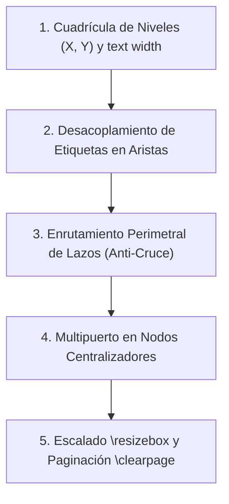

# Skill: Scientific LaTeX Reporting & TikZ Engineering (v1.0)

Esta habilidad establece el estándar editorial, estilístico y técnico para la redacción de informes de avance, artículos de conferencia (ICRA, IROS) y revistas (IEEE T-RO) en LaTeX, con énfasis en robótica manipuladora, control visuomotor y aprendizaje por refuerzo (RL). Proporciona pautas rigurosas para erradicar patrones de texto generados por IA, maquetar diagramas TikZ nativos sin colisiones visuales y aplicar estadística no paramétrica formal.

---

## 1. Cuándo Activar esta Habilidad

- Al redactar o editar documentos académicos en LaTeX (`.tex`) destinados a evaluación técnica, comités o publicaciones científicas.
- Al diseñar o refactorizar diagramas de arquitectura de redes neuronales, pipelines metodológicos o flujos de control en código TikZ nativo.
- Al reconciliar curvas de entrenamiento empíricas (pérdidas, retornos de RL, divergencias KL) con el texto descriptivo del manuscrito.
- Al estructurar pruebas de significancia estadística comparativas (Student pareado vs. Wilcoxon) sobre datos cinemáticos en robótica.
- Al optimizar la maquetación de documentos LaTeX para cumplir con restricciones estrictas de número de páginas y evitar *overfull \hbox*.

---

## 2. Protocolo de Estilo y Redacción Académica Humana (Anti-AI)

Los modelos generativos tienden a introducir muletillas, hipérboles y metalenguaje que degradan la credibilidad científica de un manuscrito. Se deben aplicar estrictamente las siguientes directivas:

### A. Erradicación Total de Metalenguaje de Rúbrica o Curso
- Suprimir cualquier alusión a "la rúbrica", "los requisitos del curso", "la entrega final", "lo que responde la evidencia", "expectativa ingenua" o puntajes explícitos (`[30 PUNTOS]`).
- Presentar los hallazgos como delimitaciones empíricas intrínsecas a la física del problema y a la capacidad del algoritmo, no como respuestas a una tarea escolar.

### B. Sobriedad Léxica y Reemplazo de Hipérboles
Sustituir sistemáticamente términos grandilocuentes por lenguaje técnico medido y exacto:
- *Paradigma de frontera* $\rightarrow$ *Enfoque reciente* o *arquitectura contemporánea*.
- *Erradicar* $\rightarrow$ *Corregir*, *mitigar* o *suprimir*.
- *Integridad matemática* $\rightarrow$ *Consistencia dimensional y temporal*.
- *Fuga causal odométrica* $\rightarrow$ *Sobreajuste causal* o *dependencia circular*.
- *Certificar incondicionalmente* $\rightarrow$ *Verificar empíricamente* o *validar*.
- *Congelando cinemáticamente* $\rightarrow$ *Deteniendo el efector final en la pose objetivo*.
- *Colapso catastrófico* $\rightarrow$ *Inestabilidad en el entrenamiento* o *divergencia numérica*.

### C. Supresión de Conectores Formulaicos
Evitar iniciar párrafos consecutivos con muletillas repetitivas:
- Prohibidos al inicio de párrafo: *"En primer término"*, *"Cabe destacar que"*, *"Como consecuencia directa de"*, *"En concordancia con"*.
- Alternar inicios temáticos directos centrados en el sujeto o fenómeno físico: *"El seguimiento en espacio de tareas exhibe..."*, *"La evaluación comparativa revela..."*, *"Para modelar la interacción de contacto, se implementa..."*.

### D. Control de Anclaje Bilingüe
- Eliminar el vicio de colocar la traducción en inglés entre paréntesis después de cada sustantivo (*"búfer de transiciones (replay buffer)"*, *"recorte de acciones (action chunking)"*).
- Si un término en inglés es el estándar técnico aceptado internacionalmente en la literatura, emplearlo directamente en cursiva técnica:
  - *\textit{dataloader}*, *\textit{action chunking}*, *\textit{rollout buffer}*, *\textit{clipping}*, *\textit{outliers}*, *\textit{flat minima}*, *\textit{jitter}*, *\textit{schedule}*.

### E. Variabilidad Sintáctica (*Burstiness*) y Voz Pasiva Refleja
- Alternar deliberadamente oraciones breves y contundentes (reporte de métricas clave, tasas de éxito) con oraciones compuestas explicativas (justificaciones de dinámicas físicas o transformaciones de tensores).
- Mantener un tono impersonal mediante la tercera persona o pasiva refleja (*"se implementó"*, *"los resultados indican"*, *"se observa"*), erradicando expresiones en primera persona informal (*"hicimos"*, *"nos dimos cuenta"*).

---

## 3. Ingeniería de Diagramas TikZ Nativos de Precisión (Sin Sobrelapamientos ni Defectos)

Los diagramas esquemáticos en código TikZ aportan calidad tipográfica y vectorial inigualable, pero son propensos a colisiones de texto sobre flechas, cruce desordenado de líneas, desalineación de cajas y desbordes de página. A continuación se detallan las técnicas, patrones y sintaxis para garantizar diagramas limpios, armónicos y legibles:



### A. Cuadrícula Geométrica de Niveles y Envoltura de Texto
1. **Cuadrícula Fija de Coordenadas ($X, Y$):**
   - En lugar de anidamientos automáticos impredecibles, distribuir los nodos en una cuadrícula cartesiana con cotas horizontales y verticales fijas.
   - *Ejemplo de pipeline de 3 columnas y 2 filas:*
     - Fila 1 (Nivel Superior): $Y = 3.6$ con $X = 0.0, 6.2, 12.4$.
     - Fila 2 (Nivel Inferior): $Y = 1.0$ con $X = 0.0, 6.2, 12.4$.
   - Esto garantiza que las flechas horizontales sean $100\%$ horizontales y las de transición vertical sean $100\%$ perpendiculares, eliminando trazos diagonales accidentales.
2. **Definición Obligatoria de `text width` y `align=center`:**
   - Si no se define `text width`, un título largo expande la caja horizontalmente hasta colisionar con los nodos vecinos.
   - Fijar siempre un ancho acotado (`text width=3.2cm` a `3.6cm`) y permitir quiebres de línea manuales mediante `\\`:
     ```latex
     \node [block, text width=3.3cm, text centered] (step1) at (0.0, 2.1) {
         \textbf{1. Muestreo Halton}\\
         Pose 3D Determinista\\
         Semilla Fija ($S = 123$)
     };
     ```
3. **Control de Altura Mínima (`minimum height`):**
   - En filas de cajas adyacentes con distinta cantidad de líneas de texto, utilizar `minimum height=2.8em` o `3.2em` para que todas las cajas tengan la misma presencia visual y sus centros geométricos coincidan perfectamente.

### B. Desacoplamiento de Aristas y Prevención de Colisiones de Etiquetas
La causa principal de defectos visuales en TikZ es la colocación de texto sobre la línea de la flecha:
1. **Flechas Horizontales:**
   - Colocar el texto por encima o por debajo del trazo con un desplazamiento mínimo:
     ```latex
     \path [line] (step1) -- node [above=2pt, font=\scriptsize] {Pose 3D Halton} (step2);
     ```
2. **Flechas Verticales (Punto Crítico):**
   - Por defecto, `node {Texto}` centra el texto sobre la flecha, tachándolo.
   - **Solución Obligatoria:** Desplazar lateralmente la etiqueta al menos $4\text{ pt}$ hacia la derecha o izquierda:
     ```latex
     \path [line] (sim) -- node [midway, right=4pt, font=\scriptsize, align=left] {RGB + TF\\Joint States} (sensors);
     ```
3. **Rutas Ortogonales en Ángulo Recto (`|-` o `-|`):**
   - Cuando una línea dobla en 90 grados, nunca colocar el texto en el vértice. Usar `pos=0.35` o `pos=0.65` para ubicarlo en el tramo recto antes o después del giro:
     ```latex
     \path [line] (reward.south) |- node [pos=0.35, right=4pt, font=\scriptsize] {Recompensa $R_t$} (buffer.east);
     ```
4. **Etiquetas con Halo de Fondo (`fill=white` o `fill=color`):**
   - Si el espacio es sumamente ajustado y no se puede evitar que una etiqueta roce una línea, aplicar un halo opaco con margen fino:
     ```latex
     node [midway, fill=white, inner sep=1.5pt, font=\scriptsize] {Texto}
     ```

### C. Enrutamiento Perimetral de Lazos de Retroalimentación (Sin Cruzar Nodos)
En arquitecturas de control en lazo cerrado (ej. PID, RL, simulador físico), la señal de control debe regresar desde los bloques inferiores o finales hacia el nodo inicial superior:
* **Anti-patrón:** Trazar una flecha diagonal directa que atraviesa el centro de otros bloques y texto.
* **Patrón Canónico (Ruta Perimetral Superior Externa):** Salir hacia el exterior lateral, subir con un margen libre sobre el diagrama (`yshift=0.9cm`), cruzar horizontalmente y descender de forma ortogonal sobre el nodo de entrada:
  ```latex
  \path [line] (pid.west) -- ++(-0.8,0) 
        |- ([yshift=0.9cm]halton.north) 
        -- ([yshift=0.9cm]sim.north) 
        node [midway, above=2pt, font=\scriptsize] {Comandos de Velocidad Cartesiana (100 Hz)} 
        -| (sim.north);
  ```

### D. Conexión Multipuerto en Nodos Centralizadores
Cuando un bloque central (ej. un *Rollout Buffer*, un *Dataset Zarr* o un *Optimizador*) recibe o emite múltiples flujos de datos:
* **Anti-patrón:** Conectar todas las flechas al centro `(zarr)` o al mismo borde `(zarr.north)`, generando una acumulación confusa de puntas de flecha superpuestas.
* **Patrón Canónico:** Distribuir los puntos de llegada entre las distintas caras cardinales del nodo:
  ```latex
  % Entrada 1 por el lateral izquierdo:
  \path [line] (pid.south) |- node [pos=0.35, left=4pt, font=\scriptsize] {Acciones 9D} (zarr.west);
  % Entrada 2 por la cara superior:
  \path [line] (fsm.south) -- node [midway, right=4pt, font=\scriptsize] {Done Flag} (zarr.north);
  % Entrada 3 por el lateral derecho:
  \path [line] (sensors.south) |- node [pos=0.35, right=4pt, font=\scriptsize] {Frames RGB} (zarr.east);
  ```

### E. Consistencia Aritmética y Dimensional en Tensores
Todo nodo que describa la concatenación de tensores debe reflejar la multiplicación temporal real:
* $\text{Correcto: } 2 \times 64\text{D} + 16\text{D} = 144\text{D} \quad (\text{para } T_{\text{obs}} = 2)$
* $\text{Incorrecto: } 64\text{D} + 16\text{D} = 144\text{D}$

### F. Paleta Cromática Semántica y Estilos Reutilizables
Definir estilos globales coherentes al inicio del entorno `tikzpicture` o en el preámbulo para evitar discrepancias visuales:
```latex
\tikzset{
    block/.style   ={draw=blue!80!black, fill=blue!6, rounded corners=4pt, line width=0.8pt, text centered},
    process/.style ={draw=orange!80!black, fill=orange!6, rounded corners=4pt, line width=0.8pt, text centered},
    sensor/.style  ={draw=green!60!black, fill=green!6, rounded corners=4pt, line width=0.8pt, text centered},
    storage/.style ={draw=red!75!black, fill=red!6, rounded corners=5pt, line width=1.0pt, text centered},
    action/.style  ={draw=purple!80!black, fill=purple!8, rounded corners=4pt, line width=0.8pt, text centered},
    line/.style    ={draw=black!75, -{Stealth[length=2.5mm, width=1.5mm]}, line width=0.8pt}
}
```

### G. Escalado Responsivo (`\resizebox`) y Control de Paginación
1. **Encapsulamiento Responsivo:**
   - Envolver siempre el entorno `tikzpicture` en `\resizebox{0.96\linewidth}{!}{...}`. Esto garantiza que el diagrama utilice todo el ancho disponible del cuerpo del texto sin desbordar el margen derecho (prevención de *overfull \hbox*).
2. **Espaciado Vertical Fino:**
   - Interpolar `\vspace{-0.25cm}` antes y después del diagrama para compensar el espacio en blanco de las cajas flotantes sin deformar la tipografía.
3. **Control de Flotantes con `\clearpage`:**
   - Si un diagrama esquemático de medio folio precede a una subsección con enumeraciones densas y provoca que los ítems se corten torpemente entre páginas, anteponer un `\clearpage` antes de `\begin{figure}[htbp]`. Esto asegura que el diagrama y la subsección completa queden empaquetados armoniosamente en la misma plana.
4. **Nomenclatura Editorial:**
   - En el texto y en el epígrafe (`\caption`), denominar a la ilustración como *"diagrama"*, *"esquema"* o *"figura"*, sin aludir a la herramienta (*nunca escribir "diagrama programado íntegramente en código TikZ nativo"*).

---

## 4. Rigor Cuantitativo y Formulación Estadística en Robótica

### A. Justificación del Test de Wilcoxon para Datos Pareados
En robótica manipuladora con políticas generativas, las métricas de desempeño (distancia mínima de contacto, error terminal, tiempo de ciclo) no satisfacen el supuesto de normalidad gaussiana debido a:
1. **Asimetría intrínseca:** La mayoría de los ensayos exitosos se concentran en errores milimétricos ($0{,}8$ a $7{,}0\text{ mm}$), mientras que los fallos o *timeouts* generan valores atípicos extremos (*outliers* $> 100\text{ mm}$).
2. **Truncamiento por límite temporal:** Los episodios que alcanzan `max_steps` inducen una cota artificial superior.

*Directiva:* Aplicar la prueba de rangos con signo de Wilcoxon (*Wilcoxon signed-rank test*) como prueba primaria no paramétrica pareada, complementada opcionalmente con la prueba $t$ de Student pareada. Justificar en el texto que Wilcoxon evalúa si la **mediana de las diferencias pareadas** entre Solo DP y DP + RL difiere significativamente de cero ($p < 0{,}05$), siendo inmune al sesgo por *outliers*.

### B. Reconciliación Fiel de Curvas Empíricas de RL
- **Divergencia KL en Difusión:** Durante el fine-tuning con DPPO, la actualización estocástica a través de los pasos de difusión induce excursiones de KL ($0{,}1$ a $2{,}4$). Explicar que estas variaciones no implican desestabilización, ya que son acotadas por el recorte (*clipping*) de la razón de verosimilitud de PPO ($\epsilon = 0{,}2$) y el término de regularización de imitación ($\lambda_{\text{BC}}$). Nunca maquillar los datos afirmando que $\text{KL} \le 0{,}05$ constante si la gráfica muestra lo contrario.
- **Retorno Medio vs. Retorno Máximo:** Distinguir claramente el retorno medio por lote (que promedia episodios fallidos y exitosos, ej. $\approx 350-500$) de los retornos pico alcanzados en episodios singulares perfectos ($> 1600$).
- **Pérdida del Crítico:** Detallar su evolución real: inicialización moderada, pico transitorio al activarse el gradiente del actor (desacoplamiento dinámico), y convergencia asintótica hacia un régimen bajo ($20$ a $40$).

### C. Notación Sobria en Magnitudes Físicas
- Evitar ceros flotantes redundantes procedentes de salidas crudas de consola:
  - Inapropiado: $p_{\text{medida}} = -0{,}010000\text{ m} \Longrightarrow \delta = 0{,}000000\text{ m}$.
  - Apropiado: $p_{\text{medida}} = -0{,}010\text{ m} \Longrightarrow \delta = 0{,}0\text{ mm}$ o $\delta < 1 \times 10^{-4}\text{ m}$.
- Para micro-deformaciones elásticas del gripper, emplear milímetros o notación científica: $\delta \ge 0{,}7\text{ mm}$ o $7 \times 10^{-4}\text{ m}$.

---

## 5. Control Editorial de Paginación y Acabado Final en LaTeX

1. **Prevención de Overfull `\hbox`:**
   - En nombres largos de archivos o variables de telemetría (ej. `benchmark_comparison_results.csv`), intercalar comandos de ruptura opcional:
     ```latex
     \texttt{benchmark\_}\allowbreak\texttt{comparison\_results.csv}
     ```
2. **Página de Bibliografía Limpia:**
   - Forzar que la sección de referencias (`\printbibliography`) comience en una página nueva e independiente al final del manuscrito, garantizando que el título quede en la línea 1 y sin desbordes huérfanos.
3. **Auditoría de Compilación:**
   - Verificar siempre: `0 errors, 0 warnings de overfull hbox` mediante `pdflatex` y `biber`.
