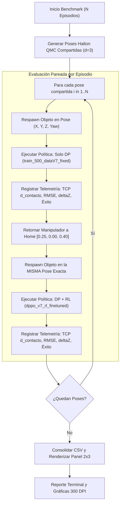

# Skill: Visuomotor Benchmark Evaluator (v1.0)

Esta habilidad proporciona el procedimiento estandarizado y reproducible para ejecutar campañas de evaluación experimental comparativa en robótica visuomotora, contrastando modelos de **Behavior Cloning (Solo Diffusion Policy)** frente a modelos optimizados por **Reinforcement Learning (Diffusion Policy + DPPO RL)** sobre el manipulador xArm Lite6 en NVIDIA Isaac Sim 4.2 y ROS 2 Jazzy.

---

## 1. Cuándo Activar esta Habilidad
- Al finalizar el entrenamiento de un nuevo modelo de Diffusion Policy (ej. tras generar un nuevo dataset Zarr).
- Al completar iteraciones de fine-tuning por refuerzo con DPPO (`dppo_vX_rl_finetuned`).
- Al comparar puntos de control intermedios (checkpoints `iter_10` ... `iter_100`) para certificar la evolución de la política.
- Cuando se requiera generar tablas cuantitativas (CSV) y paneles gráficos $2 \times 3$ listos para informes de avance o papers científicos.

---

## 2. Requisitos Previos del Entorno

Para que la evaluación opere síncronamente sin bloqueos de red DDS ni desincronización de TF:

1. **Simulador y Control Cartesiano Activos (Host o Terminal 1):**
   ```bash
   ros2 launch visuomotor_bringup lite6_cartesian.launch.py rviz:=false sim:=true
   ```
2. **Variables de Entorno DDS Obligatorias (Dentro del Contenedor Docker):**
   ```bash
   export RMW_IMPLEMENTATION=rmw_cyclonedds_cpp
   export ROS_LOCALHOST_ONLY=1
   export ROS_DOMAIN_ID=42
   source /opt/ros/jazzy/setup.bash
   source /ros/install/setup.bash
   ```

---

## 3. Arquitectura del Evaluador (`tools/compare_models.py`)

El comparador ejecuta un protocolo de **episodios pareados**:
* Para cada episodio $i \in [1, N]$, se genera una pose espacial $(X, Y, Z, \text{Yaw})$ mediante muestreo cuasi-aleatorio Halton QMC dentro de la mesa de trabajo calibrada.
* Se evalúa primero **Solo DP** en dicha pose exacta.
* Se reasienta el objeto en la misma pose y se evalúa **DP + RL** bajo idénticas condiciones iniciales.



---

## 4. Métricas Científicas Registradas

El evaluador extrae en cada paso síncrono a 20 Hz las siguientes variables cinemáticas y físicas:

1. **Distancia de Contacto TCP ($d_{\text{contacto}}$ en mm):**
   Proyección cinemática desde la brida (`gripper_base_link`) hasta el centro de contacto entre las almohadillas de los dedos:
   $$\mathbf{p}_{\text{tcp}} = \mathbf{p}_{\text{ee}} + \mathbf{v}_z(\mathbf{q}) \cdot \mathbf{tcp\_offset\_z} \quad (\mathbf{79.0\text{ mm}})$$
   $$d_{\text{contacto}} = \|\mathbf{p}_{\text{tcp}} - \mathbf{p}_{\text{objeto}}\|$$
   * En agarre exitoso: $d_{\text{contacto}} \in [0.0, 5.0]\text{ mm}$.
   * En fase de aproximación: $d_{\text{contacto}} \approx 150\text{ mm}$.
2. **Distancia de Brida Mecánica ($d_{\text{ee}}$ en mm):** Distancia euclidiana directa de `gripper_base_link` al objeto.
3. **Tasa de Agarre Firme (`is_clamped`):** Validación propioceptiva de retención mecánica ($\ge 0.7\text{ mm}$ de compresión de dedos y velocidad $< 0.0015\text{ m/s}$).
4. **Elevación Vertical $\Delta Z$ (cm):** Confirmación de despegue y vuelo contra la gravedad ($\Delta Z \ge 8\text{ cm}$).
5. **Error Terminal en Destino (mm):** Distancia euclidiana entre la posición final del cubo y el objetivo en Home $[0.25, 0.00, 0.40]$.
6. **Fidelidad Cinemática Cartesiana / RMSE (mm):** Error cuadrático medio de seguimiento entre la trayectoria predicha por la política y el movimiento real del TCP.
7. **Duración de Ciclo y Auto-Stop (s):** Tiempo hasta la activación del Auto-Stop neuronal o conclusión por éxito en destino.

---

## 5. Comando de Ejecución Estándar

Ejecutar siempre dentro del contenedor bajo el usuario `hackbrian` (UID 1000):

```bash
docker exec -it -u 1000 -w /ros visuomotor_ros2 bash -c "source /opt/ros/jazzy/setup.bash && source /ros/install/setup.bash && export RMW_IMPLEMENTATION=rmw_cyclonedds_cpp && export ROS_LOCALHOST_ONLY=1 && export ROS_DOMAIN_ID=42 && python3 tools/compare_models.py --episodes 10 --max_steps 1500 --seed 123"
```

### Parámetros Configurables:
* `--episodes N`: Cantidad de episodios compartidos por modelo (default: `10`, total $2N$ ejecuciones).
* `--max_steps S`: Límite máximo de pasos por episodio (default: `1500`, $\approx 75\text{ s}$ simulación, evitando cortes prematuros).
* `--seed K`: Semilla para el generador cuasi-aleatorio Halton QMC (default: `123`).
* `--out_dir DIR`: Directorio de exportación de métricas y gráficos (default: `/ros/visuomotor_core/outputs/benchmark_comparison`).

### Re-Generación Rápida de Gráficos (Sin Simulación):
Si se desea modificar el diseño estético de los subplots a partir de un CSV ya generado, se ejecuta directamente:
```bash
docker exec -u 1000 -w /ros visuomotor_ros2 python3 tools/replot_benchmark.py
```

---

## 6. Salidas y Artefactos Producidos

El proceso genera automáticamente los siguientes artefactos en `visuomotor_core/outputs/benchmark_comparison/`:

1. **`benchmark_episodes.csv`:** Registro tabular detallado fila por fila con las 17 columnas de telemetría por episodio.
2. **`benchmark_comparison_plot.png` (300 DPI):** Panel de 6 figuras $2 \times 3$ para inclusión en informes y presentaciones:
   - **A)** Tasa de Éxito Global y Agarre Firme (`is_clamped`) (%)
   - **B)** Mínima Distancia de Contacto TCP-Objeto (mm)
   - **C)** Error Terminal de Entrega en Home (mm)
   - **D)** Fidelidad Cinemática / Tracking RMSE (mm)
   - **E)** Elevación Vertical Máxima $\Delta Z$ (cm)
   - **F)** Duración de Ciclo por Episodio (s)
3. **`benchmark_comparison_plot.pdf`:** Versión vectorial de alta fidelidad para compilación en documentos LaTeX.

---

## 7. Protocolo de Diagnóstico y Resolución de Problemas

| Síntoma | Causa Raíz | Solución |
| :--- | :--- | :--- |
| **Corte prematuro de trayectoria (< 30s)** | `max_steps` demasiado bajo o flag `done` activado en falso. | Mantener `--max_steps 1500` y verificar que el auto-stop solo active con $d_{\text{home}} < 0.10\text{ m}$. |
| **Error `ExternalShutdownException` / SIGSEGV 139 al salir** | Concurrencia de hilos al cerrar el executor de ROS 2. | Asegurar `executor.shutdown()` antes de `runner.destroy_node()` y `rclpy.shutdown()`. |
| **Distancia mínima reportada $\approx 80\text{ mm}$ en agarre** | Se midió desde la brida y no desde el TCP. | Verificar que `GymROS2Env` proyecte el vector director con $\mathbf{tcp\_offset\_z} = 0.079\text{ m}$. |
| **Procesos duplicados compitiendo por `/target_frame_raw`** | Sesiones anteriores en segundo plano no terminadas. | Ejecutar `ps aux \| grep compare_models` y matar procesos con `kill -9 <PID>`. |
