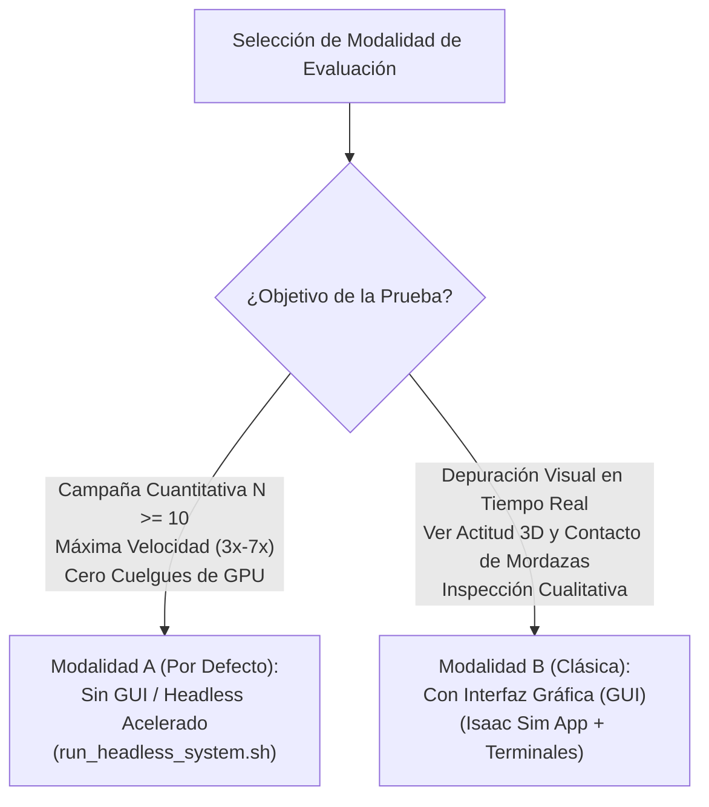
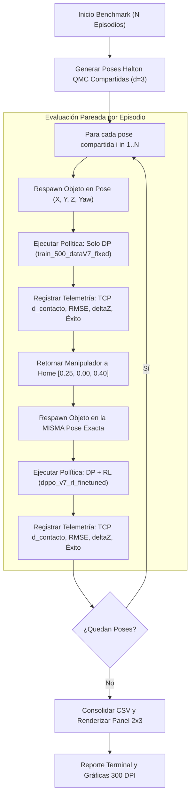

# Skill: Visuomotor Benchmark Evaluator (v2.1 — Headless & GUI)

Esta habilidad proporciona el procedimiento estandarizado y formal para ejecutar campañas de evaluación experimental comparativa en robótica visuomotora, contrastando modelos de **Behavior Cloning (Solo Diffusion Policy)** frente a modelos optimizados por **Reinforcement Learning (Diffusion Policy + DPPO RL)** sobre el manipulador xArm Lite6 en NVIDIA Isaac Sim y ROS 2 Jazzy.

Soporta dos modalidades operativas: **Modo Headless Acelerado (por defecto y recomendado)** y **Modo Clásico con Interfaz Gráfica (GUI)** para inspección visual directa.

---

## 1. Cuándo Activar esta Habilidad

- Al finalizar el entrenamiento de un nuevo modelo de Diffusion Policy (ej. tras generar un nuevo dataset Zarr).
- Al completar iteraciones de fine-tuning por refuerzo con DPPO (`dppo_vX_rl_finetuned`).
- Al comparar puntos de control intermedios (checkpoints `iter_10` ... `iter_100`) para certificar cuantitativamente la evolución de la política.
- Cuando se requiera generar tablas cuantitativas (CSV), test no paramétricos de Wilcoxon y paneles gráficos $2 \times 3$ listos para informes de avance o papers científicos.

---

## 2. Modalidades de Ejecución: Sin GUI (Headless) vs. Con GUI (Clásica)



| Criterio | Modalidad A: Sin GUI (Headless) *(Por Defecto)* | Modalidad B: Con GUI (Clásica) *(Alternativa)* |
| :--- | :--- | :--- |
| **Cuándo usarla** | **Campañas científicas formales ($N \ge 10$).** Máximo rendimiento computacional y repetibilidad. | **Depuración interactiva ($N \le 3$).** Inspeccionar visualmente la garra, el contacto del cubo y colisiones. |
| **Consumo de VRAM** | Bajo y acotado (~3.5 GB). Liberación automática a **56 MiB**. | Elevado (~6 a 7 GB) debido al framebuffer X11/Wayland a 1280x720. |
| **Factor de Tiempo Real** | Acelerado **$0.33\times$ a $0.50\times$** (sin límite de FPS ni vsync). | Lento **$0.15\times$** (restringido por tasa de refresco del compositor). |
| **Orquestación** | **Comando único automatizado** con sondeo DDS y parada limpia. | **3 terminales manuales** coordinadas manualmente por el usuario. |

---

## 3. Modalidad A (Por Defecto): Modo Sin GUI / Headless Acelerado

Esta es la modalidad estándar del laboratorio. Utiliza el orquestador maestro [`tools/sim/run_headless_system.sh`](file:///home/hackbrian/Documents/gits/visuomotor_ros2/tools/sim/run_headless_system.sh) para gestionar todo el ciclo de vida de forma autónoma.

### Comando Estándar (Ejecutado desde el Host):
```bash
./tools/sim/run_headless_system.sh benchmark --episodes 10 --seed 123
```

### Ejecución con Checkpoints Específicos:
```bash
./tools/sim/run_headless_system.sh benchmark --episodes 10 --seed 123 \
    --dp_ckpt /ros/visuomotor_core/outputs/train_500_dataV7_fixed/ \
    --rl_ckpt /ros/visuomotor_core/outputs/dppo_v7_rl_finetuned/checkpoints/iter_100/
```

### Qué realiza automáticamente el orquestador:
1. Verifica los contenedores `isaac-sim-6.0-wayland` y `visuomotor_ros2`.
2. Lanza Isaac Sim Headless en segundo plano con Real-Time 2.0 (RTPT), DLSS Performance, Eco Mode y reajuste en RAM a 256x256.
3. Sondea el bus CycloneDDS hasta certificar `/rgb`, `/isaac/joint_states` y `/clock`.
4. Inicializa la pila de control cinemático `lite6_cartesian` en modo headless (`rviz:=false`).
5. Ejecuta `tools/compare_models.py` bajo el usuario `hackbrian` (UID 1000).
6. Al finalizar la cuota de episodios, activa el trap de limpieza, detiene los nodos y restaura la GPU a **56 MiB**.

---

## 4. Modalidad B (Alternativa): Modo Clásico con Interfaz Gráfica (GUI)

Utiliza este método clásico cuando necesites ver la ventana de simulación en vivo sobre tu escritorio para analizar cualitativamente la aproximación o el agarre.

### Procedimiento en 3 Terminales:

#### Terminal 1: Lanzar Isaac Sim en Modo GUI (Host)
Abrir Isaac Sim con ventana gráfica y cargar el escenario `new_world_3.usda`:
```bash
# Lanzar Isaac Sim GUI (ejemplo streaming o kit nativo)
/isaac-sim/isaac-sim.sh /workspace/robo_imitate/xarm_bringup/isaac/new_world_3.usda
```
*Asegurar que la simulación quede en modo Play (reproducción activa) y publicando tópicos ROS 2 en Domain 42.*

#### Terminal 2: Lanzar Control Cartesiano (Host o Contenedor)
```bash
docker exec -it -u 1000 -w /ros visuomotor_ros2 bash -c "
    source /opt/ros/jazzy/setup.bash
    source /ros/install/setup.bash
    export RMW_IMPLEMENTATION=rmw_cyclonedds_cpp
    export ROS_LOCALHOST_ONLY=1
    export ROS_DOMAIN_ID=42
    ros2 launch visuomotor_bringup lite6_cartesian.launch.py rviz:=false sim:=true
"
```

#### Terminal 3: Lanzar el Evaluador Comparativo (Host hacia Contenedor)
```bash
docker exec -it -u 1000 -w /ros visuomotor_ros2 bash -c "
    source /opt/ros/jazzy/setup.bash
    source /ros/install/setup.bash
    export RMW_IMPLEMENTATION=rmw_cyclonedds_cpp
    export ROS_LOCALHOST_ONLY=1
    export ROS_DOMAIN_ID=42
    python3 tools/compare_models.py --episodes 10 --max_steps 1500 --seed 123
"
```

---

## 5. Arquitectura del Evaluador Pareado (`tools/compare_models.py`)

El comparador ejecuta un riguroso protocolo de **episodios pareados bajo semillas compartidas**:
* Para cada episodio $i \in [1, N]$, se calcula una pose espacial $(X, Y, Z, \text{Yaw})$ mediante muestreo cuasi-aleatorio Halton Quasi-Monte Carlo (QMC).
* Se evalúa primero **Solo DP** en dicha pose exacta.
* Se reasienta el objeto en la misma pose y se evalúa **DP + RL** bajo idénticas condiciones iniciales.



---

## 6. Métricas Científicas Registradas

El evaluador extrae en cada paso síncrono a 20 Hz las siguientes variables cinemáticas y físicas:

1. **Distancia de Contacto TCP ($d_{\text{contacto}}$ en mm):**
   Proyección cinemática desde la brida (`gripper_base_link`) hasta el centro de contacto entre las almohadillas de los dedos:
   $$\mathbf{p}_{\text{tcp}} = \mathbf{p}_{\text{ee}} + \mathbf{v}_z(\mathbf{q}) \cdot \mathbf{tcp\_offset\_z} \quad (\mathbf{79.0\text{ mm}})$$
   $$d_{\text{contacto}} = \|\mathbf{p}_{\text{tcp}} - \mathbf{p}_{\text{objeto}}\|$$
   * En agarre exitoso: $d_{\text{contacto}} \in [0.0, 5.0]\text{ mm}$.
   * En fase de aproximación: $d_{\text{contacto}} \approx 150\text{ mm}$.
2. **Distancia de Brida Mecánica ($d_{\text{ee}}$ en mm):** Distancia euclidiana directa de `gripper_base_link` al objeto.
3. **Tasa de Agarre Firme (`is_clamped`):** Validación propioceptiva de retención mecánica ($\ge 0.7\text{ mm}$ de compresión de dedos y velocidad $< 0.0015\text{ m/s}$).
4. **Elevación Vertical $\Delta Z$ (cm):** Confirmación de despegue y vuelo contra la gravedad ($\Delta Z \ge 8\text{ cm}$).
5. **Error Terminal en Destino (mm):** Distancia euclidiana entre la posición final del cubo y el objetivo esperado de Home descontando el offset vertical de pinza:
   $$\mathbf{p}_{\text{obj\_target}} = \mathbf{p}_{\text{home}} - [0, 0, 0.079]$$
6. **Fidelidad Cinemática Cartesiana / RMSE (mm):** Error cuadrático medio de seguimiento entre la trayectoria predicha por la política y el movimiento real del TCP.
7. **Duración de Ciclo y Auto-Stop (s):** Tiempo hasta la activación del Auto-Stop neuronal o conclusión por éxito en destino.

### Calibración Geométrica del Auto-Stop Neuronal (Evitación de Falsos Negativos)
1. **Umbral de Proximidad Dinámico (`arrival_thresh`):**
   - Cuando el objeto está sujeto (`is_clamped = True`), el auto-stop solo se autoriza a distancias $\le 5\text{ cm}$ de Home (`dist_home < 0.05 m`). Si no está sujeto, se mantiene en $8\text{ cm}$. Esto evita cortes prematuros a $9\text{--}10\text{ cm}$ antes de entrar al radio formal de éxito.
2. **Criterio de Éxito Calibrado:**
   - Un episodio se acredita como exitoso si:
     `task_success = bool(final_info.get("task_success", False)) or (is_clamped and (terminal_error_obj_mm <= 100.0 or terminal_error_tcp_mm <= 60.0))`

---

## 7. Salidas y Artefactos Producidos

El proceso genera automáticamente los siguientes artefactos en `visuomotor_core/outputs/benchmark_comparison/`:

1. **`benchmark_episodes.csv`:** Registro tabular detallado fila por fila con las 17 columnas de telemetría por episodio.
2. **`benchmark_comparison_plot.png` (300 DPI):** Panel de 6 figuras $2 \times 3$ para inclusión en informes y presentaciones:
   - **A)** Tasa de Éxito Global y Agarre Firme (`is_clamped`) (%)
   - **B)** Mínima Distancia de Contacto TCP-Objeto (mm)
   - **C)** Error Terminal de Entrega en Home (mm)
   - **D)** Fidelidad Cinemática / Tracking RMSE (mm)
   - **E)** Elevación Vertical Máxima $\Delta Z$ (cm)
   - **F)** Duración de Ciclo por Episodio (s)
3. **`benchmark_comparison_plot.pdf`:** Versión vectorial de alta fidelidad para compilación en documentos LaTeX.

### Re-Generación Rápida de Gráficos (Sin Simulación):
Para modificar el diseño estético de los subplots a partir de un CSV ya generado sin necesidad de volver a correr la simulación:
```bash
docker exec -u 1000 -w /ros visuomotor_ros2 python3 tools/replot_benchmark.py
```

---

## 8. Protocolo de Diagnóstico y Resolución de Problemas

| Síntoma | Causa Raíz | Solución |
| :--- | :--- | :--- |
| **Corte prematuro de trayectoria (< 30s)** | `max_steps` demasiado bajo o flag `done` activado en falso. | Mantener `--max_steps 1500` y verificar que el auto-stop solo active con $d_{\text{home}} < 0.10\text{ m}$. |
| **Error `ExternalShutdownException` / SIGSEGV 139 al salir** | Concurrencia de hilos al cerrar el executor de ROS 2. | Asegurar `executor.shutdown()` antes de `runner.destroy_node()` y `rclpy.shutdown()`. |
| **Distancia mínima reportada $\approx 80\text{ mm}$ en agarre** | Se midió desde la brida y no desde el TCP. | Verificar que `GymROS2Env` proyecte el vector director con $\mathbf{tcp\_offset\_z} = 0.079\text{ m}$. |
| **Procesos duplicados compitiendo por `/target_frame_raw`** | Sesiones anteriores en segundo plano no terminadas. | Ejecutar `./tools/sim/run_headless_system.sh stop` o `kill -9 <PID>`. |
| **VRAM saturada tras cancelar benchmark con Ctrl+C** | El proceso de Isaac Sim no capturó SIGINT en modo GUI. | Ejecutar inmediatamente `./tools/sim/run_headless_system.sh stop` para limpiar la GPU. |
