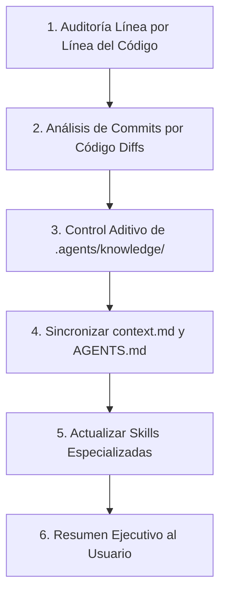

# UPDATE_KNOWLEDGE.md — Protocolo Universal de Sincronización y Memoria Infinita

Este archivo define la rutina exhaustiva que cualquier agente de Inteligencia Artificial debe ejecutar cuando el usuario solicite:
- *"actualiza la base de conocimientos"*
- *"actualiza context y agents"*
- *"guarda los aprendizajes de esta sesión"*
- O cuando el usuario invoque directamente este archivo (`@UPDATE_KNOWLEDGE.md` o `/update-knowledge`).

---

## 1. Misión del Agente (System Prompt de Ejecución)

Al recibir este archivo como referencia, el agente asume el rol de **Knowledge Engineer & System Architect** y debe seguir rigurosamente el siguiente flujo:



---

## 2. Pasos de Ejecución Obligatorios

### Paso 1: Auditoría Previa Línea por Línea del Código
> [!IMPORTANT]
> **Antes de escribir o actualizar cualquier archivo de conocimiento**, el agente DEBE leer y auditar los programas fuente línea por línea para constatar la realidad fáctica del software y verificar que tal como está el código funciona y es correcto.

Archivos obligatorios a inspeccionar línea a línea según el tema trabajado:
1. `visuomotor_ros2/visuomotor_ros2/policy_node.py` (Inferencia, Auto-Stop, logs, tensores de entrada/salida).
2. `visuomotor_data_collection/visuomotor_data_collection/pickup_approximate.py` (FSM, PID cartesiano, inyección de `done_flag`, duración de `HOLD_TARGET`, `max_speed_m_s = 0.20`).
3. `visuomotor_core/visuomotor_core/dataset/zarr_dataset.py` (Slicing de ventanas, Copy-Padding, dropout propioceptivo).
4. `visuomotor_core/train.py` (Detección dinámica de dimensiones, loss, scheduler, device).
5. Archivos de parámetros: `visuomotor_ros2/config/policy_params.yaml` y `visuomotor_data_collection/config/data_collection_params.yaml`.
6. Herramientas del sistema y orquestación: `tools/sim/run_headless_system.sh`, `tools/verify_dataset_frequency.py`, `tools/visualize_dataset.py`, `tools/compare_models.py`, `tools/replot_benchmark.py` y `tools/experiment_tracker.py`.

### Paso 2: Análisis de Commits Recientes por Código (Diffs Reales)
* El agente debe revisar las modificaciones de los commits recientes.
* **Directriz estricta:** No guiarse únicamente por el mensaje descriptivo del commit. El agente debe examinar el **código real modificado (diffs)** para entender exactamente qué cambios se introdujeron, qué bugs se corrigieron y qué impacto tienen en la arquitectura.
* *Nota de Entorno:* La gestión de Git se realiza en el Host local del usuario; el agente nunca debe ejecutar comandos de alteración de Git dentro de Docker.

### Paso 3: Control Aditivo de la Carpeta `.agents/knowledge/`
La carpeta `.agents/knowledge/` es la **memoria a largo plazo persistente**. El agente debe gestionarla bajo un enfoque **estrictamente aditivo y acumulativo**:
* **Nunca sobrescribir ni borrar información histórica válida:** El conocimiento nuevo debe sumarse a los módulos existentes o inaugurar un nuevo módulo temático (`06_...md`).
* **Catálogo de módulos temáticos a nutrir:**
  * `01_diffusion_policy_architecture.md`: Parámetros de red, DDIM, loss, FiLM.
  * `02_tensors_and_autostop.md`: Formato 8D estado vs 9D acción, prevención de fuga causal, auto-stop desacoplado.
  * `03_data_collection_and_fsm.md`: Secuencias FSM, freno Z dinámico, Halton QMC respawn, tiempos de hold y calibración Pareto 0.20 m/s.
  * `04_dataloaders_and_datasets.md`: Copy-padding terminal, protección contra truncamiento del horizonte, copias seguras de datasets.
  * `05_troubleshooting_and_environment.md`: Contrato Docker (`-u hackbrian`), reglas de consentimiento, CycloneDDS, dependencias.
  * `06_reinforcement_learning_dppo.md`: DPPO actor-crítico, recorte PPO $\epsilon=0.2$, pérdida de imitación $\lambda_{\text{BC}}$.
  * `06_scientific_latex_reporting_and_tikz.md`: Estándar anti-AI, ingeniería TikZ nativa con aristas `[midway, right=4pt]`, tensores 144D.
  * `06_telemetry_metrics_and_rl_evaluation.md`: Telemetría en tiempo real (`/policy/metrics/`, `/rl/metrics/`).
  * `07_scientific_benchmarking_and_metrics.md`: Diseño factorial $(D_{\text{experto}}) \times (\text{Algoritmo})$, semillas compartidas Halton.
  * `07_sota_visuomotor_evaluation_and_uncertainty.md`: Predicción conforme (PlanCP), Diff-DAgger VFD, Best-of-N y AdaBoost con tocones.
  * `08_3d_diffusion_policy_and_ml_rigor.md`: Transición a DP3 nubes de puntos, LayerNorm encoder, splits estrictos por episodio.
  * `08_off_ros_logging_and_benchmarking.md`: Coloredlogs, benchmarking de nanosegundo, monitoreo de VRAM pico en GPU.
  * `09_comparative_benchmarking_and_precision_metrics.md`: Modelo cinemático TCP (79 mm), panel 2x3 con escala logarítmica y smart zoom.
  * `10_sim_to_real_finetuning_and_residual_policies.md`: Co-Fine-Tuning 20/80, LoRA visual, residuales ResiP/TRANSIC.
  * `11_isaac_sim_headless_acceleration.md`: Real-Time 2.0 (RTPT), DLSS Performance, Eco Mode, deprecación de frameSkipCount.

### Paso 4: Sincronización de `context.md` y `AGENTS.md`
* **`context.md`:** Actualizar la sección de **Lecciones Aprendidas y Troubleshooting** con los nuevos casos resueltos, y actualizar el **Roadmap y Estado Actual**.
* **`AGENTS.md`:** Garantizar que el contrato maestro refleje las reglas operativas vigentes (ejecución Docker bajo `-u hackbrian`, Git en host local, dimensiones de tensores, directivas headless y comandos de referencia rápida).

### Paso 5: Actualización de Skills de IA (`.agents/skills/`)
Actualizar las habilidades permanentes en `.agents/skills/`:
* `scientific-benchmarking/SKILL.md` (v2.0)
* `visuomotor-benchmark-evaluator/SKILL.md` (v2.0)
* `headless-experimentation-workflow/SKILL.md` (v1.0)
* `diffusion-policy-expert/SKILL.md` (v1.1)
* `scientific-latex-reporting/SKILL.md` (v1.0)
* `update-knowledge/SKILL.md` (v2.1)

### Paso 6: Protocolo Interactivo de Aprendizaje (`/learn`)
* Toda modificación de habilidades o reglas operativas debe plasmarse primero en un artefacto interactivo `learning_proposal.md` con metadatos `RequestFeedback: true`.
* Clasificar rigurosamente: Reglas (`AGENTS.md`) vs Habilidades (`.agents/skills/`) vs Conocimiento (`.agents/knowledge/`).
* Aplicar los cambios únicamente tras la aprobación explícita del usuario (Proceed).

### Paso 7: Resumen Ejecutivo al Usuario
Presentar un reporte conciso en español indicando:
1. Códigos auditados y estado verificado.
2. Archivos de `.agents/knowledge/` nutridos.
3. Actualizaciones en `context.md` y `AGENTS.md`.
4. Habilidades sincronizadas y próximos pasos técnicos recomendados.

---

## 3. Cómo Invocar este Protocolo

### En Google Antigravity:
1. **Mención directa de archivo (Recomendado):**
   ```text
   @[UPDATE_KNOWLEDGE.md] actualiza la base de conocimientos con lo trabajado hoy
   ```
2. **Vía Skill de proyecto:**
   ```text
   /update-knowledge
   ```
3. **Con el comando de aprendizaje integrado:**
   ```text
   /learn actualiza la base de conocimientos siguiendo UPDATE_KNOWLEDGE.md
   ```

### En Cursor o Windsurf:
```text
@UPDATE_KNOWLEDGE.md audita el código línea por línea y nutre la carpeta .agents/knowledge/ y la documentación.
```

### En Anthropic Claude Code:
```text
Sigue UPDATE_KNOWLEDGE.md para auditar el código y actualizar context.md, AGENTS.md y .agents/knowledge/.
```
