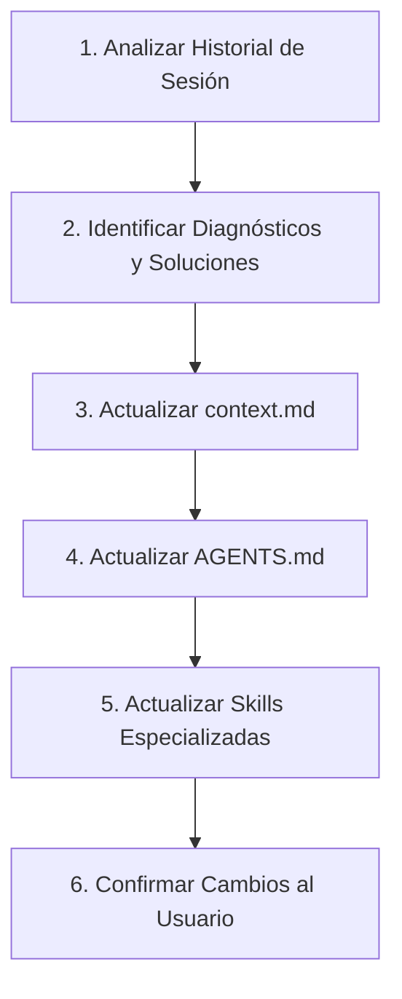

# UPDATE_KNOWLEDGE.md — Protocolo Universal de Sincronización de Conocimiento

Este archivo define la rutina automatizada que cualquier agente de Inteligencia Artificial debe ejecutar cuando el usuario solicite:
- *"actualiza la base de conocimientos"*
- *"actualiza context y agents"*
- *"guarda los aprendizajes de esta sesión"*
- O cuando el usuario invoque directamente este archivo (`@UPDATE_KNOWLEDGE.md` o `/update-knowledge`).

---

## 1. Instrucción para el Agente (System Prompt de Ejecución)

Al recibir este archivo como referencia, el agente debe asumir el rol de **Knowledge Engineer & System Architect** y ejecutar estrictamente los siguientes 5 pasos:



---

## 2. Pasos de Ejecución Obligatorios

### Paso 1: Extracción de Aprendizajes de la Sesión
Revisa todo el historial del chat actual e identifica:
1. **Bugs resueltos:** Qué falló, cuál fue la causa raíz demostrada y qué cambio de código lo solucionó.
2. **Decisiones arquitectónicas:** Modificaciones en espacios de observación vs acción, tensores, horizontes, normalización o protocolos de parada.
3. **Parámetros y YAMLs:** Nuevos parámetros agregados, hardcoding eliminado y valores óptimos descubiertos.
4. **Datasets y Modelos:** Nuevas versiones de datasets creadas (`demonstrations_vX.zarr`) o modelos entrenados.

### Paso 2: Actualización de `context.md`
Abre `context.md` y:
- Incorpora las nuevas soluciones en la sección de **Lecciones Aprendidas y Troubleshooting**.
- Actualiza la sección de **Hitos Logrados** y el **Roadmap**.
- Asegura que ninguna directriz técnica contradiga los descubrimientos más recientes.

### Paso 3: Actualización de `AGENTS.md`
Abre `AGENTS.md` y:
- Verifica que las reglas de tensores (observación vs acción), entorno Docker (Python/ROS) y gestión de Git exclusiva en el host local reflejen el estado exacto actual del proyecto.
- Si se añadieron nuevas variables de configuración en YAMLs, anótalas en la especificación.

### Paso 4: Actualización de Skills de Antigravity
Actualiza los archivos de habilidades permanentes en `~/.gemini/skills/` o `.agents/skills/`:
- `diffusion-policy-expert`: Si hubo mejoras en la red, loss, dataloaders o inferencia.
- `pytorch-dl-expert`: Si hubo optimizaciones de entrenamiento o tensores.

### Paso 5: Resumen al Usuario
Presenta un informe conciso en español indicando:
- Archivos modificados y secciones añadidas.
- Próximos pasos recomendados para la siguiente sesión.

---

## 3. Guía para el Usuario: Cómo Invocar este Archivo

### En Google Antigravity:
Puedes invocarlo de cualquiera de las siguientes formas:
1. **Mención directa de archivo (Recomendado):**
   ```text
   @[UPDATE_KNOWLEDGE.md] actualiza todo con lo trabajado hoy
   ```
2. **Vía Skill nativa:**
   Antigravity descubrirá la skill en `.agents/skills/update-knowledge/SKILL.md`:
   ```text
   /update-knowledge
   ```
3. **Comando de aprendizaje integrado:**
   ```text
   /learn actualiza la base de conocimientos siguiendo UPDATE_KNOWLEDGE.md
   ```

### En Cursor o Windsurf:
Escribe en el chat:
```text
@UPDATE_KNOWLEDGE.md ejecuta este protocolo y actualiza la documentación del proyecto.
```

### En Anthropic Claude Code o Terminal CLI:
```text
Sigue las instrucciones de UPDATE_KNOWLEDGE.md y sincroniza context.md y AGENTS.md con los cambios recientes.
```
